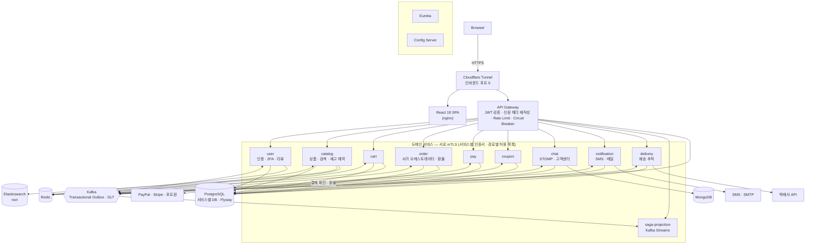
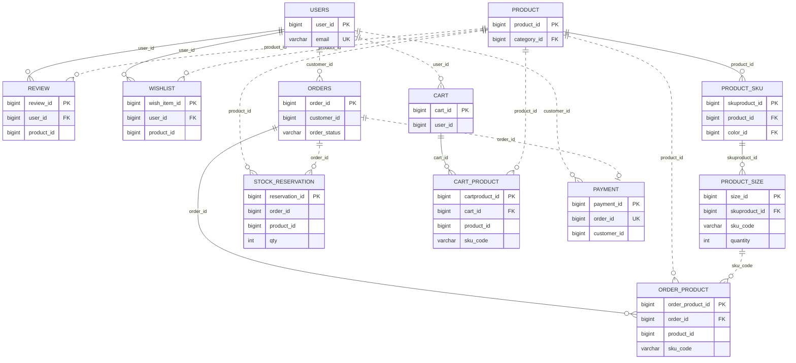

# ecommerce-msa

[日本語](README.md) | **한국어**

Spring Cloud 기반 마이크로서비스 이커머스입니다. **실제로 운영 중인** 사이트이고, 기능을 만든 기록보다
**깨진 것을 어떻게 찾았고, 왜 그렇게 고쳤고, 어떻게 다시 깨지지 않게 했는지**를 남기는 데 무게를 뒀습니다.

🌐 **운영 사이트** — https://www.ysyproject.com (OCI Ampere arm64 · k3s · Cloudflare Tunnel)

---

## 한눈에 보기

| | |
|---|---|
| 구성 | Spring Boot 애플리케이션 **13개**(도메인 10 + 게이트웨이·Eureka·Config) + React 18 SPA |
| 운영 | OCI Ampere(arm64) 단일 노드 k3s · **인바운드 포트 0개**(Cloudflare Tunnel) · 서비스 간 **mTLS**(서비스별 인증서, cert-manager 자동 갱신) |
| 테스트 | 백엔드 **1,931개** · 프론트엔드 **1,028개** · 설정 가드레일 **B-1 ~ B-73 · B-75 · B-76 · B-78**(되돌려서 실패하는지 확인한 회귀 가드) |
| 배포 | GitHub Actions — 커밋 SHA 태그 이미지를 **한 번만** 빌드(amd64·arm64) → 통합·인수 테스트 → **승인** → 운영 노드 러너가 배포, 스모크 실패 시 **자동 롤백** |
| 결제 | PayPal · Stripe · 포트원 V1/V2 · 무통장입금 · 가상계좌, 부분 환불 |
| 다국어 | 한국어 · 일본어(화면 문구 1,091곳, 서버 응답 문구 약 290개) |
| 문서 | 설계·장애 분석 **62편**([docs/](docs/README.ko.md)) · 운영 스크립트 **39개**([ops/](ops/README.ko.md)) |

---

## 아키텍처



- **동기 조회는 OpenFeign, 상태 변경은 Kafka.** 여러 서비스에 걸친 결제는 order 가 사가로 조율하고,
  이벤트는 Transactional Outbox(`FOR UPDATE SKIP LOCKED` + 커밋 직후 릴레이)로 "DB 에는 썼는데 이벤트는 없다"를 막습니다.
- **신원은 게이트웨이가 검증한 토큰에서만.** 클라이언트가 보낸 `User-Id` 같은 헤더는 지우고 다시 씁니다.
  요청 본문의 id·email 은 신원으로 쓰지 않습니다.
- **관측** — OpenTelemetry(OTLP → OTel Collector → Jaeger · span_metrics) · Prometheus · Grafana · Alertmanager · Loki. OpenTelemetry 데모와 같은 구성으로, 로그의 traceId · 지연 그래프의 점(exemplar)에서 추적으로, 추적에서 로그 · RED 지표로 왕복합니다. 추적에 실리는 자격 증명(URL 쿼리 · JWT · 이메일)은 저장 전에 Collector 가 지웁니다([docs/63](docs/63-opentelemetry.ko.md)).

---

## 핵심 사례 — 문제 → 원인 → 해결 → 검증

### 1. 💳 로그인만 하면 결제 없이 주문이 완료됐다

- **원인:** 서버가 브라우저의 "결제했다"를 그대로 믿었습니다.
- **해결:** 결제사 API 를 서버에서 다시 조회하고, **DB 에 저장된 금액**과 통화를 대조합니다. 결제 id 는 유니크 제약으로 재사용을 막았습니다. 설정이 비면 결제를 거부합니다(fail closed).
- **확장:** 결제수단을 포트 하나로 뽑아 PayPal · Stripe · 포트원 V1/V2 · 무통장 · 가상계좌를 붙였습니다. 부분 환불은 결제사의 잔액 대조(`checksum` / `currentCancellableAmount`)로 **같은 환불이 두 번 나가지 않게** 했습니다.
- **검증:** Stripe 는 운영에서 결제와 환불까지 확인했습니다.
- → [docs/35](docs/35-payment-verification.ko.md) · [docs/49](docs/49-payment-providers.ko.md)

### 2. 📦 마지막 1개를 두 사람이 결제했다

- **원인:** 결제에서 차감까지 사이에 재고를 붙드는 것이 없었습니다.
- **예방:** 주문을 만들 때 30분간 재고를 예약합니다.
  - 전부 잡거나 하나도 잡지 않습니다. SKU 를 정렬해서 잠가 교착을 피합니다.
  - 결제 차감과 **같은 트랜잭션에서** 확정합니다.
  - 무통장입금은 입금 기한까지 예약을 연장합니다.
- **보상:** 그래도 모자라면 부족분만큼 자동으로 부분 환불하고 경보를 보냅니다. 무통장입금은 수동 환불로 넘깁니다.
- → [docs/59](docs/59-stock-reservation.ko.md) · [docs/53](docs/53-restock-and-sold-out.ko.md)

### 3. 🔁 레플리카를 2개로 늘리자 이벤트가 100% 중복 발행됐다

- **원인:** 아웃박스 폴러가 레플리카마다 같은 행을 읽었습니다. 동시 트랜잭션 테스트로 재현했습니다.
- **해결:** `FOR UPDATE SKIP LOCKED` 로 행을 선점하게 했습니다.
- **이어서 발견한 것:** 결제 뒤 `PAID` 가 되기까지 약 12초가 걸렸습니다. 사가가 느린 게 아니라 **10초짜리 폴러를 두 번** 건너고 있었습니다.
  - 폴링 간격을 줄이는 대신 커밋 직후 릴레이를 한 번 돌리고, 폴러는 안전망으로 남겼습니다.
- → [docs/21](docs/21-horizontal-scaling.ko.md) · [docs/56](docs/56-saga-latency.ko.md)

### 4. 🧯 새로 클론하면 서비스가 하나도 뜨지 않았다(0 / 8)

- **원인:** 컴파일도 리뷰도 통과하는데 실행하면 죽는 결함이 29건 있었습니다.
  - MySQL Dialect 로 PostgreSQL DDL 을 만들고 있었습니다.
  - 원저자 PC 경로(`file:E:/…`)가 하드코딩돼 있었습니다.
  - 파티션 키 시간대가 `Asia/Seoul` 로 고정돼 있었습니다.
- **해결:** 전부 고치고 **설정 가드레일 테스트**를 만들었습니다. 지금 B-69 까지 있고, 모두 되돌려서 실패하는지 확인했습니다.
- **가장 흔한 결함은 "설정된 것처럼 보이는 미설정"이었습니다.**
  - Feign 타임아웃이 Spring Cloud 4 에서 바뀐 접두사 때문에 **적용되지 않아** 기본값(연결 10초 · 읽기 60초)으로 돌고 있었습니다.
  - 경보 수신자가 플레이스홀더라 경보가 어디로도 가지 않았습니다.
- → [docs/14](docs/14-boot-test-findings.ko.md) · [docs/37](docs/37-transaction-boundary-audit.ko.md) · [docs/22](docs/22-alerting-and-backup-automation.ko.md)

### 5. 🔒 4개 서비스의 IDOR, 헤더 위조, git 이력에 남은 자격증명

- **원인:** 클라이언트가 고를 수 있는 값을 신원·금액·레이트리밋 키로 쓰고 있었습니다. IDOR, 무료 주문, 제한 우회가 모두 이 한 뿌리였습니다.
- **해결:**
  - 판정을 한 곳에 모으고, "남의 것을 요청하면 거절"을 테스트로 고정했습니다.
  - git 이력에 남은 자격증명은 이력을 지우는 것으로 끝나지 않습니다. **폐기한 뒤 실제로 로그인해서 통하지 않는지** 확인했습니다.
  - 서비스 간 호출은 **서비스별 인증서(CN = 서비스 이름)** 로 판정합니다. 관찰 모드로 먼저 돌린 뒤 강제 모드로 바꿨습니다. "어느 서비스가 어느 내부 경로를 부를 수 있는가" 를 정한 경로별 허용 목록은 지금 관찰 모드로 위반을 기록하고 있습니다.
  - NetworkPolicy 는 기본 거부입니다.
- → [docs/27](docs/27-security-review.ko.md) · [docs/30](docs/30-git-history-secret-exposure.ko.md) · [docs/54](docs/54-improvements-vs-practice.ko.md)

### 6. 🚚 테스트한 바이너리와 배포한 바이너리가 달랐다

- **원인:** 테스트용과 배포용으로 이미지를 따로 빌드하고 있었습니다.
- **해결:** 커밋 스테이지에서 **한 번만** 빌드하고, 그 이미지로 통합·인수 테스트까지 돌립니다.
  - 태그는 커밋 SHA 입니다.
  - 배포는 스크립트 하나(`ops/28-deploy.sh`)이고 환경은 인자로 받습니다. 사람이 배포하든 CI 가 배포하든 같은 경로입니다.
  - 되돌릴 수 없는 마이그레이션이 끼어 있으면 롤백을 거부합니다.
  - 스키마 변경은 expand-contract 로 여러 릴리스에 나눠 무중단으로 넣습니다.
- → [docs/36](docs/36-deployment-pipeline.ko.md) · [docs/55](docs/55-zero-downtime-migrations.ko.md)

### 7. 🧪 목(mock) 테스트는 통과했는데 운영에서 깨졌다

- **증상:**
  - 장바구니에 담아도 저장되지 않았습니다. `merge` 에는 PERSIST cascade 가 적용되지 않습니다.
  - 리뷰는 저장되는데 읽을 수 없었습니다. 엔티티에 기본 생성자가 없었습니다.
  - 좋아요가 1 에서 0 으로 돌아갔습니다. JS 가 19자리 TSID 의 끝자리를 반올림해 없는 id 로 요청하고 있었습니다.
- **해결:** 요청마다 트랜잭션을 따로 여는 **실제 JPA 테스트**를 추가하고, 기본 생성자는 가드(B-69)로, 브라우저로 나가는 id 는 문자열 직렬화로 고정했습니다.
- → [docs/61](docs/61-adding-a-service.ko.md) §1

---

## 서비스 구성

| 서비스 | 역할 | 저장소 |
|---|---|---|
| gateway-server | JWT 검증, 신원 헤더 재작성, 레이트리밋, 서킷 브레이커, 내부 엔드포인트(actuator·API 명세) 차단 | Redis |
| user-service | 가입(메일 인증), 로그인(계정 잠금 · 2FA · 리프레시 토큰 회전 · 다중 로그인 감지), 리뷰 | PostgreSQL · Redis |
| catalog-service | 상품, 검색(nori 형태소 분석), 재고 예약, 재입고 알림 | PostgreSQL · Elasticsearch · Redis |
| cart-service | 서버 기준 장바구니(기기 간 동기화) | PostgreSQL · Redis |
| order-service | 주문, **사가 오케스트레이터**, 결제 확인, 환불·반품, 구매 확정 | PostgreSQL |
| pay-service | 결제 기록, 아웃박스 | PostgreSQL |
| coupon-service | 쿠폰 발급, 견적, 사용 | PostgreSQL |
| chat-service | 친구 채팅, 고객센터 상담(STOMP) | PostgreSQL · MongoDB |
| notification-service | SMS(한국·일본 번호), 트랜잭션 메일, 알림 | PostgreSQL |
| delivery-service | 분할 배송, 국제 배송(통관), 택배사 어댑터, 상태별 폴링 | PostgreSQL |
| saga-projection | 사가 이벤트를 Kafka Streams 로 모아 주문 진행 상황 조회 | Kafka Streams 상태 저장소 |
| eureka-server · config-server | 서비스 디스커버리 · 설정 | — |

---

## 기술 스택

- **Back End** — Java 17 · Spring Boot 3.5 · Spring Cloud 2025.0(Gateway · OpenFeign · Eureka · Config) ·
  Spring Security · Spring Batch · Kafka · Kafka Streams · PostgreSQL · Flyway · Elasticsearch(nori) ·
  MongoDB · Redis(Redisson) · Testcontainers
- **Front End** — React 18 · React Query v5 · Redux Toolkit · Tailwind CSS · Material UI · Webpack 5 ·
  Jest + Testing Library
- **Infra** — k3s · kustomize · cert-manager · Cloudflare Tunnel · GitHub Actions · GHCR(amd64 · arm64) ·
  OpenTelemetry(Collector · Jaeger) · Prometheus · Grafana · Alertmanager · Loki

---

## 테스트와 품질 장치

- **백엔드 1,931개** — 단위 테스트와 실제 JPA 테스트(H2)입니다. CI 통합 단계에서는 Testcontainers(PostgreSQL · Kafka · Redis 등)와 사가 E2E 가 더 돕니다.
- **프론트엔드 1,022개** — 화면 동작 테스트 외에 코드 구조를 검사하는 가드가 있습니다.
  - 화면에 박힌 문구가 없는지(구문 트리로 찾습니다)
  - import 경로가 webpack 과 jest 에서 같게 풀리는지
- **설정 가드레일(B-1 ~ B-73 · B-75 · B-76 · B-78)** — 설정 파일과 코드를 읽어 "실행해야 드러나는 결함"을 빌드에서 잡습니다. 예:
  - 되돌릴 수 없는 마이그레이션인데 `ROLLBACK-UNSAFE` 선언이 없는 것
  - Feign 이 부르는 내부 경로가 mTLS 허용 규칙에 없는 것
  - 인증서 갱신 뒤 서비스를 재시작하게 하는 주석이 빠진 것
- **CI 비밀 스캔** — 넣었다가 지운 비밀까지 커밋 범위 단위로 찾습니다.

---

## 정직하게 — 아직 부족한 것

- **단일 노드입니다.** 노드 하나가 곧 전체 장애입니다. 비용 때문에 내린 결정입니다([docs/23](docs/23-infrastructure-decision.ko.md)).
- **백업이 클러스터 안에 있습니다.** PITR 복원은 `DROP TABLE` 을 실제로 되돌려 검증했습니다. 하지만 클러스터 밖(오브젝트 스토리지) 보관과 백업 CronJob 상시 가동은 아직입니다([docs/15](docs/15-backup-and-dr.ko.md)).
- **PayPal · 포트원은 실제 API 로 검증하지 못했습니다.** 응답 필드 매핑은 문서 기준입니다. fail closed 라서 매핑이 틀려도 돈이 새지는 않습니다.
- **관측 스택에 남은 것:** 관측 경로의 TLS 신뢰 설정과 추적 샘플링(지금 1.0) 조정입니다.
- **config-server 에는 설정 저장소를 연결하지 않았습니다.** 연결하려면 인증을 먼저 붙여야 합니다. 관리 엔드포인트는 외부 경로에서 제외했습니다.

전체 목록과 닫힌 항목의 근거는 [docs/54 §10](docs/54-improvements-vs-practice.ko.md)에 있습니다.

---

## 문서 읽는 순서

1. [**docs/62 — 기술 사례집**](docs/62-engineering-casebook.ko.md): 중요한 사례 17개를 문제 · 처리 · 한계 · 개선할 점과 참고한 오라일리 책으로 정리했습니다.
2. [**docs/00 — 전/후 종합 색인**](docs/00-before-after.ko.md): 발견한 문제와 해결을 한 표로 봅니다.
3. [**docs/54 — 개선 사항과 실무 기준**](docs/54-improvements-vs-practice.ko.md): 영역별로 무엇이 부족했고 지금은 어떤지, 그리고 교훈 10가지.
4. 관심 있는 주제 — 결제 [35](docs/35-payment-verification.ko.md)·[49](docs/49-payment-providers.ko.md) ·
   재고 [59](docs/59-stock-reservation.ko.md) · 배포 [36](docs/36-deployment-pipeline.ko.md)·[55](docs/55-zero-downtime-migrations.ko.md) ·
   보안 [27](docs/27-security-review.ko.md)·[30](docs/30-git-history-secret-exposure.ko.md) ·
   관측 [11](docs/11-observability-and-kafka-reliability.ko.md)·[51](docs/51-logging.ko.md)·[63](docs/63-opentelemetry.ko.md)
5. 전체 목록 — [docs/README.ko.md](docs/README.ko.md)
6. **코드를 읽는다면** — 코드 주석은 한국어로 썼고, 핵심 클래스 38개에는 주석마다 바로 아래에 `[JA]` 로 시작하는
   일본어 번역을 붙였습니다. 입구로는 아웃박스와 Kafka 를 건너는 추적(`common/.../outbox/OutboxTraceContext.java`),
   서비스 간 mTLS 판정(`common/.../security/InternalCallerFilter.java`), 결제 사가(`order-service/.../saga/OrderSaga.java`),
   웹훅 서명 검증(`.../payment/stripe/StripeWebhookVerifier.java`), 재고 예약(`catalog-service/.../service/StockReservationService.java`),
   추적 Collector 설정(`observability/otel-collector.yml`)을 권합니다.

---

## 실행

```bash
# 0. 인증서 — 모든 서비스가 HTTPS 로 기동하므로 먼저 필요합니다(로컬 CA, 오프라인)
./ops/07-issue-certificates.sh
set -a; source ./certs/certs.env; set +a

# 1. 백엔드 (Java 17)
./gradlew test                    # 단위 테스트
./gradlew test -PwithContainers   # Testcontainers 통합 테스트 포함 (Docker 필요)

# 2. 프론트엔드
cd frontend && npm ci && npm test && npm start
```

- **운영 배포(k3s)는 [docs/33 배포 런북](docs/33-deploy-runbook.ko.md)을 따릅니다.** 배포는 `./ops/28-deploy.sh <환경> <버전>` 하나로 합니다(이미지 확인 → 마이그레이션 검사 → 스모크 → 실패 시 롤백).
- **비밀은 저장소에 없습니다.** `k8s/20-secret.example.yaml` 을 복사해 값을 넣습니다(`20-secret.yaml` 은 gitignore).
- **새 서비스를 추가할 때는** [docs/61 체크리스트](docs/61-adding-a-service.ko.md)를 따릅니다.

---

## 개발 이력

| 기간 | 내용 |
|---|---|
| 2024.07 ~ 2024.09 | 초기 개발, 기본 기능. 프론트엔드는 [full-amazon-clone](https://github.com/no2ehi/full-amazon-clone) 을 fork 해 Next.js → React 로 옮김 |
| 2025.01 ~ 2025.03 | 마이크로서비스로 전환 |
| 2025.08 ~ 2025.10 | Elasticsearch 도입, mTLS, 멀티 스테이지 빌드 |
| 2025.10 ~ 2026.09 | **신뢰성 · 보안 · 운영 · 품질** — 위의 핵심 사례들. 배송 · 알림 · 고객센터 · 재고 예약 · 다국어 · 결제수단 확장, OCI 운영 배포와 CI/CD |

## ERD

핵심 커머스 도메인의 서비스 사이 참조입니다. 실선은 같은 DB 안의 FK, 점선은 서비스 사이의 논리 참조(DB 가 달라 FK 가 없습니다)입니다.



> 서비스별 전체 표 · 컬럼은 [docs/69 ERD](docs/69-erd.ko.md) 에 있습니다. Flyway 마이그레이션을 실제로 적용한 DB 에서
> `ops/tools/gen-erd.py` 로 생성하므로 스키마와 어긋나지 않습니다.

## 관련 프로젝트

[**distributed-email-service**](https://github.com/ruke79/distributed-email-service) —
『System Design Interview』 Vol.2 23장을 구현한 별도 저장소입니다(Cassandra · Elasticsearch · MinIO · k6).
이 저장소에는 그중 **발신 파이프라인 패턴만** 옮겼고, 새 인프라는 늘리지 않았습니다([docs/29](docs/29-transactional-email.ko.md)).
