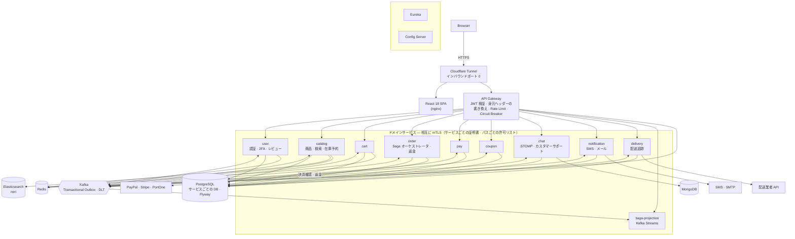
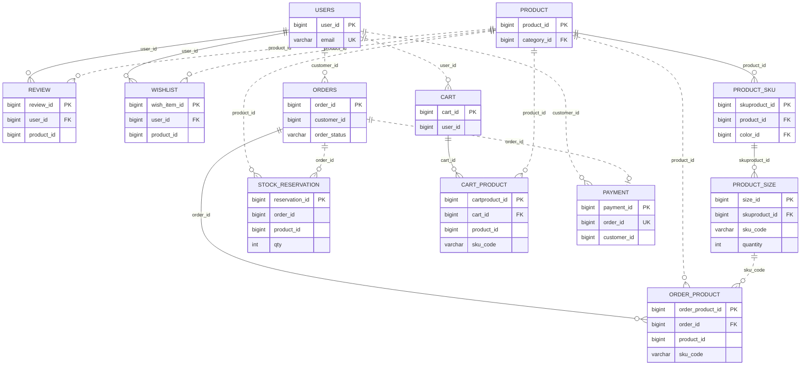

# ecommerce-msa

**日本語** | [한국어](README.ko.md)

Spring Cloud ベースのマイクロサービス EC サイトです。**実際に本番運用しています。**
機能を作った記録よりも、**壊れていたものをどう見つけ、なぜそう直し、どう再発を防いだか**を残すことを重視しました。

🌐 **本番サイト** — https://www.ysyproject.com （OCI Ampere arm64 · k3s · Cloudflare Tunnel）

---

## ひと目でわかる

| | |
|---|---|
| 構成 | Spring Boot アプリ **13 個**（ドメイン 10 + ゲートウェイ・Eureka・Config）+ React 18 SPA |
| 運用 | OCI Ampere（arm64）単一ノード k3s · **インバウンドポート 0**（Cloudflare Tunnel）· サービス間 **mTLS**（サービスごとの証明書、cert-manager で自動更新） |
| テスト | バックエンド **2,449 件** · フロントエンド **1,035 件** · 設定ガードレール **B-1 〜 B-73 · B-75 · B-76 · B-78 · B-80 〜 B-96**（元に戻して失敗することを確認した回帰ガード） |
| デプロイ | GitHub Actions — コミット SHA タグのイメージを**一度だけ**ビルド（amd64・arm64）→ 統合・受け入れテスト → **承認** → 本番ノードのランナーがデプロイ。スモーク失敗時は**自動ロールバック** |
| 決済 | PayPal · Stripe · PortOne V1/V2 · 銀行振込 · バーチャル口座、部分返金 |
| 多言語 | 韓国語 · 日本語（画面の文言 1,091 箇所、サーバー応答の文言 約 290 件） |
| ドキュメント | 設計・障害分析 **62 本**（[docs/](docs/README.md)）· 運用スクリプト **39 本**（[ops/](ops/README.md)） |

---

## アーキテクチャ



- **同期の照会は OpenFeign、状態の変更は Kafka。** 複数サービスにまたがる決済は order が Saga で調整し、
  イベントは Transactional Outbox（`FOR UPDATE SKIP LOCKED` + コミット直後のリレー）で
  「DB には書けたのにイベントが出ていない」を防ぎます。
- **身元はゲートウェイが検証したトークンからだけ取る。** クライアントが送った `User-Id` などのヘッダーは消して書き直します。
  リクエスト本文の id・email は身元として使いません。
- **可観測性** — OpenTelemetry（OTLP → OTel Collector → Jaeger · span_metrics）· Prometheus · Grafana · Alertmanager · Loki。OpenTelemetry デモと同じ構成で、ログの traceId · レイテンシグラフの点（exemplar）からトレースへ、トレースからログ · RED メトリクスへ往復できます。トレースに載る資格情報（URL のクエリ · JWT · メール）は保存前に Collector が消します（[docs/63](docs/63-opentelemetry.md)）。

---

## 主な事例 — 問題 → 原因 → 解決 → 検証

### 1. 💳 ログインさえすれば、支払わずに注文が完了した

- **原因:** サーバーがブラウザの「支払った」をそのまま信じていました。
- **解決:** 決済会社の API をサーバーから再照会し、**DB に保存した金額**と通貨を突き合わせます。決済 id はユニーク制約で再利用を防ぎます。設定が空なら決済を拒否します（fail closed）。
- **拡張:** 決済手段を 1 つのポートに切り出し、PayPal · Stripe · PortOne V1/V2 · 銀行振込 · バーチャル口座を載せました。部分返金は決済会社側の残高照合（`checksum` / `currentCancellableAmount`）で、**同じ返金が二度出ない**ようにしています。
- **検証:** Stripe は本番で決済と返金まで確認しました。
- → [docs/35](docs/35-payment-verification.md) · [docs/49](docs/49-payment-providers.md)

### 2. 📦 最後の 1 個を 2 人が決済できた

- **原因:** 決済から在庫の引き当てまでの間、在庫を押さえるものがありませんでした。
- **予防:** 注文作成時に 30 分間在庫を予約します。
  - すべて押さえるか、何も押さえないかのどちらかです。SKU をソートしてからロックし、デッドロックを避けます。
  - 決済の引き当てと**同じトランザクションで**確定します。
  - 銀行振込は入金期限まで予約を延長します。
- **補償:** それでも足りなければ、不足分だけ自動で部分返金し、アラートを送ります。銀行振込は手動返金に回します。
- → [docs/59](docs/59-stock-reservation.md) · [docs/53](docs/53-restock-and-sold-out.md)

### 3. 🔁 レプリカを 2 台にしたら、イベントが 100% 重複発行された

- **原因:** Outbox のポーラーがレプリカごとに同じ行を読んでいました。同時トランザクションのテストで再現しました。
- **解決:** `FOR UPDATE SKIP LOCKED` で行を取り合わないようにしました。
- **その後見つけたこと:** 決済から `PAID` になるまで約 12 秒かかっていました。Saga が遅いのではなく、**10 秒間隔のポーラーを 2 回**またいでいたのが原因です。
  - 間隔を縮めるのではなく、コミット直後にリレーを 1 回走らせ、ポーラーは安全網として残しました。
- → [docs/21](docs/21-horizontal-scaling.md) · [docs/56](docs/56-saga-latency.md)

### 4. 🧯 新しくクローンすると、サービスが 1 つも起動しなかった（0 / 8）

- **原因:** コンパイルもレビューも通るのに、起動すると落ちる欠陥が 29 件ありました。
  - MySQL Dialect で PostgreSQL の DDL を生成していた。
  - 元の作者の PC のパス（`file:E:/…`）がハードコードされていた。
  - パーティションキーのタイムゾーンが `Asia/Seoul` に固定されていた。
- **解決:** すべて直し、**設定ガードレールテスト**を作りました。いまは B-69 まであり、どれも元に戻して失敗することを確認しています。
- **いちばん多かった欠陥は「設定済みに見えて、実は効いていない」ものでした。**
  - Feign のタイムアウトが、Spring Cloud 4 で変わったプレフィックスのせいで**適用されておらず**、デフォルト（接続 10 秒 · 読み取り 60 秒）で動いていた。
  - アラートの受信先がプレースホルダーのままで、アラートがどこにも届いていなかった。
- → [docs/14](docs/14-boot-test-findings.md) · [docs/37](docs/37-transaction-boundary-audit.md) · [docs/22](docs/22-alerting-and-backup-automation.md)

### 5. 🔒 4 サービスの IDOR、ヘッダー偽装、git 履歴に残った資格情報

- **原因:** クライアントが選べる値を、身元・金額・レートリミットのキーとして使っていました。IDOR、無料注文、制限の回避はすべてこの 1 つの根から来ていました。
- **解決:**
  - 判定を 1 箇所にまとめ、「他人のものを要求したら拒否」をテストで固定しました。
  - git 履歴の資格情報は、履歴を消しても解決しません。**失効させたうえで、実際にログインして通らないこと**を確かめました。
  - サービス間の呼び出しは、**サービスごとの証明書（CN = サービス名）**で判定します。観察モードで動かしてから強制モードに切り替えました。「どのサービスがどの内部パスを呼べるか」を決めるパスごとの許可リストは、いまは観察モードで違反を記録しています。
  - NetworkPolicy はデフォルト拒否です。
- → [docs/27](docs/27-security-review.md) · [docs/30](docs/30-git-history-secret-exposure.md) · [docs/54](docs/54-improvements-vs-practice.md)

### 6. 🚚 テストしたバイナリと、デプロイしたバイナリが別物だった

- **原因:** テスト用とデプロイ用に、イメージを別々にビルドしていました。
- **解決:** コミットステージで**一度だけ**ビルドし、そのイメージで統合・受け入れテストまで回します。
  - タグはコミット SHA です。
  - デプロイは 1 本のスクリプト（`ops/28-deploy.sh`）で行い、環境は引数で渡します。人が手でデプロイしても CI がデプロイしても同じ経路です。
  - 戻せないマイグレーションを挟む場合はロールバックを拒否します。
  - スキーマ変更は expand-contract で複数リリースに分け、無停止で入れます。
- → [docs/36](docs/36-deployment-pipeline.md) · [docs/55](docs/55-zero-downtime-migrations.md)

### 7. 🧪 モックのテストは通るのに、本番で壊れた

- **症状:**
  - カートに入れても保存されなかった。`merge` には PERSIST のカスケードが効きません。
  - レビューは保存できるのに読み出せなかった。エンティティにデフォルトコンストラクタがありませんでした。
  - いいねが 1 から 0 に戻った。JS が 19 桁の TSID の末尾を丸め、存在しない id でリクエストしていました。
- **解決:** リクエストごとに別のトランザクションを開く**実 JPA テスト**を加え、デフォルトコンストラクタはガード（B-69）で、ブラウザに出す id は文字列でのシリアライズで固定しました。
- → [docs/61](docs/61-adding-a-service.md) §1

---

## サービス構成

| サービス | 役割 | ストレージ |
|---|---|---|
| gateway-server | JWT 検証、身元ヘッダーの書き換え、レートリミット、サーキットブレーカー、内部エンドポイント（actuator・API 仕様）の遮断 | Redis |
| user-service | 会員登録（メール認証）、ログイン（アカウントロック · 2FA · リフレッシュトークンのローテーション · 多重ログイン検知）、レビュー | PostgreSQL · Redis |
| catalog-service | 商品、検索（nori 形態素解析）、在庫予約、再入荷通知 | PostgreSQL · Elasticsearch · Redis |
| cart-service | サーバー基準のカート（端末間で同期） | PostgreSQL · Redis |
| order-service | 注文、**Saga オーケストレータ**、決済確認、返金・返品、購入確定 | PostgreSQL |
| pay-service | 決済記録、Outbox | PostgreSQL |
| coupon-service | クーポンの発行、見積もり、使用 | PostgreSQL |
| chat-service | 友だちチャット、カスタマーサポート（STOMP） | PostgreSQL · MongoDB |
| notification-service | SMS（韓国・日本の番号）、トランザクションメール、通知 | PostgreSQL |
| delivery-service | 分割配送、国際配送（通関）、配送業者アダプター、状態ごとのポーリング | PostgreSQL |
| saga-projection | Saga のイベントを Kafka Streams で集め、注文の進み具合を照会 | Kafka Streams の状態ストア |
| eureka-server · config-server | サービスディスカバリ · 設定 | — |

---

## 技術スタック

- **Back End** — Java 17 · Spring Boot 3.5 · Spring Cloud 2025.0（Gateway · OpenFeign · Eureka · Config）·
  Spring Security · Spring Batch · Kafka · Kafka Streams · PostgreSQL · Flyway · Elasticsearch（nori）·
  MongoDB · Redis（Redisson）· Testcontainers
- **Front End** — React 18 · React Query v5 · Redux Toolkit · Tailwind CSS · Material UI · Webpack 5 ·
  Jest + Testing Library
- **Infra** — k3s · kustomize · cert-manager · Cloudflare Tunnel · GitHub Actions · GHCR（amd64 · arm64）·
  OpenTelemetry（Collector · Jaeger）· Prometheus · Grafana · Alertmanager · Loki

---

## テストと品質の仕組み

- **バックエンド 2,449 件** — 単体テストと実 JPA テスト（H2）です。CI の統合ステージでは、Testcontainers（PostgreSQL · Kafka · Redis など）と Saga の E2E がさらに走ります。
- **フロントエンド 1,035 件** — 画面の動作テストのほかに、コードの構造を検査するガードがあります。
  - 画面にハードコードされた文言がないか（構文木で探します）
  - import パスが webpack と jest で同じように解決されるか
- **設定ガードレール（B-1 〜 B-73 · B-75 · B-76 · B-78 · B-80 〜 B-96）** — 設定ファイルとコードを読み、「起動して初めてわかる欠陥」をビルドの段階で捕まえます。例:
  - 戻せないマイグレーションなのに `ROLLBACK-UNSAFE` の宣言がない
  - Feign が呼ぶ内部パスが mTLS の許可ルールにない
  - 証明書の更新後にサービスを再起動させるアノテーションが抜けている
- **CI のシークレットスキャン** — 入れてから消したシークレットまで、コミット範囲単位で探します。

---

## 正直に — まだ足りないもの

- **単一ノードです。** ノード 1 台の障害がそのまま全体の障害になります。コストを優先した判断です（[docs/23](docs/23-infrastructure-decision.md)）。
- **バックアップがクラスタ内にあります。** PITR による復元は、実際に `DROP TABLE` を起こして戻せることを確認済みです。ただし、クラスタ外（オブジェクトストレージ）への保管と、バックアップ CronJob の常時稼働はまだです（[docs/15](docs/15-backup-and-dr.md)）。
- **PayPal · PortOne は実際の API では検証できていません。** 応答フィールドの対応はドキュメントに基づいています。fail closed なので、対応が間違っていてもお金が漏れることはありません。
- **可観測性で残っているもの:** 観測経路の TLS 信頼設定と、トレースのサンプリング率（今は 1.0）の調整です。
- **config-server には設定リポジトリを接続していません。** 接続するには、先に認証を付ける必要があります。管理エンドポイントは外部経路から除外しています。

全体の一覧と、閉じた項目の根拠は [docs/54 §10](docs/54-improvements-vs-practice.md) にあります（ドキュメントは韓国語です）。

---

## ドキュメントの読み方

1. [**docs/62 — 技術事例集**](docs/62-engineering-casebook.md): 重要な事例 17 件を、問題 · 対応 · 限界 · 改善点と、参考にしたオライリーの本でまとめました。
2. [**docs/00 — 前後の総合索引**](docs/00-before-after.md): 見つけた問題と解決を 1 つの表で見られます。
3. [**docs/54 — 改善点と実務の基準**](docs/54-improvements-vs-practice.md): 領域ごとに何が足りず、いまどうなっているか。それと教訓 10 項目。
4. 関心のあるテーマ — 決済 [35](docs/35-payment-verification.md)・[49](docs/49-payment-providers.md) ·
   在庫 [59](docs/59-stock-reservation.md) · デプロイ [36](docs/36-deployment-pipeline.md)・[55](docs/55-zero-downtime-migrations.md) ·
   セキュリティ [27](docs/27-security-review.md)・[30](docs/30-git-history-secret-exposure.md) ·
   可観測性 [11](docs/11-observability-and-kafka-reliability.md)・[51](docs/51-logging.md)・[63](docs/63-opentelemetry.md)
5. 全体の一覧 — [docs/README.md](docs/README.md)
6. **コードを読むなら** — コードのコメントは韓国語で書かれていますが、中核のクラス 38 個には各コメントの直後に
   `[JA]` で始まる日本語訳を付けています。入口としては、アウトボックスと Kafka 越しのトレース
   （`common/.../outbox/OutboxTraceContext.java`）、サービス間 mTLS の判定（`common/.../security/InternalCallerFilter.java`）、
   決済 Saga（`order-service/.../saga/OrderSaga.java`）、Webhook 署名検証（`.../payment/stripe/StripeWebhookVerifier.java`）、
   在庫の仮押さえ（`catalog-service/.../service/StockReservationService.java`）、トレースの Collector 設定（`observability/otel-collector.yml`）がおすすめです。

---

## 実行

```bash
# 0. 証明書 — 全サービスが HTTPS で起動するので最初に必要です（ローカル CA、オフライン）
./ops/07-issue-certificates.sh
set -a; source ./certs/certs.env; set +a

# 1. バックエンド（Java 17）
./gradlew test                    # 単体テスト
./gradlew test -PwithContainers   # Testcontainers の統合テストも含める（Docker が必要）

# 2. フロントエンド
cd frontend && npm ci && npm test && npm start
```

- **本番デプロイ（k3s）は [docs/33 デプロイ手順書](docs/33-deploy-runbook.md)に従います。** デプロイは `./ops/28-deploy.sh <環境> <バージョン>` の 1 本で行います（イメージ確認 → マイグレーション検査 → スモーク → 失敗時はロールバック）。
- **シークレットはリポジトリにありません。** `k8s/20-secret.example.yaml` をコピーして値を入れます（`20-secret.yaml` は gitignore 済み）。
- **新しいサービスを追加するときは** [docs/61 のチェックリスト](docs/61-adding-a-service.md)に従います。

---

## 開発の経緯

| 期間 | 内容 |
|---|---|
| 2024.07 〜 2024.09 | 初期開発、基本機能。フロントエンドは [full-amazon-clone](https://github.com/no2ehi/full-amazon-clone) を fork し、Next.js → React に移行 |
| 2025.01 〜 2025.03 | マイクロサービスへ移行 |
| 2025.08 〜 2025.10 | Elasticsearch の導入、mTLS、マルチステージビルド |
| 2025.10 〜 2026.09 | **信頼性 · セキュリティ · 運用 · 品質** — 上の主な事例。配送 · 通知 · カスタマーサポート · 在庫予約 · 多言語 · 決済手段の拡張、OCI への本番デプロイと CI/CD |

## ERD

コア EC ドメインのサービス間の参照です。実線は同じ DB 内の FK、点線はサービス間の論理参照（DB が別なので FK はありません）。



> サービスごとの全テーブル・全カラムは [docs/69 ERD](docs/69-erd.md) にあります。Flyway マイグレーションを実際に適用した DB から
> `ops/tools/gen-erd.py` で生成するので、スキーマと食い違いません。

## 関連プロジェクト

[**distributed-email-service**](https://github.com/ruke79/distributed-email-service) —
『System Design Interview』Vol.2 第 23 章を実装した別リポジトリです（Cassandra · Elasticsearch · MinIO · k6）。
このリポジトリには、そのうち**送信パイプラインのパターンだけ**を移植し、新しいインフラは増やしていません（[docs/29](docs/29-transactional-email.md)）。
