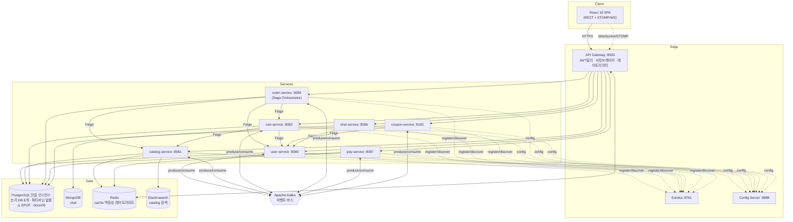
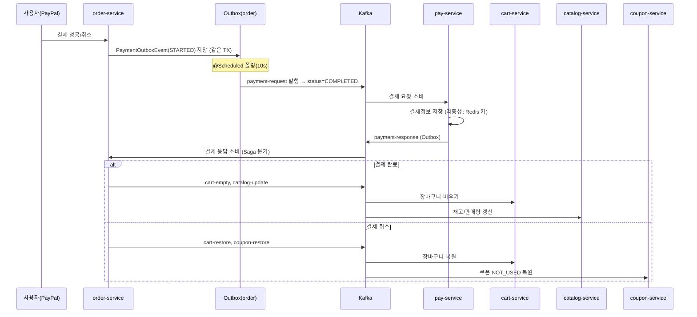
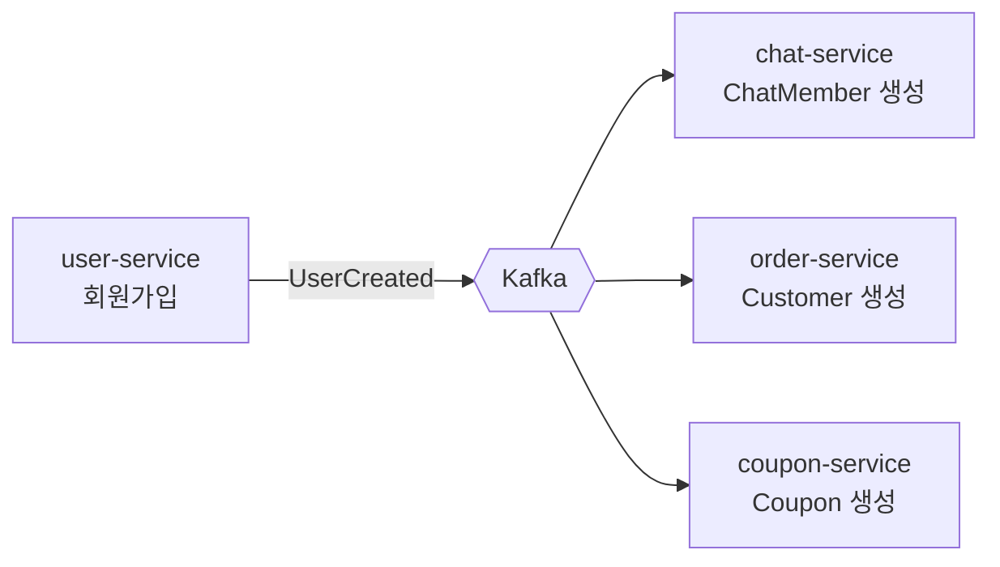

# 시스템 아키텍처 & 신뢰성 설계 문서

[日本語](03-architecture-and-reliability.md) | **한국어**

> 🕰️ **상태(2026-09-27) — 일부 낡음.** 상태 표의 P3 · P4 · P5 · P7 · P11 과 R-5(mTLS)는 이후 적용됐습니다. 구조와 장애 시나리오 설명은 유효합니다. 최신 상태는 [docs/54](54-improvements-vs-practice.ko.md).

> 대상: `ecommerce-msa` (Spring Cloud 기반 e-commerce 마이크로서비스)
> 작성일: 2026-07-24
> 참고: [liquidslr/system-design-notes](https://github.com/liquidslr/system-design-notes)
> 관련 문서: [브랜치 문제점](01-branch-issues.ko.md) · [개선 내역](02-improvements.ko.md)

---

## 1. 이 시스템은 무엇인가

PayPal 결제와 실시간 채팅을 갖춘 **아마존 클론형 e-commerce 플랫폼**을, 하나의 모놀리스가 아니라 **도메인별 마이크로서비스**로 분해한 시스템이다.

- **동기 통신**: API Gateway(Spring Cloud Gateway) + 서비스 디스커버리(Eureka) + 서비스 간 조회는 **OpenFeign**.
- **비동기 통신**: 상태 변경 이벤트는 **Kafka**로 전파. 결제/주문 정합성은 **Transaction Outbox + Saga** 패턴.
- **데이터**: 서비스별 독립 저장소(PostgreSQL), 채팅은 MongoDB, 검색은 Elasticsearch, 캐시/멱등성/레이트리미트는 Redis.
- **보안**: JWT(액세스=메모리, 리프레시=HttpOnly 쿠키 + Rotation), 게이트웨이 토큰 검증 필터, 서비스 간 mTLS(개선 대상 §R-5).

### 서비스 목록

| 서비스 | 포트 | 저장소 | 책임 |
|---|---|---|---|
| eureka-server | 8761 | - | 서비스 디스커버리 |
| config-server | 8888 | - | 중앙 설정 |
| gateway-server | 8000 | Redis(레이트리미트) | 라우팅·인증·서킷브레이커·레이트리미트 |
| user-service | 8080 | PostgreSQL | 회원/인증/토큰 |
| catalog-service | 8081 | PostgreSQL + ES + Redis | 상품/검색/재고 |
| cart-service | 8082 | PostgreSQL | 장바구니 |
| order-service | 8084 | PostgreSQL | 주문·**Saga 오케스트레이터** |
| chat-service | 8086 | MongoDB | 실시간 채팅(STOMP/WebSocket) |
| pay-service | 8087 | PostgreSQL + Redis(멱등성) | 결제 |
| coupon-service | 8183 | PostgreSQL | 쿠폰 |

---

## 2. 시스템 구조도

### 2.1 컴포넌트 / 통신 개요



### 2.2 결제·주문 Saga (핵심 정합성 흐름)



### 2.3 회원가입 이벤트 팬아웃



---

## 3. 시스템의 문제점 (요약)

상세 근거는 [`docs/01`](01-branch-issues.ko.md). 개선 후 남은 위험까지 포함해 요약하면:

| # | 문제 | 상태 |
|---|---|---|
| P1 | Feign 레벨 서킷브레이커/폴백 부재 | ⚠️ 타임아웃만 적용, CB는 로드맵(R-1) |
| P2 | 게이트웨이 서킷브레이커/레이트리미터 미배선 | ✅ 개선 완료([`docs/02`](02-improvements.ko.md)) |
| P3 | Kafka 컨슈머 DLQ/재시도 없음 → poison message가 파티션 블로킹 | ⚠️ 로드맵(R-2) |
| P4 | 컨슈머 멱등성 부재(pay 제외) → 중복 처리 | ⚠️ 로드맵(R-3) |
| P5 | 분산 추적 부재 → 사가 흐름 장애 추적난이 | ⚠️ 로드맵(R-4) |
| P6 | 운영: healthcheck/restart/리소스 상한 부재 | ✅ 개선 완료 |
| P7 | `useInsecureTrustManager: true` → mTLS 무력화 | ⚠️ 로드맵(R-5) |
| P8 | 상태 저장소 단일 인스턴스(SPOF) | ⚠️ 인프라 로드맵 → [`docs/09`](09-postgresql-partitioning-sharding.ko.md) |
| P9 | Outbox 정리 정책·부분 실패 격리 부재 | ⚠️ 로드맵(R-2) |
| **P10** | **DB 파티셔닝/샤딩 전무 + 삭제 로직 없는 무한 증가 테이블 10여 개** | 🔴 **[`docs/09`](09-postgresql-partitioning-sharding.ko.md)에서 별도 설계** |
| **P11** | **스키마를 Hibernate `ddl-auto`가 단독 소유(마이그레이션 도구 부재)** | 🔴 [`docs/09` §3](09-postgresql-partitioning-sharding.ko.md) — 파티셔닝의 선결 조건 |

---

## 4. 장애 발생 가능 시나리오

각 시나리오: **트리거 → 전파 경로 → 영향 범위(blast radius)**.

### F-1. 다운스트림 서비스 지연으로 인한 장애 전파 (Cascading Failure) 🔴
- **트리거**: `catalog-service`가 GC 폭주/DB 락으로 응답이 느려짐.
- **전파**: `order-service`/`cart-service`의 Feign 호출이 대기 → (타임아웃 적용 전) 서블릿 워커 스레드 점유 → 스레드 풀 고갈.
- **영향**: 정상이던 주문·장바구니 기능까지 동반 마비.
- **현 완화**: Feign `readTimeout 5s`로 무한 대기는 차단. 게이트웨이 서킷브레이커가 catalog 라우트를 열어 폴백 응답. **남은 위험**: 5s×동시성만큼의 스레드 점유는 여전 → R-1(Feign CB)로 완결.
  - ⚠️ 이 완화는 한동안 **실재하지 않았다.** 설정 키가 OpenFeign 4.x 가 읽지 않는 옛 접두사(`feign.client.config`)여서 실제 적용값은 읽기 60초였다. docs/37 §2.1 에서 발견해 `spring.cloud.openfeign` 으로 고쳤다. 이 줄을 믿고 있던 기간의 실제 노출은 "60s×동시성"이었다.

### F-2. Kafka Poison Message 파티션 블로킹 🔴
- **트리거**: 스키마 불일치/역직렬화 실패 레코드가 토픽에 유입.
- **전파**: 컨슈머가 처리 실패 → 오프셋 미커밋 → 같은 레코드 **무한 재시도**. DLQ가 없어 진행 불가.
- **영향**: 해당 파티션의 **모든 후속 이벤트 정지**. 예: `payment-response` 파티션이 막히면 사가가 멈춰 주문이 영구 `PENDING`.
- **현 완화**: 없음 → **R-2 최우선**.

### F-3. 이벤트 중복 소비로 인한 데이터 오염 🔴
- **트리거**: 컨슈머 리밸런싱/재처리(at-least-once)로 같은 이벤트 재소비.
- **전파**: `catalog`가 재고 이중 차감, `coupon`이 이중 처리, `cart`가 중복 반영.
- **영향**: 재고/정산 불일치(금전 영향).
- **현 완화**: `pay-service`만 Redis 멱등성 키 보유. 나머지는 무방비 → **R-3**.

### F-4. Outbox 릴레이 정지/폭증 🟠
- **트리거**: `@Scheduled` 릴레이 배치가 한 이벤트 발행 실패로 `@Transactional` 롤백, 또는 스케줄러 스레드 hang.
- **전파**: `STARTED` 이벤트가 발행되지 못하고 적체. `COMPLETED` 정리 정책이 없어 outbox 테이블 무한 증가.
- **영향**: 결제 요청/응답 지연 → 사가 지연. 장기적으로 DB 팽창.
- **현 완화**: 부분. → **R-2**(부분 실패 격리 + 정리 배치).

### F-5. 게이트웨이 인증 필터/토큰 검증 장애 🟠
- **트리거**: JWT 시크릿 로테이션 불일치, user-service의 공개키/블랙리스트 저장소 장애.
- **전파**: 게이트웨이 `JwtAuthorization` 필터가 전 요청 401.
- **영향**: 로그인 이후 전 기능 접근 불가(**전면 장애**).
- **현 완화**: 게이트웨이는 SPOF 방어를 위해 다중 인스턴스 전제 필요(§7).

### F-6. Redis 장애 시 게이트웨이 트래픽 차단 🟠 (개선의 부작용)
- **트리거**: 레이트리미터 백엔드 Redis 다운.
- **전파**: `RequestRateLimiter`가 토큰 버킷 조회 실패 → 요청 오류.
- **영향**: 게이트웨이 전 경로 영향 가능.
- **현 완화**: 문서화된 **의도적 트레이드오프**. 운영에서 Redis 이중화(Sentinel/Cluster) 전제. → §7 + R 항목의 "fail-open" 옵션 검토.

### F-7. WebSocket/STOMP 스케일아웃 시 메시지 유실 🟠
- **트리거**: chat-service를 2개 이상 인스턴스로 확장.
- **전파**: 인메모리 SimpleBroker는 인스턴스 로컬 → 다른 인스턴스에 붙은 사용자에게 메시지 미전달.
- **영향**: 채팅 파편화. (참고: 메시지는 Mongo Sink로 영속되지만 실시간 전달은 유실)
- **현 완화**: 단일 인스턴스 전제. 확장 시 외부 브로커(Redis/RabbitMQ relay) 필요 → 로드맵.

### F-8. 상태 저장소 SPOF 🟠
- **트리거**: 특정 서비스의 단일 PostgreSQL/MongoDB/ES 인스턴스 장애.
- **영향**: 해당 도메인 전체 read/write 불가. ⚠️ 실제로는 더 심각합니다 — **8개 DB가 논리적으로만 분리되어 있고 물리적으로는 단일 PostgreSQL 인스턴스**(`localhost:5435`)이므로, 이 한 대가 죽으면 **전 서비스가 동시에 정지**합니다.
- **현 완화**: 인프라 레벨 복제 필요(§7).
- **상세**: 데이터 계층의 장애 시나리오(무한 증가로 인한 디스크 고갈 F-10, 파티션 미생성 F-11, 프루닝 실패 F-12, 복제 지연 F-13, 샤드 불균형 F-14)는 [`docs/09` §7](09-postgresql-partitioning-sharding.ko.md)에서 다룹니다.

### F-9. 설정/디스커버리 부트스트랩 장애 🟡
- **트리거**: config-server 또는 eureka 다운, compose의 빈 호스트/프로토콜 불일치.
- **영향**: 신규 인스턴스 기동 실패, 라우팅 실패.
- **현 완화**: `SPRING_CONFIG_IMPORT=optional:` 로 config는 옵셔널. eureka는 `depends_on service_healthy`로 순서 보장. cart의 http/https 불일치 수정 완료.

---

## 5. 장애 대응 시나리오 (Incident Response)

각 장애: **탐지(Detect) → 즉시 대응(Mitigate) → 복구(Recover) → 사후(Post)**.

### F-1/F-2 공통 관측 신호
- 게이트웨이 서킷브레이커 상태 전이 로그(`Resilience4jConfig`가 이미 로깅) + `/actuator/health`의 CB 상태.
- Prometheus: `resilience4j_circuitbreaker_state`, Feign 에러율, Kafka consumer lag.

### F-1 Cascading Failure 대응
1. **탐지**: 특정 서비스 응답시간 급증 + 게이트웨이 해당 라우트 CB `OPEN` 전이 경보.
2. **즉시**: CB가 이미 폴백으로 격리 → 사용자에겐 503/안내 메시지. 원인 서비스 인스턴스 **격리/재시작**(healthcheck+restart로 자동).
3. **복구**: 원인(GC/DB락) 해소 후 CB `HALF_OPEN`→`CLOSED` 자동 전이. 스케일아웃으로 여유 확보.
4. **사후**: 타임아웃/스레드풀/CB 임계값 튜닝, R-1(Feign CB) 도입.

### F-2 Poison Message 대응
1. **탐지**: consumer lag 급증 + 동일 오프셋 반복 에러 로그.
2. **즉시(수기)**: 해당 컨슈머 그룹 오프셋을 문제 레코드 다음으로 **스킵**(`kafka-consumer-groups --reset-offsets`), 또는 임시 배포로 문제 메시지 건너뛰기.
3. **복구**: 파티션 정상화, 스킵한 레코드는 별도 보관/재처리.
4. **사후**: **R-2(DLQ)** 도입 → 자동 격리. 프로듀서 스키마 계약(Schema Registry) 검토.

### F-3 중복 소비 대응
1. **탐지**: 재고/쿠폰 불일치 정합성 배치 경보, 매출-재고 대사 불일치.
2. **즉시**: 영향 레코드 식별 후 보정 스크립트로 원복.
3. **복구/사후**: **R-3(멱등성 키)** 확산으로 재발 방지.

### F-4 Outbox 정지 대응
1. **탐지**: `outbox` 테이블 `STARTED` 적체 수 경보, 발행 지연 메트릭.
2. **즉시**: 스케줄러 재시작(자동). 적체분은 다음 폴링에 자연 배출.
3. **복구/사후**: R-2(부분 실패 격리: 이벤트 단위 트랜잭션·개별 재시도) + `COMPLETED` 아카이브 배치.

### F-5 게이트웨이 인증 장애 대응
1. **탐지**: 401 급증, user-service 헬스 저하.
2. **즉시**: 정상 인스턴스로 롤백/트래픽 이동, 시크릿 정합성 확인.
3. **사후**: 시크릿 로테이션 절차 자동화, 키 저장소 이중화.

### F-6 Redis 장애 대응
1. **탐지**: 게이트웨이 요청 에러율 급증 + Redis 헬스 다운.
2. **즉시**: Redis Sentinel 페일오버, 또는 레이트리미터 **일시 비활성화**(default-filter 제거 배포)로 fail-open.
3. **사후**: fail-open 정책을 코드화(레이트리미터 예외 시 통과) 검토.

### F-7 채팅 스케일아웃 대응
- 확장 전이라면 단일 인스턴스 유지가 임시 대응. 확장 필요 시 외부 STOMP relay 도입 후에만 스케일아웃.

### 공통 런북 원칙
- **healthcheck + `restart: unless-stopped`**로 1차 자동 복구.
- **CB/타임아웃**으로 장애를 도메인 경계에 격리.
- 수기 개입이 필요한 항목(오프셋 스킵, 보정 스크립트)은 위 절차를 런북으로 유지.

---

## 6. 장애 예방 대책 (Prevention)

### 이번 개선으로 확보한 것 ✅
- **엣지 방어**: 게이트웨이 REST 라우트별 서킷브레이커 + 사용자/IP 단위 레이트리미터.
- **타임아웃 표준화**: 전 서비스 Feign `connect 3s/read 5s`.
- **자가 치유 운영**: 컨테이너 healthcheck, `restart: unless-stopped`, 리소스 상한(noisy-neighbor 차단), 기동 순서(`service_healthy`).
- **관측성 기반**: liveness/readiness 프로브 분리, actuator/Prometheus 노출 표준화.
- **설정 정합**: eureka 빌드 컨텍스트 오타 수정, cart http→https 통일.
- **보안(기존 유지)**: chat WS 신원 위조 차단, JWT 검증 일원화, CORS 축소.

### 상시 운영 원칙 (Standing Practices)
1. **모든 서비스 간 호출은 타임아웃 필수** — 무한 대기 금지.
2. **모든 Kafka 컨슈머는 멱등** — 이벤트 재처리를 정상 경로로 간주.
3. **at-least-once 전제** — 정확히-한번은 멱등성으로 달성.
4. **상태 변경은 Outbox로** — 이중 쓰기(DB+Kafka) 원자성 확보.
5. **배포 전 계약 검증** — 이벤트 스키마 하위호환.
6. **경보는 증상이 아니라 SLO로** — consumer lag, CB open, p99 지연, outbox 적체.

---

## 7. 향후 개선 방향 (Roadmap)

우선순위: **R-6-P0/P1(데이터 계층: 마이그레이션 도구 + 아웃박스 파티셔닝) ≈ R-2(메시징 신뢰성) ≥ R-1(Feign CB) > R-3 > R-4 > R-5 > 나머지 인프라 이중화**.

> R-6의 P0/P1을 최상위로 올린 이유: 아웃박스 테이블에 **정리 로직이 아예 없어** 시간이 지나면 반드시 디스크가 고갈되고(F-10), 8개 DB가 물리적으로 한 인스턴스를 공유하므로 그 영향이 **전 서비스 정지**로 번집니다. "언젠가 터지는" 것이 아니라 "반드시 터지는" 항목입니다.

### R-1. Feign 서킷브레이커 + 폴백 (인증 컨텍스트 전파와 함께)
ThreadLocal 유실 문제(§[docs/02](02-improvements.ko.md))를 해결한 뒤 활성화:
```yaml
# application-common.yml
spring:
  cloud:
    openfeign:
      circuitbreaker:
        enabled: true
```
```java
// 방법 A) TimeLimiter의 스레드 오프로딩을 끄고 호출 스레드에서 실행 → ThreadLocal 유지
//         (Resilience4JConfigBuilder에서 timeLimiter 비활성 or 동기 실행 커스터마이저)
// 방법 B) RequestContextHolder 대신 요청 스코프 값을 명시적으로 캡처해 전달하는
//         RequestInterceptor로 교체 (권장, 스레드 독립적)
@FeignClient(name = "catalog-service", url = "${feign.catalog-url}",
             configuration = FeignConfig.class, fallbackFactory = CatalogFallback.class)
```
각 클라이언트에 `fallbackFactory`를 붙여 CB open 시 안전한 기본값 반환.

### R-2. Kafka DLQ + 재시도 백오프 + Outbox 부분 실패 격리
```java
// 대상이 batch listener 이므로 record 리스너 또는 BatchListenerFailedException 처리 주의
@Bean
DefaultErrorHandler errorHandler(KafkaTemplate<Object,Object> template) {
    var recoverer = new DeadLetterPublishingRecoverer(template,
        (rec, ex) -> new TopicPartition(rec.topic() + ".DLT", rec.partition()));
    var handler = new DefaultErrorHandler(recoverer,
        new ExponentialBackOffWithMaxRetries(3)); // 3회 재시도 후 DLT
    handler.addNotRetryableExceptions(DeserializationException.class); // poison 즉시 격리
    return handler;
}
// factory.setCommonErrorHandler(errorHandler);  // 각 ConcurrentKafkaListenerContainerFactory에 연결
```
- Outbox 릴레이는 **이벤트 단위 트랜잭션 + 개별 재시도 카운트**로 부분 실패를 격리하고, `COMPLETED` 이벤트는 아카이브/삭제 배치로 정리.

### R-3. 컨슈머 멱등성 확산
- `pay-service`의 `IdempotencyKeyRepository`(Redis) 패턴을 order/cart/catalog/coupon 컨슈머에 적용.
- 처리 전 `eventId` 소비 여부 확인 → 이미 처리 시 스킵. 또는 DB 유니크 제약 + upsert.

### R-4. 분산 추적 & 상관관계 ID
- Micrometer Tracing + OpenTelemetry(또는 Zipkin) 도입, Feign/Kafka 헤더로 traceId 전파.
- 로그(logstash-encoder 이미 사용)에 traceId 필드 추가 → 사가 흐름 단일 추적.
  > **2026-09 정정.** "이미 사용" 은 사실이 아니었다 — 의존성만 있고 쓰는 설정은 이름 오타로 읽히지
  > 않던 eureka 의 파일 하나뿐이었다. 이제 common 의 공통 설정이 모든 서비스에 JSON 로그(traceId·userId
  > 필드)를 쓰고 Loki 로 모은다 — docs/51.

### R-5. TLS 신뢰 정상화
- 게이트웨이 `useInsecureTrustManager: true` 제거, 업스트림 인증서를 트러스트스토어로 정식 검증.

### R-6. 데이터 계층: 파티셔닝 · 샤딩 · 복제 → **[`docs/09`](09-postgresql-partitioning-sharding.ko.md) 전용 문서**

이 항목은 분량과 중요도가 커서 별도 문서로 분리했습니다. 요약하면:

- **P0 — Flyway 도입 + `ddl-auto: validate`**: 현재 스키마를 Hibernate가 단독 소유하고 있어 파티션 테이블을 만들 수 없습니다. 모든 것의 선결 조건입니다.
- **P1 — 아웃박스 4종 시간 RANGE 파티셔닝 + 보존 정책**: 아웃박스는 상태만 바꾸고 **행을 삭제하지 않아** 무한 증가 중입니다(F-4, F-10). `DELETE` 대신 `DROP PARTITION`으로 O(1) 정리.
- **P2/P3 — 물리 인스턴스 분리 + 스트리밍 복제 + 읽기 복제본 라우팅**: 현재 8개 DB가 물리적으로 한 대라 장애 격리가 전혀 없습니다.
- **P4 — `orders`/`payment` 월 단위 파티셔닝**: PK가 TSID(시간정렬)라 커서 페이지네이션이 파티션 프루닝과 잘 맞습니다.
- **P5 — 수평 샤딩(`user_id` 기준, Citus 우선 검토)**: **지금은 불필요**. 다만 자식 테이블의 샤드 키 비정규화 등 "미리 해두면 싼" 준비 항목이 있습니다.

### 인프라 이중화 (그 외 저장소)
- MongoDB Replica Set, Redis Sentinel/Cluster, Kafka 다중 브로커·복제계수≥3.
- 게이트웨이/무상태 서비스 다중 인스턴스 + 오토스케일. (참고: System Design Notes의 *Replication/Partitioning*, *Rate Limiter*, *Message Queue* 챕터)

---

## 부록: 관측 지표 체크리스트

| 지표 | 소스 | 경보 기준(예) |
|---|---|---|
| 서킷브레이커 상태 | `resilience4j_circuitbreaker_state` | OPEN 전이 시 |
| Kafka consumer lag | Kafka exporter | 지속 증가 / 임계 초과 |
| Outbox `STARTED` 적체 | 앱 메트릭 | N건 이상 M분 지속 |
| p99 지연 | Micrometer | SLO 초과 |
| 컨테이너 헬스 | docker healthcheck | unhealthy N회 |
| 인증 401 비율 | 게이트웨이 | 급증 시 |
