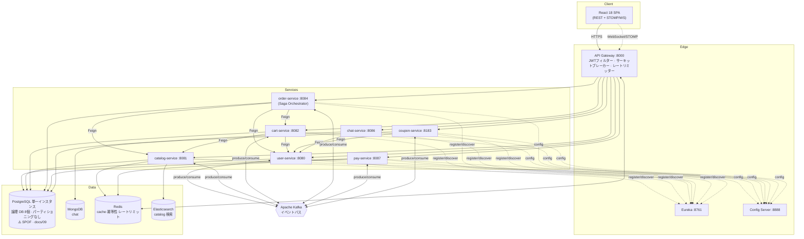
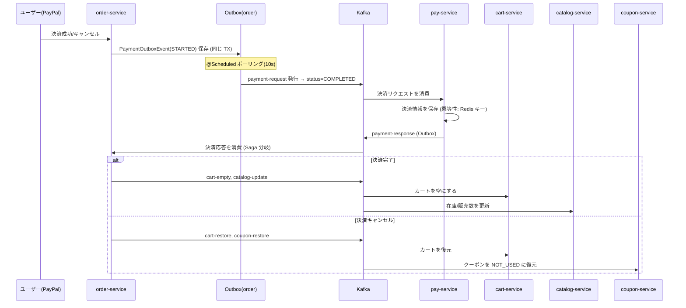
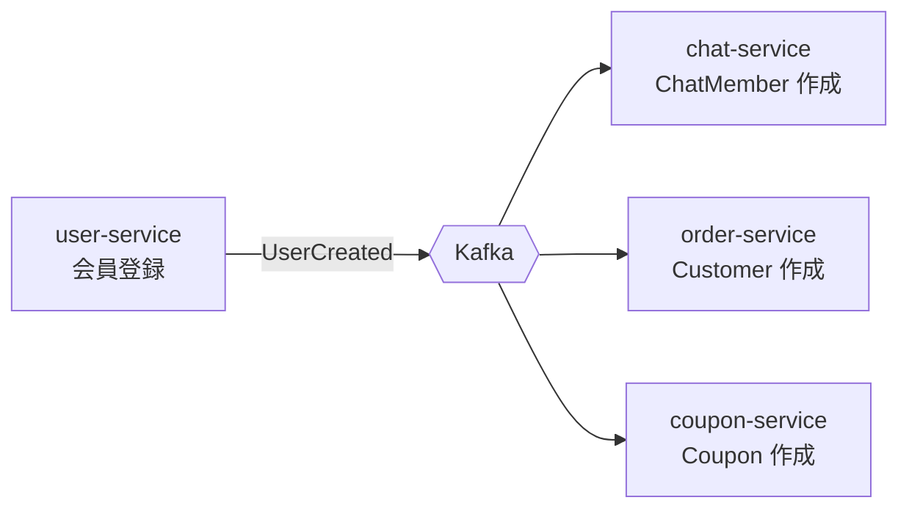

# システムアーキテクチャ & 信頼性設計文書

**日本語** | [한국어](03-architecture-and-reliability.ko.md)

> 🕰️ **状態（2026-09-27）— 一部古い。** 状態表の P3・P4・P5・P7・P11 と R-5（mTLS）はその後適用されました。構造と障害シナリオの説明は有効です。最新の状態は [docs/54](54-improvements-vs-practice.md)。

> 対象: `ecommerce-msa`（Spring Cloud ベースの e-commerce マイクロサービス）
> 作成日: 2026-07-24
> 参考: [liquidslr/system-design-notes](https://github.com/liquidslr/system-design-notes)
> 関連文書: [ブランチの問題点](01-branch-issues.md) ・ [改善内容](02-improvements.md)

---

## 1. このシステムは何か

PayPal 決済とリアルタイムチャットを備えた**Amazon クローン型の e-commerce プラットフォーム**を、一つのモノリスではなく**ドメインごとのマイクロサービス**に分解したシステムである。

- **同期通信**: API Gateway（Spring Cloud Gateway）+ サービスディスカバリー（Eureka）+ サービス間の照会は **OpenFeign**。
- **非同期通信**: 状態変更イベントは **Kafka** で伝播。決済/注文の整合性は **Transaction Outbox + Saga** パターン。
- **データ**: サービスごとの独立したストア（PostgreSQL）、チャットは MongoDB、検索は Elasticsearch、キャッシュ/冪等性/レートリミットは Redis。
- **セキュリティ**: JWT（アクセス=メモリ、リフレッシュ=HttpOnly Cookie + Rotation）、ゲートウェイのトークン検証フィルター、サービス間 mTLS（改善対象 §R-5）。

### サービス一覧

| サービス | ポート | ストア | 責務 |
|---|---|---|---|
| eureka-server | 8761 | - | サービスディスカバリー |
| config-server | 8888 | - | 中央設定 |
| gateway-server | 8000 | Redis（レートリミット） | ルーティング・認証・サーキットブレーカー・レートリミット |
| user-service | 8080 | PostgreSQL | 会員/認証/トークン |
| catalog-service | 8081 | PostgreSQL + ES + Redis | 商品/検索/在庫 |
| cart-service | 8082 | PostgreSQL | カート |
| order-service | 8084 | PostgreSQL | 注文・**Saga オーケストレーター** |
| chat-service | 8086 | MongoDB | リアルタイムチャット（STOMP/WebSocket） |
| pay-service | 8087 | PostgreSQL + Redis（冪等性） | 決済 |
| coupon-service | 8183 | PostgreSQL | クーポン |

---

## 2. システム構成図

### 2.1 コンポーネント / 通信の概要



### 2.2 決済・注文 Saga（中核となる整合性フロー）



### 2.3 会員登録イベントのファンアウト



---

## 3. システムの問題点（要約）

詳細な根拠は [`docs/01`](01-branch-issues.md)。改善後に残ったリスクまで含めて要約すると:

| # | 問題 | 状態 |
|---|---|---|
| P1 | Feign レベルのサーキットブレーカー/フォールバックの不在 | ⚠️ タイムアウトのみ適用、CB はロードマップ（R-1） |
| P2 | ゲートウェイのサーキットブレーカー/レートリミッターが未配線 | ✅ 改善完了（[`docs/02`](02-improvements.md)） |
| P3 | Kafka コンシューマーに DLQ/リトライなし → poison message がパーティションをブロック | ⚠️ ロードマップ（R-2） |
| P4 | コンシューマーの冪等性の不在（pay を除く）→ 重複処理 | ⚠️ ロードマップ（R-3） |
| P5 | 分散トレーシングの不在 → Saga フローの障害追跡が困難 | ⚠️ ロードマップ（R-4） |
| P6 | 運用: healthcheck/restart/リソース上限の不在 | ✅ 改善完了 |
| P7 | `useInsecureTrustManager: true` → mTLS の無力化 | ⚠️ ロードマップ（R-5） |
| P8 | ステートフルなストアが単一インスタンス（SPOF） | ⚠️ インフラのロードマップ → [`docs/09`](09-postgresql-partitioning-sharding.md) |
| P9 | Outbox の整理ポリシー・部分失敗の隔離の不在 | ⚠️ ロードマップ（R-2） |
| **P10** | **DB のパーティショニング/シャーディングが皆無 + 削除ロジックのない無限に増え続けるテーブルが 10 個ほど** | 🔴 **[`docs/09`](09-postgresql-partitioning-sharding.md) で別途設計** |
| **P11** | **スキーマを Hibernate の `ddl-auto` が単独で所有（マイグレーションツールの不在）** | 🔴 [`docs/09` §3](09-postgresql-partitioning-sharding.md) — パーティショニングの前提条件 |

---

## 4. 障害発生の可能性があるシナリオ

各シナリオ: **トリガー → 伝播経路 → 影響範囲（blast radius）**。

### F-1. ダウンストリームサービスの遅延による障害伝播（Cascading Failure）🔴
- **トリガー**: `catalog-service` が GC の暴走/DB ロックで応答が遅くなる。
- **伝播**: `order-service`/`cart-service` の Feign 呼び出しが待機 →（タイムアウト適用前）サーブレットのワーカースレッドを占有 → スレッドプールの枯渇。
- **影響**: 正常だった注文・カート機能まで巻き込まれて麻痺。
- **現在の緩和策**: Feign の `readTimeout 5s` で無限待機は遮断。ゲートウェイのサーキットブレーカーが catalog ルートをオープンしてフォールバック応答。**残るリスク**: 5s×同時実行数分のスレッド占有は依然として残る → R-1（Feign CB）で完結。
  - ⚠️ この緩和策はしばらくの間**実在しなかった。** 設定キーが OpenFeign 4.x が読まない古い接頭辞（`feign.client.config`）だったため、実際の適用値は読み取り 60 秒だった。docs/37 §2.1 で発見し、`spring.cloud.openfeign` に修正した。この行を信じていた期間の実際の露出は「60s×同時実行数」だった。

### F-2. Kafka Poison Message によるパーティションのブロック 🔴
- **トリガー**: スキーマ不一致/デシリアライズ失敗のレコードがトピックに流入。
- **伝播**: コンシューマーが処理に失敗 → オフセット未コミット → 同じレコードを**無限にリトライ**。DLQ がないので先に進めない。
- **影響**: 該当パーティションの**後続イベントがすべて停止**。例: `payment-response` のパーティションが詰まると Saga が止まり、注文が永久に `PENDING`。
- **現在の緩和策**: なし → **R-2 が最優先**。

### F-3. イベントの重複消費によるデータ汚染 🔴
- **トリガー**: コンシューマーのリバランス/再処理（at-least-once）で同じイベントを再消費。
- **伝播**: `catalog` が在庫を二重に引き当て、`coupon` が二重処理、`cart` が重複反映。
- **影響**: 在庫/精算の不一致（金銭的影響）。
- **現在の緩和策**: `pay-service` だけが Redis の冪等性キーを持つ。残りは無防備 → **R-3**。

### F-4. Outbox リレーの停止/急増 🟠
- **トリガー**: `@Scheduled` のリレーバッチが一つのイベントの発行失敗で `@Transactional` ロールバック、またはスケジューラースレッドの hang。
- **伝播**: `STARTED` イベントが発行されずに滞留。`COMPLETED` の整理ポリシーがないため outbox テーブルが無限に増加。
- **影響**: 決済リクエスト/応答の遅延 → Saga の遅延。長期的には DB の肥大化。
- **現在の緩和策**: 部分的。→ **R-2**（部分失敗の隔離 + 整理バッチ）。

### F-5. ゲートウェイの認証フィルター/トークン検証の障害 🟠
- **トリガー**: JWT シークレットのローテーション不一致、user-service の公開鍵/ブラックリストのストアの障害。
- **伝播**: ゲートウェイの `JwtAuthorization` フィルターが全リクエストに 401。
- **影響**: ログイン以降の全機能にアクセス不能（**全面障害**）。
- **現在の緩和策**: ゲートウェイは SPOF 防御のためにマルチインスタンスを前提とする必要がある（§7）。

### F-6. Redis 障害時のゲートウェイのトラフィック遮断 🟠（改善の副作用）
- **トリガー**: レートリミッターのバックエンドの Redis がダウン。
- **伝播**: `RequestRateLimiter` がトークンバケットの照会に失敗 → リクエストエラー。
- **影響**: ゲートウェイの全経路に影響しうる。
- **現在の緩和策**: 文書化された**意図的なトレードオフ**。本番では Redis の冗長化（Sentinel/Cluster）を前提とする。→ §7 + R 項目の「fail-open」オプションを検討。

### F-7. WebSocket/STOMP のスケールアウト時のメッセージ消失 🟠
- **トリガー**: chat-service を 2 つ以上のインスタンスに拡張。
- **伝播**: インメモリの SimpleBroker はインスタンスローカル → 別のインスタンスに接続したユーザーにメッセージが届かない。
- **影響**: チャットの断片化。（参考: メッセージは Mongo Sink で永続化されるが、リアルタイム配信は失われる）
- **現在の緩和策**: 単一インスタンスが前提。拡張時には外部ブローカー（Redis/RabbitMQ relay）が必要 → ロードマップ。

### F-8. ステートフルなストアの SPOF 🟠
- **トリガー**: 特定サービスの単一の PostgreSQL/MongoDB/ES インスタンスの障害。
- **影響**: 該当ドメイン全体の read/write が不能。⚠️ 実際にはもっと深刻です — **8 個の DB が論理的に分離されているだけで、物理的には単一の PostgreSQL インスタンス**（`localhost:5435`）なので、この 1 台が落ちると**全サービスが同時に停止**します。
- **現在の緩和策**: インフラレベルのレプリケーションが必要（§7）。
- **詳細**: データ層の障害シナリオ（無限増加によるディスク枯渇 F-10、パーティション未作成 F-11、プルーニング失敗 F-12、レプリケーション遅延 F-13、シャードの不均衡 F-14）は [`docs/09` §7](09-postgresql-partitioning-sharding.md) で扱います。

### F-9. 設定/ディスカバリーのブートストラップ障害 🟡
- **トリガー**: config-server または eureka のダウン、compose の空のホスト/プロトコルの不一致。
- **影響**: 新規インスタンスの起動失敗、ルーティング失敗。
- **現在の緩和策**: `SPRING_CONFIG_IMPORT=optional:` で config はオプショナル。eureka は `depends_on service_healthy` で順序を保証。cart の http/https の不一致は修正完了。

---

## 5. 障害対応シナリオ（Incident Response）

各障害: **検知（Detect）→ 即時対応（Mitigate）→ 復旧（Recover）→ 事後（Post）**。

### F-1/F-2 共通の観測シグナル
- ゲートウェイのサーキットブレーカーの状態遷移ログ（`Resilience4jConfig` がすでにロギング）+ `/actuator/health` の CB 状態。
- Prometheus: `resilience4j_circuitbreaker_state`、Feign のエラー率、Kafka consumer lag。

### F-1 Cascading Failure への対応
1. **検知**: 特定サービスの応答時間の急増 + ゲートウェイの該当ルートの CB が `OPEN` に遷移したアラート。
2. **即時**: CB がすでにフォールバックで隔離 → ユーザーには 503/案内メッセージ。原因サービスのインスタンスを**隔離/再起動**（healthcheck+restart で自動）。
3. **復旧**: 原因（GC/DB ロック）の解消後、CB が `HALF_OPEN`→`CLOSED` に自動遷移。スケールアウトで余裕を確保。
4. **事後**: タイムアウト/スレッドプール/CB の閾値チューニング、R-1（Feign CB）の導入。

### F-2 Poison Message への対応
1. **検知**: consumer lag の急増 + 同じオフセットで繰り返されるエラーログ。
2. **即時（手動）**: 該当コンシューマーグループのオフセットを問題レコードの次に**スキップ**（`kafka-consumer-groups --reset-offsets`）、または一時的なデプロイで問題メッセージを読み飛ばす。
3. **復旧**: パーティションの正常化、スキップしたレコードは別途保管/再処理。
4. **事後**: **R-2（DLQ）**を導入 → 自動隔離。プロデューサーのスキーマ契約（Schema Registry）を検討。

### F-3 重複消費への対応
1. **検知**: 在庫/クーポンの不一致に対する整合性バッチのアラート、売上と在庫の突合の不一致。
2. **即時**: 影響を受けたレコードを特定した後、補正スクリプトで原状回復。
3. **復旧/事後**: **R-3（冪等性キー）**の展開で再発を防止。

### F-4 Outbox 停止への対応
1. **検知**: `outbox` テーブルの `STARTED` 滞留数のアラート、発行遅延のメトリクス。
2. **即時**: スケジューラーの再起動（自動）。滞留分は次のポーリングで自然に排出。
3. **復旧/事後**: R-2（部分失敗の隔離: イベント単位のトランザクション・個別リトライ）+ `COMPLETED` のアーカイブバッチ。

### F-5 ゲートウェイ認証障害への対応
1. **検知**: 401 の急増、user-service のヘルス低下。
2. **即時**: 正常なインスタンスへのロールバック/トラフィック移動、シークレットの整合性を確認。
3. **事後**: シークレットのローテーション手順の自動化、キーストアの冗長化。

### F-6 Redis 障害への対応
1. **検知**: ゲートウェイのリクエストエラー率の急増 + Redis のヘルスがダウン。
2. **即時**: Redis Sentinel のフェイルオーバー、またはレートリミッターを**一時的に無効化**（default-filter を除去したデプロイ）して fail-open。
3. **事後**: fail-open ポリシーのコード化（レートリミッターの例外時は通過）を検討。

### F-7 チャットのスケールアウトへの対応
- 拡張前であれば、単一インスタンスの維持が暫定対応。拡張が必要な場合は、外部 STOMP relay を導入した後にのみスケールアウト。

### 共通のランブック原則
- **healthcheck + `restart: unless-stopped`** で一次的な自動復旧。
- **CB/タイムアウト**で障害をドメイン境界に隔離。
- 手動介入が必要な項目（オフセットのスキップ、補正スクリプト）は、上記の手順をランブックとして維持。

---

## 6. 障害予防策（Prevention）

### 今回の改善で確保したもの ✅
- **エッジの防御**: ゲートウェイの REST ルートごとのサーキットブレーカー + ユーザー/IP 単位のレートリミッター。
- **タイムアウトの標準化**: 全サービスの Feign を `connect 3s/read 5s`。
- **自己修復的な運用**: コンテナの healthcheck、`restart: unless-stopped`、リソース上限（noisy-neighbor の遮断）、起動順序（`service_healthy`）。
- **可観測性の基盤**: liveness/readiness プローブの分離、actuator/Prometheus の公開の標準化。
- **設定の整合**: eureka のビルドコンテキストのタイポ修正、cart の http→https 統一。
- **セキュリティ（既存を維持）**: chat WS の身元偽装を遮断、JWT 検証の一元化、CORS の縮小。

### 常時の運用原則（Standing Practices）
1. **すべてのサービス間呼び出しにタイムアウト必須** — 無限待機は禁止。
2. **すべての Kafka コンシューマーは冪等** — イベントの再処理を正常な経路とみなす。
3. **at-least-once が前提** — exactly-once は冪等性で達成する。
4. **状態変更は Outbox で** — 二重書き込み（DB+Kafka）の原子性を確保。
5. **デプロイ前の契約検証** — イベントスキーマの後方互換性。
6. **アラートは症状ではなく SLO で** — consumer lag、CB open、p99 遅延、outbox の滞留。

---

## 7. 今後の改善方針（Roadmap）

優先順位: **R-6-P0/P1（データ層: マイグレーションツール + Outbox のパーティショニング）≈ R-2（メッセージングの信頼性）≥ R-1（Feign CB）> R-3 > R-4 > R-5 > その他のインフラ冗長化**。

> R-6 の P0/P1 を最上位に上げた理由: Outbox テーブルには**整理ロジックがまったくないため**、時間が経てば必ずディスクが枯渇し（F-10）、8 個の DB が物理的に一つのインスタンスを共有しているため、その影響が**全サービスの停止**に広がります。「いつか破綻する」のではなく「必ず破綻する」項目です。

### R-1. Feign サーキットブレーカー + フォールバック（認証コンテキストの伝播と併せて）
ThreadLocal 消失の問題（§[docs/02](02-improvements.md)）を解決した後に有効化:
```yaml
# application-common.yml
spring:
  cloud:
    openfeign:
      circuitbreaker:
        enabled: true
```
```java
// 方法 A) TimeLimiter のスレッドオフロードを無効にして呼び出し元スレッドで実行 → ThreadLocal を維持
//         (Resilience4JConfigBuilder で timeLimiter を無効化 or 同期実行のカスタマイザー)
// 方法 B) RequestContextHolder の代わりに、リクエストスコープの値を明示的にキャプチャして渡す
//         RequestInterceptor に置き換え (推奨、スレッド非依存)
@FeignClient(name = "catalog-service", url = "${feign.catalog-url}",
             configuration = FeignConfig.class, fallbackFactory = CatalogFallback.class)
```
各クライアントに `fallbackFactory` を付けて、CB open 時に安全なデフォルト値を返す。

### R-2. Kafka DLQ + リトライのバックオフ + Outbox の部分失敗の隔離
```java
// 対象が batch listener なので、record リスナーまたは BatchListenerFailedException の扱いに注意
@Bean
DefaultErrorHandler errorHandler(KafkaTemplate<Object,Object> template) {
    var recoverer = new DeadLetterPublishingRecoverer(template,
        (rec, ex) -> new TopicPartition(rec.topic() + ".DLT", rec.partition()));
    var handler = new DefaultErrorHandler(recoverer,
        new ExponentialBackOffWithMaxRetries(3)); // 3 回リトライ後に DLT
    handler.addNotRetryableExceptions(DeserializationException.class); // poison を即時隔離
    return handler;
}
// factory.setCommonErrorHandler(errorHandler);  // 各 ConcurrentKafkaListenerContainerFactory に接続
```
- Outbox リレーは**イベント単位のトランザクション + 個別のリトライカウント**で部分失敗を隔離し、`COMPLETED` イベントはアーカイブ/削除バッチで整理。

### R-3. コンシューマーの冪等性の展開
- `pay-service` の `IdempotencyKeyRepository`（Redis）パターンを order/cart/catalog/coupon のコンシューマーに適用。
- 処理前に `eventId` の消費済みかどうかを確認 → すでに処理済みならスキップ。または DB のユニーク制約 + upsert。

### R-4. 分散トレーシング & 相関 ID
- Micrometer Tracing + OpenTelemetry（または Zipkin）を導入し、Feign/Kafka のヘッダーで traceId を伝播。
- ログ（logstash-encoder をすでに使用）に traceId フィールドを追加 → Saga フローを一本で追跡。
  > **2026-09 訂正。**「すでに使用」は事実ではなかった — 依存関係があるだけで、それを使う設定は名前のタイポで読み込まれて
  > いなかった eureka のファイル一つだけだった。現在は common の共通設定がすべてのサービスに JSON ログ（traceId・userId
  > フィールド）を書き出し、Loki に集約している — docs/51。

### R-5. TLS の信頼の正常化
- ゲートウェイの `useInsecureTrustManager: true` を削除し、アップストリームの証明書をトラストストアで正式に検証。

### R-6. データ層: パーティショニング・シャーディング・レプリケーション → **[`docs/09`](09-postgresql-partitioning-sharding.md) 専用文書**

この項目は分量と重要度が大きいため、別の文書に分離しました。要約すると:

- **P0 — Flyway の導入 + `ddl-auto: validate`**: 現在はスキーマを Hibernate が単独で所有しているため、パーティションテーブルを作れません。すべての前提条件です。
- **P1 — Outbox 4 種の時間 RANGE パーティショニング + 保持ポリシー**: Outbox は状態を変えるだけで**行を削除しないため**、無限に増え続けています（F-4、F-10）。`DELETE` の代わりに `DROP PARTITION` で O(1) で整理。
- **P2/P3 — 物理インスタンスの分離 + ストリーミングレプリケーション + 読み取りレプリカへのルーティング**: 現在 8 個の DB が物理的に 1 台なので、障害の隔離がまったくありません。
- **P4 — `orders`/`payment` の月単位パーティショニング**: PK が TSID（時間順）なので、カーソルページネーションがパーティションプルーニングとよく噛み合います。
- **P5 — 水平シャーディング（`user_id` 基準、Citus を優先的に検討）**: **今は不要**。ただし、子テーブルへのシャードキーの非正規化など、「先にやっておけば安い」準備項目があります。

### インフラの冗長化（その他のストア）
- MongoDB Replica Set、Redis Sentinel/Cluster、Kafka のマルチブローカー・レプリケーション係数≥3。
- ゲートウェイ/ステートレスサービスのマルチインスタンス + オートスケール。（参考: System Design Notes の *Replication/Partitioning*、*Rate Limiter*、*Message Queue* の章）

---

## 付録: 観測指標のチェックリスト

| 指標 | ソース | アラート基準（例） |
|---|---|---|
| サーキットブレーカーの状態 | `resilience4j_circuitbreaker_state` | OPEN への遷移時 |
| Kafka consumer lag | Kafka exporter | 継続的な増加 / 閾値超過 |
| Outbox `STARTED` の滞留 | アプリのメトリクス | N 件以上が M 分継続 |
| p99 遅延 | Micrometer | SLO 超過 |
| コンテナのヘルス | docker healthcheck | unhealthy が N 回 |
| 認証 401 の比率 | ゲートウェイ | 急増時 |
