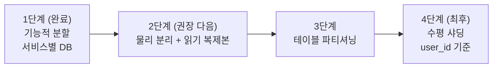

# PostgreSQL 파티셔닝 & 샤딩 설계

[日本語](09-postgresql-partitioning-sharding.md) | **한국어**

> 🕰️ **상태(2026-09-27) — 일부 낡음.** `ddl-auto` 는 `validate` 로 바꿨습니다([docs/20](20-schema-ownership.ko.md)). 월 파티션 자동 생성은 pg_partman 대신 애플리케이션 잡으로 넣었습니다(2026-09-27, [docs/62 §3](62-engineering-casebook.ko.md)).

> 작성일: 2026-07-25
> 대상: `userdb` / `productdb` / `metadb` / `cartdb` / `orderdb` / `paydb` / `coupondb` (+ chat)
> 참고: [liquidslr/system-design-notes](https://github.com/liquidslr/system-design-notes) — *Replication / Partitioning*, *Unique ID Generator in Distributed Systems*, *Key-Value Store(Consistent Hashing)*
> 관련: [아키텍처·신뢰성](03-architecture-and-reliability.ko.md) · [catalog 검색 이슈](06-catalog-search-issues.ko.md)

## 0. 이 문서가 왜 필요한가

[`docs/03`](03-architecture-and-reliability.ko.md)은 데이터 계층을 "PostgreSQL 복제/failover" **한 줄**로만 다루고(§인프라 이중화), 참고 레포의 *Replication/Partitioning* 챕터를 각주로 달아놓고도 **정작 이 프로젝트에 적용하지 않았습니다**. 이 문서가 그 공백을 메웁니다.

이 프로젝트에서 데이터 계층은 이론적 관심사가 아닙니다. 조사 결과 **삭제 로직이 아예 없는 무한 증가 테이블이 최소 10개** 있고, 그중 4개(아웃박스)는 Debezium CDC가 실시간으로 tailing하는 결제·주문 핵심 경로입니다. 즉 현재 구조는 **시간이 지나면 반드시 고장나는** 상태입니다.

---

## 1. 현재 상태 (As-Is)

### 1.1 이미 되어 있는 것: 기능적 분할(Vertical / Functional Partitioning)

서비스별로 독립 데이터베이스를 쓰고 있습니다. 이것은 이미 **샤딩의 1단계(기능적 분할)** 이며, MSA에서 올바른 출발점입니다.

| DB | 소유 서비스 | 스키마 |
|---|---|---|
| `userdb` | user-service | `users` |
| `productdb` | catalog-service | `product` |
| `metadb` | catalog-service (Spring Batch 메타데이터) | `BATCH_JOB_*` |
| `cartdb` | cart-service | `cart` |
| `orderdb` | order-service | `orders` |
| `paydb` | pay-service | `pay` |
| `coupondb` | coupon-service | `coupon` |
| (chat) | chat-service | `chat` + 스키마 미지정 테이블 |

### 1.2 되어 있지 않은 것

| 항목 | 상태 |
|---|---|
| 테이블 파티셔닝 (PostgreSQL declarative partitioning) | ❌ **전무** |
| 수평 샤딩 (동일 테이블을 여러 노드로 분산) | ❌ 전무 |
| 읽기 복제본(read replica) / 읽기-쓰기 분리 | ❌ 전무 |
| 물리적 분리 | ❌ **8개 DB가 전부 단일 인스턴스(`localhost:5435`)** |
| 스키마 마이그레이션 도구 | ❌ **전무** (Hibernate `ddl-auto` 단독) |
| 데이터 보존(retention)/아카이빙 정책 | ❌ 전무 |

**핵심**: 논리적으로는 8개로 나뉘어 있지만 **물리적으로는 한 대의 PostgreSQL**입니다. 즉 buffer pool·WAL·CPU·디스크를 8개 서비스가 전부 공유하며, 이 한 대가 죽으면 전 서비스가 정지합니다([`docs/03` F-8](03-architecture-and-reliability.ko.md)).

### 1.3 유리한 조건 — PK가 TSID다 🎉

조사 중 발견한 가장 중요한 사실입니다. 대부분의 엔티티가 `io.hypersistence:hypersistence-utils`의 **`@Tsid`** 를 씁니다(루트 `build.gradle`).

```java
@Id @Tsid private Long orderId;   // 64-bit, 애플리케이션 생성, 시간 정렬(time-sorted)
```

TSID(Time-Sorted ID)는 Snowflake 계열의 **애플리케이션 생성 64비트 정수**입니다. 이것이 왜 결정적이냐면:

1. **DB 시퀀스 조율이 불필요** → 샤딩 시 노드 간 ID 충돌이 원천적으로 없습니다. 참고 레포의 *Unique ID Generator* 챕터가 요구하는 조건을 **이미 충족**하고 있습니다.
2. **시간 정렬** → `order_id` 범위 조건이 곧 시간 범위 조건이므로, `created_at`으로 range 파티셔닝해도 **`order_id` 기반 커서 페이지네이션이 여전히 파티션 프루닝됩니다**(`OrderRepository.findByCustomerIdAndOrderIdLessThanOrderByOrderIdDesc`).

**예외**: `catalog-service`만 전 엔티티가 `IDENTITY`(DB 시퀀스)이고, `users.notification`, `chat_room`, `participant_chat_room`, `alarm`도 `IDENTITY`입니다. 이들은 샤딩 대상에서 제외하거나 TSID로 먼저 이관해야 합니다.

---

## 2. 문제점

### PG-1. 삭제 로직이 없는 무한 증가 테이블 🔴

조사 결과 **어떤 테이블에도 정리(cleanup) 배치가 없습니다.** 특히 아웃박스 4종은 상태만 `STARTED → COMPLETED`로 바꾸고 **행을 절대 삭제하지 않습니다**(`PaymentOutboxScheduler`는 `save()`만 호출).

| 테이블 | 성격 | 위험 |
|---|---|---|
| `orders.payment_outbox_event` | append + status UPDATE, **CDC tailing** | 무한 증가 + UPDATE로 인한 dead tuple 폭증 |
| `pay.order_outbox_event` | 〃 | 〃 |
| `cart.outbox_event` | 〃 | 〃 |
| `users.outbox_event` | append-only | 무한 증가 |
| `orders.orders` / `order_product` / `order_address` | append-only | 주문량에 비례해 영구 증가 |
| `pay.payment` | append-only | 〃 |
| `users.notification` | append-only | 〃 |
| `alarm` (chat) | append-only | 〃 |
| `users.review` / `review_style` | append-heavy | 〃 |
| `metadb`의 `BATCH_JOB_*` | append-only | 배치 실행 이력 영구 누적 |

**영향**: 인덱스 비대화 → 쿼리 지연 증가, autovacuum 부하 증가, 백업/복구 시간 선형 증가, 디스크 고갈. 아웃박스는 `INSERT` 후 `UPDATE`가 뒤따르므로 **dead tuple 비율이 특히 높아** bloat가 가속됩니다.

**파티셔닝이 유일하게 깔끔한 해법인 이유**: `DELETE FROM ... WHERE created_at < ?`는 대량 삭제 시 락·WAL 폭증·bloat를 유발하지만, 파티션은 `DROP PARTITION` 한 번이면 **O(1) 메타데이터 연산**으로 끝납니다.

### PG-2. 스키마를 Hibernate가 소유하고 있음 🔴 (최대 선결 조건)

전 서비스가 `ddl-auto: update`, catalog만 `create-drop`이며 **Flyway/Liquibase도, `.sql` 파일도 저장소에 하나도 없습니다.**

Hibernate 스키마 생성기는 **`PARTITION BY RANGE`를 생성할 수 없습니다.** 또한 `ddl-auto: update`는 손으로 만든 파티션 테이블을 인식하지 못해, 최악의 경우 조용히 어긋난 스키마를 만듭니다. **파티셔닝의 모든 이야기는 이 문제를 먼저 해결해야 시작됩니다.**

(추가로 catalog의 `create-drop`은 재기동 시 스키마를 통째로 날립니다 — [`docs/06` CAT-15](06-catalog-search-issues.ko.md).)

### PG-3. 파티션 키를 포함하지 않는 UNIQUE 제약 🟠

PostgreSQL은 **파티션 테이블의 모든 UNIQUE/PK 제약이 파티션 키를 포함**할 것을 요구합니다. 현재 제약 중 이를 위반하는 것들:

| 제약 | 위치 | 파티셔닝 영향 |
|---|---|---|
| `uk_order_trackingId(tracking_id)` | `orders.orders` | `created_at`/`customer_id` 파티셔닝 **불가** |
| `UniqueOrderIdAndTrackingId(order_id, tracking_id)` | `pay.payment` | 〃 |
| UC `email`, UC `username` | `users.users` | user_id 샤딩 시 전역 유일성 깨짐 |
| UC `email`/`username`/`nickname` | `orders.customer` | 〃 |
| UC `email`/`nickname` | `chat.member` | 〃 |
| `token unique` | `users.password_reset_token` | 조회 키가 `user_id`와 직교 |
| `uk_coupon_name_user_id(name, user_id)` | `coupon.coupon` | ✅ **`user_id` 포함 → 샤딩 안전** |

### PG-4. 샤드 키 컬럼 자체가 없는 자식 테이블 🟠

수평 샤딩의 테넌트 키는 사실상 `user_id`뿐인데, 정작 자식 테이블들이 그 컬럼을 갖고 있지 않습니다.

| 테이블 | 보유 키 | 누락 |
|---|---|---|
| `orders.order_product` | `order_id`만 | `customer_id` |
| `orders.order_address` | `order_id`만 | `customer_id` |
| `cart.cart_product` | `cart_id`만 | `user_id` |
| `users.review_style` | `rstyle_id`만 | `user_id` |

→ 부모와 **코로케이션(co-location)** 하려면 샤드 키를 **비정규화로 내려꽂아야** 합니다. 샤딩 설계에서 가장 흔하고, 가장 나중에 발견되면 가장 비싼 문제입니다.

### PG-5. 파티션 프루닝을 방해하는 쿼리 🟠

- 아웃박스 스케줄러의 핫 쿼리 `findByOutboxStatus(STARTED)` — **status 컬럼에 인덱스가 없어 풀스캔**. 파티셔닝하면 **매 tick마다 전 파티션을 스캔**하게 되어 오히려 악화됩니다. → 부분 인덱스 필수.
- catalog의 `SELECT DISTINCT` 전체 조회, `~*` 정규식 3중 조인, `unnest(CAST(:ids AS BIGINT[]))` 서브쿼리 — 모두 프루닝 불가([`docs/06` CAT-14](06-catalog-search-issues.ko.md)).
- `password_reset_token` / `verfication_token`의 `delete ... where expiry_date <= ?` — **비키 컬럼 기준 대량 삭제**. 파티셔닝의 대표적 적용 대상.

### PG-6. Debezium CDC와 파티셔닝의 상호작용 🟠

`order-outbox-connector-postgresql.json` / `payment-outbox-connector-postgresql.json`은 `plugin.name: pgoutput`, `table.include.list: public.<table>`을 씁니다.

1. **이미 스키마 불일치**: 커넥터는 `public`을 보는데 엔티티는 `orders`/`pay` 스키마를 선언합니다.
2. 파티션 테이블을 논리 복제 publication에 넣을 때 **`publish_via_partition_root = true`** 를 설정하지 않으면 Debezium이 **자식 파티션 단위 이벤트**를 내보내 `table.include.list` 매칭이 깨집니다.
3. 아웃박스 행은 `UPDATE`(상태 변경)를 받으므로 **replica identity**가 필요합니다 → PK를 없애는 설계를 택하면 `REPLICA IDENTITY FULL`(고비용)이 강제됩니다.

### PG-7. 단일 인스턴스 = SPOF + 쓰기 병목 🟠

8개 DB가 한 인스턴스에 있어 장애 격리가 전혀 없고, 읽기 부하(카탈로그 조회)와 쓰기 부하(주문/결제/아웃박스)가 같은 WAL·버퍼를 두고 경쟁합니다. 커넥션 풀 설정도 없어 서비스당 HikariCP 기본값 10개가 그대로 곱해집니다.

---

## 3. 선결 조건 — 스키마 소유권 이전

**파티셔닝 이전에 반드시 선행해야 합니다.**

```gradle
// 각 서비스 build.gradle
implementation 'org.flywaydb:flyway-core'
implementation 'org.flywaydb:flyway-database-postgresql'
```

```yaml
# application-common.yml (또는 서비스별)
spring:
  jpa:
    hibernate:
      ddl-auto: validate      # update/create-drop → validate
  flyway:
    enabled: true
    locations: classpath:db/migration
    baseline-on-migrate: true # 이미 데이터가 있는 기존 DB에 도입할 때
    baseline-version: 0
```

절차:
1. 운영 DB에서 현재 스키마를 덤프: `pg_dump --schema-only -n orders orderdb > V1__baseline.sql`
2. `src/main/resources/db/migration/V1__baseline.sql`로 커밋
3. `ddl-auto: validate`로 전환 후 기동하여 **엔티티와 스키마가 일치하는지 검증**(불일치 시 기동 실패 → 조기 발견)
4. 이후 모든 DDL은 `V2__...`, `V3__...`로만 변경

> catalog-service는 `create-drop`이므로 이 단계에서 **데이터 유실 위험이 먼저 제거**되는 부수 효과가 있습니다.

### 3.1 적용 현황 (2026-07-27 반영)

P0/P1이 브랜치에 **실제로 적용**되었습니다:

| 항목 | 상태 |
|---|---|
| Flyway 의존성 (`flyway-core` + `flyway-database-postgresql`) | ✅ DB 사용 7개 서비스 build.gradle에 추가 |
| 공통 Flyway 설정 (`baseline-on-migrate: true`, `baseline-version: 0`) | ✅ `application-common.yml` |
| catalog `ddl-auto: create-drop` 제거 | ✅ `update`로 전환 (CAT-15 데이터 전손실 해소) |
| 아웃박스 4종 파티셔닝 마이그레이션 | ✅ `V1__partition_*.sql` (order/pay/cart/user) |
| catalog/coupon/chat 마이그레이션 이력 시작 | ✅ `V1__flyway_init.sql` (구조 변경 없음, V2부터 실 DDL) |

**원안과 달라진 점 — `ddl-auto`는 당분간 `update` 유지 (validate 아님).**
이유: `validate`는 전 테이블의 베이스라인 스키마가 마이그레이션에 있어야 빈 DB에서도 기동이 됩니다. 실제 운영 DB 없이 35개 테이블의 베이스라인 SQL을 손으로 쓰면 검증 불가능한 불일치로 **모든 신규 환경이 기동 실패**하게 됩니다. 그래서 과도기 공존 전략을 택했습니다:
- **Flyway가 만든 파티션 테이블**은 컬럼 구성이 엔티티와 일치 → `ddl-auto: update`는 이미 있는 테이블을 건드리지 않으므로 안전하게 공존합니다.
  (⚠️ 정정: 인덱스 이름을 `@Index`와 동일하게 두어도 Hibernate는 **재생성을 시도하고 실패를 WARN으로 남깁니다** — 기동에는 지장 없으나 원래 서술은 부정확했습니다. 실제 기동 로그로 확인: [docs/14 B-5](14-boot-test-findings.ko.md))
- **PK는 DB에서 `(id, created_at)` 복합키**지만 JPA 엔티티는 `@Id String id`를 유지합니다. Hibernate validate/런타임은 PK 구성을 검사하지 않고, id가 UUID라 단독 조회의 유일성이 실질 보장되므로 `@EmbeddedId` 전환(§4.2 옵션 A) 없이 동작합니다. `findById`가 파티션 전체의 PK 인덱스를 스캔하는 비용은 파티션 수가 적은 동안은 무시 가능합니다.
- `validate` 전환은 §3의 절차대로 **운영 DB에서 `pg_dump` 베이스라인을 뜬 뒤** 진행합니다(그 시점에 이 V1들은 이미 이력에 있으므로 그대로 유지).

> ⚠️ **파티션 키의 시간대는 반드시 통일해야 합니다.** 아웃박스 엔티티가 `created_at` 을
> `LocalDateTime.now(ZoneId.of("Asia/Seoul"))` 로 하드코딩하고 있어, 다른 컬럼(JPA 감사 = JVM 기본 시계)과
> **9시간 어긋난 값이 파티션 키로 들어가고 있었습니다**. 그 상태로는 매월 말 9시간 동안의 이벤트가
> **다음 달 파티션에 저장**되어, 보존 정책(`DETACH`/`DROP`)이 엉뚱한 행을 건드립니다.
> 4개 서비스(pay·order·cart·user)를 `LocalDateTime.now()` 로 통일해 수정했습니다([docs/16 B-21](16-saga-e2e-and-observability-verification.ko.md)).
> **운영에서는 JVM 과 DB 를 모두 UTC 로 맞추는 것을 전제로 합니다** — 파티션 경계가 배포 환경의 로컬 시간대에
> 따라 달라지면 안 됩니다.

**검증 — 실제 PostgreSQL 16.13에서 실행 확인.** 검증 환경에 임시 클러스터를 띄워 4개 마이그레이션을 두 경로로 실행했습니다:
1. **빈 DB**: 4개 전부 성공 — 파티션 부모 + 월 파티션 7개 + DEFAULT + 인덱스 2종 생성 확인.
2. **기존 테이블 + 데이터**(Hibernate 생성 스키마 시뮬레이션): 데이터 이관 성공 — 과거 행(2025-11)은 DEFAULT 파티션으로, 현재 행은 `2026_07` 파티션으로 라우팅, 원본은 `*_legacy`로 보존, 신규 INSERT는 현재 월 파티션으로 정상 라우팅.
3. `findByOutboxStatus('STARTED')` 플랜이 **부분 인덱스**(`idx_*_started`)를 사용함을 EXPLAIN으로 확인.

또한 Gradle 컴파일(catalog/order/pay/cart/user)이 **BUILD SUCCESSFUL** — Flyway 의존성 추가와 기존 catalog Java 수정이 함께 검증되었습니다.

**운영 반영 시 남은 절차** (마이그레이션 스크립트 하단 주석에도 기재):
- 릴레이/CDC 정상 동작 확인 후 `*_legacy` 테이블 DROP.
- Debezium publication이 `dbz_publication`이 아닌 커스텀 이름이면 `publish_via_partition_root=true`를 수동 적용, 커넥터 `table.include.list`의 `public.*` 스키마 불일치(PG-6) 수정.
- ~~월 파티션 자동 생성(`pg_partman`) 도입 — 현재는 2027-01까지 선생성 + DEFAULT 안전망.~~ → ✅ 애플리케이션 잡(common `OutboxPartitionAutoConfiguration`)으로 해결 — 관리형 PostgreSQL 에서 확장을 못 쓸 수 있어 확장 없이 했다([docs/62 §3](62-engineering-casebook.ko.md)).

---

## 4. 파티셔닝 설계

### 4.1 테이블별 전략

원칙: **왜 파티셔닝하는가**로 키를 정합니다. 목적이 *보존/삭제*면 시간 RANGE, *분산*이면 HASH입니다.

| 테이블 | 전략 | 키 | 주기 | 목적 |
|---|---|---|---|---|
| `orders.payment_outbox_event` | RANGE | `created_at` | **일 또는 주** | 보존기간 짧음(수시간~수일) → `DROP` 정리 |
| `pay.order_outbox_event` | RANGE | `created_at` | 일/주 | 〃 |
| `cart.outbox_event` | RANGE | `created_at` | 일/주 | 〃 |
| `users.outbox_event` | RANGE | `created_at` | 일/주 | 〃 |
| `orders.orders` | RANGE | `created_at` | **월** | 무한 증가 억제 + 콜드 데이터 아카이빙 |
| `orders.order_product` | RANGE | `created_at` | 월 | 부모와 동일 경계로 코로케이션 |
| `orders.order_address` | RANGE | `created_at` | 월 | 〃 |
| `pay.payment` | RANGE | `created_at` | 월 | 〃 |
| `users.notification` | RANGE | `created_at` | 월 | 오래된 알림 폐기 |
| `alarm` (chat) | RANGE | `reg_date` | 월 | 〃 |
| `users.password_reset_token` | RANGE | `expiry_date` | **일** | `DELETE ... WHERE expiry<=?` → `DROP PARTITION` 대체 |
| `users.verfication_token` | RANGE | `expiry_date` | 일 | 〃 |
| `users.review` / `review_style` | RANGE | `created_at` | 월 | 증가 억제(우선순위 낮음) |
| `coupon.coupon` | RANGE | `end_date` | 월 | 만료 쿠폰 일괄 정리 |
| `metadb` `BATCH_JOB_*` | — | — | — | 파티셔닝 대신 **보존 배치**로 정리 |
| `cart.cart` / `cart_product` | ❌ 안 함 | — | — | 유저당 1건, UPDATE/DELETE 순환 → **파티셔닝보다 autovacuum 튜닝이 답** |
| catalog 전 테이블 | ❌ 안 함 | — | — | 상품 250건 수준의 **유한** 데이터. 파티셔닝은 순손해 |
| `users.users`, `orders.customer`, `chat.member` | ❌ 안 함(현 단계) | — | — | 유한 증가. 샤딩 단계에서 재검토 |

> **핵심 판단**: 지금 이 프로젝트에서 파티셔닝이 필요한 이유는 "데이터가 커서"가 아니라 **"지울 방법이 없어서"** 입니다. 그래서 아웃박스가 1순위입니다.

### 4.2 PK 제약 처리 — 애플리케이션에 미치는 유일한 실질 변경

PostgreSQL 규칙: *"unique constraint on partitioned table must include all partitioning columns"*.

아웃박스 PK는 `id varchar`(랜덤 UUID)인데 파티션 키는 `created_at`이므로 **PK를 복합키로 바꿔야** 합니다.

**옵션 A (권장) — 복합 PK**

```sql
PRIMARY KEY (id, created_at)
```

JPA 측 변경:

```java
@Embeddable
public class OutboxEventId implements Serializable {
    private String id;
    private LocalDateTime createdAt;
    // equals/hashCode 필수
}

@Entity @Table(schema = "orders", name = "payment_outbox_event")
public class PaymentOutboxEvent {
    @EmbeddedId private OutboxEventId id;
    ...
}
// 리포지토리: CrudRepository<PaymentOutboxEvent, String> → <PaymentOutboxEvent, OutboxEventId>
```
영향 파일: `PaymentOutboxRepository`, `OrderOutboxRepository`, `OutboxEventRepository`(cart/user) 및 각 `OutboxHelper`.

**옵션 B — PK 제거**: `@Id`는 JPA 매핑용으로만 두고 DB에는 PK를 만들지 않는 방법도 가능하며 앱 변경이 없습니다. 다만 **Debezium이 UPDATE를 복제하려면 replica identity가 필요**하므로 `REPLICA IDENTITY FULL`(모든 컬럼을 WAL에 기록 = 고비용)이 강제됩니다. → **아웃박스에는 비권장**, CDC 대상이 아닌 `notification`/`alarm`에는 사용 가능.

`orders.orders`의 `uk_order_trackingId`처럼 **전역 유일성이 업무상 필요한** 경우:

```sql
-- 파티션 테이블에서는 UNIQUE(tracking_id)를 걸 수 없으므로,
-- 작은 전역 레지스트리 테이블로 유일성 + 파티션 라우팅을 동시에 해결
CREATE TABLE orders.tracking_registry (
    tracking_id varchar(255) PRIMARY KEY,
    order_id    bigint       NOT NULL,
    created_at  timestamp    NOT NULL     -- 어느 파티션인지 알려줌 → 프루닝 가능
);
```
`findByTrackingId`는 레지스트리를 먼저 조회해 `created_at`을 얻고, 그 값을 조건에 넣어 본 테이블을 조회하면 **단일 파티션만** 읽습니다. `pay.payment`의 `UniqueOrderIdAndTrackingId`도 동일 패턴.

### 4.3 DDL 예시 — 아웃박스 (1순위)

```sql
-- V2__partition_payment_outbox.sql
BEGIN;

-- 1) 파티션 부모 테이블 생성 (기존 테이블은 아직 유지)
CREATE TABLE orders.payment_outbox_event_p (
    id             varchar(36)  NOT NULL,
    aggregate_id   varchar(255) NOT NULL,
    aggregate_type varchar(255) NOT NULL,
    event_type     varchar(255) NOT NULL,
    payload        jsonb        NOT NULL,
    outbox_status  varchar(32),
    created_at     timestamp    NOT NULL,
    PRIMARY KEY (id, created_at)          -- 파티션 키 포함 필수
) PARTITION BY RANGE (created_at);

-- 2) 스케줄러 핫 쿼리(findByOutboxStatus)용 부분 인덱스.
--    STARTED 행만 색인하므로 COMPLETED가 아무리 쌓여도 인덱스는 작게 유지됩니다.
CREATE INDEX idx_payment_outbox_started
    ON orders.payment_outbox_event_p (created_at)
    WHERE outbox_status = 'STARTED';

CREATE INDEX idx_payment_outbox_aggregate
    ON orders.payment_outbox_event_p (aggregate_id, aggregate_type, event_type);

-- 3) 파티션 생성 (예: 일 단위)
CREATE TABLE orders.payment_outbox_event_2026_07_25
    PARTITION OF orders.payment_outbox_event_p
    FOR VALUES FROM ('2026-07-25') TO ('2026-07-26');
-- ... 미래 파티션 며칠분 미리 생성 (아래 pg_partman으로 자동화)

-- 4) 경계 밖 데이터로 INSERT가 실패하는 사고를 막는 안전망
CREATE TABLE orders.payment_outbox_event_default
    PARTITION OF orders.payment_outbox_event_p DEFAULT;

COMMIT;
```

**무중단 전환** (기존 테이블 → 파티션 테이블):

```sql
-- 과거 데이터 이관 (배치로 나눠서 수행 권장)
INSERT INTO orders.payment_outbox_event_p
SELECT id, aggregate_id, aggregate_type, event_type,
       payload, outbox_status, created_at
FROM   orders.payment_outbox_event;

-- 원자적 교체 (짧은 ACCESS EXCLUSIVE 락)
BEGIN;
ALTER TABLE orders.payment_outbox_event   RENAME TO payment_outbox_event_old;
ALTER TABLE orders.payment_outbox_event_p RENAME TO payment_outbox_event;
COMMIT;

-- 검증 후
DROP TABLE orders.payment_outbox_event_old;
```

> 아웃박스는 **보존기간이 짧다**는 성질을 이용하면 더 안전한 방법도 있습니다: 새 파티션 테이블을 만들어 **신규 쓰기만 그쪽으로 보내고**, 구 테이블은 릴레이가 잔여분을 모두 처리한 뒤(수 분~수 시간) 통째로 `DROP`합니다. 과거 데이터 이관 자체가 불필요합니다.

### 4.4 DDL 예시 — orders (2순위)

```sql
CREATE TABLE orders.orders_p (
    order_id      bigint    NOT NULL,     -- TSID
    customer_id   bigint    NOT NULL,
    tracking_id   varchar(255) NOT NULL,
    created_at    timestamp NOT NULL,
    -- ... 나머지 컬럼
    PRIMARY KEY (order_id, created_at)
) PARTITION BY RANGE (created_at);

CREATE TABLE orders.orders_2026_07 PARTITION OF orders.orders_p
    FOR VALUES FROM ('2026-07-01') TO ('2026-08-01');

-- 주문 조회의 지배적 패턴: "내 주문 목록"
CREATE INDEX idx_orders_customer ON orders.orders_p (customer_id, order_id DESC);
```

`OrderRepository.findByCustomerIdAndOrderIdLessThanOrderByOrderIdDesc`(커서 페이지네이션)는 **`order_id`가 TSID(시간정렬)이므로** `order_id < cursor`가 사실상 시간 상한이 되어, 옵티마이저가 오래된 파티션을 건너뛸 수 있습니다. TSID 채택이 여기서 배당금을 돌려줍니다.

### 4.5 인덱스를 락 없이 만들기

파티션 테이블에 인덱스를 만들 때 부모에 바로 걸면 전체가 잠깁니다. 무중단 방법:

```sql
CREATE INDEX idx_foo ON ONLY orders.orders_p (customer_id);          -- 부모에 '무효' 인덱스만
CREATE INDEX CONCURRENTLY idx_foo_2026_07 ON orders.orders_2026_07 (customer_id);
ALTER INDEX idx_foo ATTACH PARTITION idx_foo_2026_07;                -- 전 파티션 attach 시 자동 유효화
```

### 4.6 보존(retention) 자동화

```sql
-- PG 14+ : 락을 거의 잡지 않고 분리
ALTER TABLE orders.payment_outbox_event
    DETACH PARTITION orders.payment_outbox_event_2026_06_25 CONCURRENTLY;
DROP TABLE orders.payment_outbox_event_2026_06_25;
```

> **두 단계 사이에서 멈추면** 분리된 같은 이름의 테이블이 남습니다. 미래 파티션을 만드는 잡(`common` 의 `OutboxPartitionMaintainer`)은 그 이름을 "그 달이 있다" 로 보지 않습니다 — 부모에 붙은 파티션만 셉니다. 붙이지도 지우지도 않고 그 점검을 실패로 남기므로(`last_success` 경보 · 줄어드는 `months_ahead`), 사람이 그 테이블을 확인해 `ATTACH` 하거나 이름을 바꾸거나 지우면 다음 주기에 이어서 만듭니다. 잡의 DDL 은 잠금을 3초까지만 기다립니다(`lock_timeout`) — 백업(pg_dump)이 DEFAULT 를 쥐고 있으면 `ATTACH` 가 잠금 줄에 서서 뒤의 INSERT 까지 막는 대신, 실패하고 6시간 뒤 다시 합니다.

> 🐛 **cart · order 에서는 이 잡이 한 번도 돌지 않았습니다(2026-10-14 발견).** 두 앱(과 chat)은 `com.project.common` 을 `@ComponentScan` 으로 직접 스캔하는데, `@SpringBootApplication` 이 기본으로 거는 `AutoConfigurationExcludeFilter` 가 빠져 있어 이 자동 설정이 사용자 설정처럼 스캔되고 조건(`@ConditionalOnBean(DataSource)`)이 DataSource 보다 먼저 평가돼 통째로 빠졌습니다. pay · user 는 스캔하지 않아 정상이었습니다. V1 이 2027-01 까지 만들어 두어 아직 DEFAULT 로 간 행은 없습니다. 고친 버전을 배포한 뒤 `kubectl -n ecommerce logs deploy/order-service | grep "아웃박스 파티션"` 에 `아웃박스 파티션 잡: tables=[orders.payment_outbox_event]` 와(30초 뒤) `아웃박스 파티션 점검` 이 나오는지 봅니다 — cart 도 같습니다(`OutboxPartitionComponentScanTest`).

파티션 생성/삭제는 **`pg_partman`** 으로 자동화하는 것을 권장합니다(수동 운영 시 "미래 파티션 생성을 깜빡해 INSERT 실패"가 대표적 장애 유형입니다 — 4.3의 DEFAULT 파티션이 그 안전망).

```sql
SELECT partman.create_parent(
    p_parent_table := 'orders.payment_outbox_event',
    p_control      := 'created_at',
    p_interval     := '1 day',
    p_premake      := 7               -- 7일치 미리 생성
);
UPDATE partman.part_config
   SET retention = '7 days', retention_keep_table = false
 WHERE parent_table = 'orders.payment_outbox_event';
```

### 4.7 Debezium 연동 시 필수 설정

```sql
ALTER PUBLICATION dbz_publication SET (publish_via_partition_root = true);
```
그리고 커넥터의 `table.include.list`를 실제 스키마에 맞게 수정해야 합니다(현재 `public.*`로 잘못 지정되어 있음 — PG-6).

### 4.8 파티셔닝의 비용 (하지 말아야 할 곳)

파티셔닝은 공짜가 아닙니다.
- 파티션 키를 조건에 넣지 않는 쿼리는 **전 파티션 스캔**(오히려 느려짐)
- 파티션 수가 많아지면 **계획 수립 시간**과 잠금 대상이 증가 (수천 개 지양)
- 파티션 간 조인/집계는 `enable_partitionwise_join`/`_aggregate`를 켜야 효율적 (기본 off)
- 커넥션당 메모리·락 오버헤드 증가

→ 그래서 위 표에서 `cart`, catalog 전 테이블을 **의도적으로 제외**했습니다. 이들은 파티셔닝보다 **autovacuum 튜닝**(`autovacuum_vacuum_scale_factor`를 테이블 단위로 낮추기)이 정답입니다.

---

## 5. 샤딩 설계

### 5.1 단계적 접근 — 필요할 때만 다음 단계로



> **수평 샤딩은 마지막 수단입니다.** 운영 복잡도가 급증하므로, 단일 노드의 수직 확장·읽기 복제본·파티셔닝으로 해결되는 동안에는 가지 않는 것이 맞습니다. 현재 이 프로젝트의 데이터 규모(상품 250건 수준)에서 **당장 필요한 것은 4단계가 아니라 2~3단계**입니다.

### 5.2 2단계: 물리 분리 + 읽기 복제본

가장 비용 대비 효과가 큽니다.
1. **인스턴스 분리**: 최소한 `orderdb`+`paydb`(쓰기 핵심)와 `productdb`(읽기 핵심)를 다른 인스턴스로 분리 → 장애 격리 + 자원 경쟁 해소.
2. **스트리밍 복제 + 자동 failover**: Patroni 또는 CloudNativePG(k8s 환경이면 후자가 자연스럽습니다 — [`k8s/`](../k8s/README.ko.md) 참조).
3. **읽기-쓰기 분리**: 카탈로그 조회, 주문 이력 조회 등을 복제본으로 라우팅.
   ```java
   // 쓰기 트랜잭션과 분리해 복제본으로 라우팅
   @Transactional(readOnly = true)  // + AbstractRoutingDataSource
   ```
   ⚠️ **복제 지연(replication lag)** 주의: 주문 생성 직후 조회를 복제본으로 보내면 "방금 만든 주문이 없다"가 됩니다. **read-your-writes가 필요한 경로는 반드시 프라이머리로** 보내야 합니다.

### 5.3 4단계: 수평 샤딩 — 샤드 키 분석

유일하게 성립하는 테넌트 키는 **`user_id` / `customer_id`** 입니다.

| 서비스 | 샤드 키 | 난이도 | 비고 |
|---|---|---|---|
| coupon | `user_id` | 🟢 **쉬움** | UC가 이미 `user_id` 포함, 테이블 1개, FK 없음 |
| cart | `user_id` | 🟡 중간 | `cart_product`에 `user_id` 비정규화 필요 |
| order | `customer_id` | 🔴 어려움 | `order_product`/`order_address`에 비정규화 + `tracking_id` 전역 유일성 |
| pay | `customer_id` | 🔴 어려움 | `UniqueOrderIdAndTrackingId` 처리 필요 |
| user | `user_id` | 🔴 어려움 | email/username 전역 유일성 → 디렉터리 테이블 필요 |
| catalog | ❌ 샤딩 안 함 | — | 유한·읽기중심·ES 전면. **복제본으로 충분**. IDENTITY PK라 샤딩 부적합 |
| chat | ❌ (Postgres 부분) | — | 메시지는 MongoDB에 있음 → **Mongo 샤딩**이 대상 |

### 5.4 전역 유일성 해결 — 디렉터리 테이블

`users.users`의 `email` UNIQUE는 샤딩하면 깨집니다. 표준 해법은 **작은 전역 디렉터리**입니다.

```sql
-- 샤딩되지 않는 별도 노드(또는 모든 샤드에 복제되는 reference table)
CREATE TABLE user_directory (
    email    varchar(255) PRIMARY KEY,   -- 전역 유일성 보장
    user_id  bigint       NOT NULL,
    shard_id smallint     NOT NULL       -- 라우팅 정보
);
```
로그인(`findByEmail`)은 디렉터리 1회 조회 → 샤드 확정 → 해당 샤드에서 사용자 조회. `orders.customer`, `chat.member`의 email UC도 동일 방식.

### 5.5 구현 수단 비교

| 방식 | 장점 | 단점 | 적합도 |
|---|---|---|---|
| **Citus** (PG 확장) | `create_distributed_table(...)` 선언만으로 분산, PG 문법·트랜잭션 유지, `reference table`로 소형 마스터 복제 | 확장 설치 필요, 일부 쿼리 제약, 분산 컬럼이 UC에 포함돼야 함(파티셔닝과 동일 제약) | ⭐ **권장** — 앱 변경 최소 |
| **ShardingSphere-JDBC** | 앱 레벨, 인프라 변경 없음 | 설정 복잡, JPA/QueryDSL과 상호작용 검증 필요 | 대안 |
| **AbstractRoutingDataSource 직접 구현** | 의존성 없음, 완전 통제 | 크로스 샤드 조회·트랜잭션을 전부 직접 구현 | 비권장(재발명) |

### 5.6 샤딩이 기존 설계와 만나는 지점

**좋은 소식**: 이 프로젝트는 이미 **Saga + Outbox**로 서비스 간 분산 트랜잭션을 회피하고 있습니다([`docs/03` §2.2](03-architecture-and-reliability.ko.md)). 샤딩 도입 시 가장 큰 난제인 "크로스 샤드 2PC"가 **구조적으로 이미 없습니다.**

**주의할 지점**:
- **아웃박스 릴레이가 샤드마다 돌아야 합니다.** `PaymentOutboxScheduler`는 단일 DB를 폴링하도록 작성되어 있어, 샤드별 실행 + 리더 선출(중복 발행 방지)이 필요합니다.
- **Debezium 커넥터도 샤드 수만큼** 필요합니다.
- 관리자용 전체 집계(매출 통계 등)는 크로스 샤드 → **분석은 별도 OLAP/데이터 웨어하우스로 분리**하는 것이 정석입니다.

---

## 6. 마이그레이션 로드맵

| 단계 | 내용 | 위험 | 선행 |
|---|---|---|---|
| **P0** | ✅ **적용됨(§3.1)** — Flyway 도입, catalog `create-drop` 제거. (`validate` 전환만 운영 pg_dump 후 진행) | 중 | — |
| **P1** | ✅ **적용됨(§3.1)** — 아웃박스 4종 파티셔닝(월 단위) + 부분 인덱스. (`pg_partman` 자동화는 운영 반영 시) | 낮음 | P0 |
| **P1.5** | 토큰 테이블 2종(`expiry_date`) 파티셔닝, `metadb` 배치 이력 보존 배치 | 낮음 | P0 |
| **P2** | 물리 인스턴스 분리 + 스트리밍 복제 + 자동 failover | 중 | — (P0 무관, 병행 가능) |
| **P3** | 읽기 복제본 라우팅(카탈로그/주문이력). read-your-writes 경로 식별 | 중 | P2 |
| **P4** | `orders`/`order_product`/`order_address`/`payment` 월 단위 파티셔닝 + `tracking_registry` | 높음 | P0, P1 경험 |
| **P5** | (필요 시) 수평 샤딩. coupon → cart → order/pay 순, Citus 우선 검토 | 매우 높음 | P4 + 샤드 키 비정규화 |

**P1을 첫 단계로 두는 이유**: 아웃박스는 (a) 보존기간이 짧아 이관 없이 전환 가능, (b) 무한 증가가 이미 진행 중인 실질 위험, (c) 실패해도 영향 범위가 릴레이로 국한되어 **가장 안전하게 파티셔닝 운영 경험을 쌓을 수 있는** 테이블입니다.

---

## 7. 장애 시나리오 보강 ([`docs/03`](03-architecture-and-reliability.ko.md) F-8 확장)

| # | 시나리오 | 트리거 → 영향 | 대응 |
|---|---|---|---|
| **F-10** | 아웃박스 무한 증가로 디스크 고갈 | 정리 배치 부재 → 테이블·인덱스 무한 증가 → **DB 인스턴스 전체 쓰기 불가**(8개 DB 공유이므로 전 서비스 정지) | 즉시: 오래된 `COMPLETED` 수동 삭제 + `VACUUM FULL`(락 주의). 근본: P1 파티셔닝 + 보존 |
| **F-11** | 미래 파티션 미생성으로 INSERT 실패 | `pg_partman` 정지/수동 운영 누락 → 경계 밖 `INSERT`가 **에러** → 주문/결제 생성 실패 | 예방: DEFAULT 파티션 + premake 여유 + "다음 파티션 존재" 모니터링 경보 |
| **F-12** | 파티션 프루닝 실패로 성능 급락 | 파티션 키 없는 쿼리(예: `findByOutboxStatus`) → 전 파티션 스캔 | 예방: 부분 인덱스, 쿼리에 시간 조건 강제, `EXPLAIN`으로 프루닝 검증 |
| **F-13** | 복제 지연으로 read-your-writes 위반 | 주문 직후 조회가 복제본으로 → "주문이 없음" | 예방: 쓰기 직후 경로는 프라이머리 고정, `pg_stat_replication` 지연 경보 |
| **F-14** | 샤드 불균형(hot shard) | 특정 사용자/테넌트 편중 → 한 샤드만 포화 | 예방: 해시 분산 + 샤드별 지표 모니터링, 리밸런싱 계획 |

## 8. 모니터링 지표 추가

| 지표 | 쿼리/소스 | 경보 기준 |
|---|---|---|
| 테이블·인덱스 크기 증가율 | `pg_total_relation_size()` | 주간 증가율 급변 |
| dead tuple 비율 | `pg_stat_user_tables.n_dead_tup` | 20% 초과 |
| 아웃박스 `STARTED` 적체 | `count(*) where outbox_status='STARTED'` | N건 M분 지속([`docs/03`](03-architecture-and-reliability.ko.md)) |
| 다음 파티션 존재 여부 | `pg_class`/`partman.part_config` | 여유 파티션 < 2 |
| 복제 지연 | `pg_stat_replication.replay_lag` | 임계 초과 |
| autovacuum 실행 이력 | `pg_stat_user_tables.last_autovacuum` | 장시간 미실행 |

---

## 9. 요약 — 지금 당장 해야 할 것

1. **Flyway 도입 + `ddl-auto: validate`** — 이것 없이는 아무것도 시작할 수 없습니다(P0).
2. **아웃박스 4종을 일 단위 RANGE 파티셔닝 + 보존 정책** — 현재 진행 중인 실질 위험을 제거합니다(P1).
3. **PostgreSQL 물리 분리 + 복제** — SPOF 제거(P2).

수평 샤딩은 **지금 필요하지 않습니다**. 다만 그때가 왔을 때 비싸지지 않도록, 지금 미리 해둘 수 있는 것들이 있습니다:
- 자식 테이블에 샤드 키(`user_id`/`customer_id`) **비정규화 컬럼을 미리 추가**해 두기(PG-4)
- catalog의 `IDENTITY`를 TSID로 이관 검토
- 신규 UNIQUE 제약을 만들 때 **항상 테넌트 키를 포함**시키기(coupon이 좋은 예)
