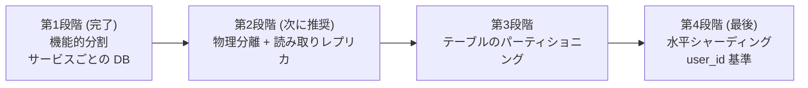

# PostgreSQL パーティショニング & シャーディング設計

**日本語** | [한국어](09-postgresql-partitioning-sharding.ko.md)

> 🕰️ **状態（2026-09-27）— 一部古い。** `ddl-auto` は `validate` に変更しました（[docs/20](20-schema-ownership.md)）。月次パーティションの自動作成は、pg_partman の代わりにアプリケーションのジョブで入れました（2026-09-27、[docs/62 §3](62-engineering-casebook.md)）。

> 作成日: 2026-07-25
> 対象: `userdb` / `productdb` / `metadb` / `cartdb` / `orderdb` / `paydb` / `coupondb`（+ chat）
> 参考: [liquidslr/system-design-notes](https://github.com/liquidslr/system-design-notes) — *Replication / Partitioning*, *Unique ID Generator in Distributed Systems*, *Key-Value Store(Consistent Hashing)*
> 関連: [アーキテクチャ・信頼性](03-architecture-and-reliability.md) ・ [catalog 検索の問題](06-catalog-search-issues.md)

## 0. なぜこの文書が必要なのか

[`docs/03`](03-architecture-and-reliability.md) はデータ層を「PostgreSQL のレプリケーション/failover」という**一行**だけで扱っており（§インフラの冗長化）、参考リポジトリの *Replication/Partitioning* の章を脚注に付けておきながら、**肝心のこのプロジェクトには適用していませんでした**。この文書がその空白を埋めます。

このプロジェクトにおいて、データ層は理論上の関心事ではありません。調査の結果、**削除ロジックがまったくない無限に増え続けるテーブルが少なくとも 10 個**あり、そのうち 4 個（Outbox）は Debezium CDC がリアルタイムで tailing している決済・注文の中核経路です。つまり現在の構造は、**時間が経てば必ず壊れる**状態です。

---

## 1. 現在の状態（As-Is）

### 1.1 すでにできていること: 機能的分割（Vertical / Functional Partitioning）

サービスごとに独立したデータベースを使っています。これはすでに**シャーディングの第 1 段階（機能的分割）**であり、MSA における正しい出発点です。

| DB | 所有サービス | スキーマ |
|---|---|---|
| `userdb` | user-service | `users` |
| `productdb` | catalog-service | `product` |
| `metadb` | catalog-service（Spring Batch メタデータ） | `BATCH_JOB_*` |
| `cartdb` | cart-service | `cart` |
| `orderdb` | order-service | `orders` |
| `paydb` | pay-service | `pay` |
| `coupondb` | coupon-service | `coupon` |
| (chat) | chat-service | `chat` + スキーマ未指定のテーブル |

### 1.2 できていないこと

| 項目 | 状態 |
|---|---|
| テーブルのパーティショニング（PostgreSQL declarative partitioning） | ❌ **皆無** |
| 水平シャーディング（同一テーブルを複数ノードに分散） | ❌ 皆無 |
| 読み取りレプリカ（read replica）/ 読み書き分離 | ❌ 皆無 |
| 物理的分離 | ❌ **8 個の DB がすべて単一インスタンス（`localhost:5435`）** |
| スキーママイグレーションツール | ❌ **皆無**（Hibernate の `ddl-auto` 単独） |
| データ保持（retention）/アーカイブのポリシー | ❌ 皆無 |

**要点**: 論理的には 8 個に分かれていますが、**物理的には 1 台の PostgreSQL** です。つまり buffer pool・WAL・CPU・ディスクを 8 つのサービスがすべて共有しており、この 1 台が落ちると全サービスが停止します（[`docs/03` F-8](03-architecture-and-reliability.md)）。

### 1.3 有利な条件 — PK が TSID である 🎉

調査中に見つけた最も重要な事実です。ほとんどのエンティティが `io.hypersistence:hypersistence-utils` の **`@Tsid`** を使っています（ルートの `build.gradle`）。

```java
@Id @Tsid private Long orderId;   // 64-bit、アプリケーションで生成、時間順(time-sorted)
```

TSID（Time-Sorted ID）は Snowflake 系の**アプリケーションで生成する 64 ビット整数**です。これがなぜ決定的かというと:

1. **DB シーケンスの調整が不要** → シャーディング時にノード間の ID 衝突が原理的に起こりません。参考リポジトリの *Unique ID Generator* の章が求める条件を**すでに満たして**います。
2. **時間順** → `order_id` の範囲条件がそのまま時間範囲の条件になるので、`created_at` で range パーティショニングしても、**`order_id` ベースのカーソルページネーションは依然としてパーティションプルーニングされます**（`OrderRepository.findByCustomerIdAndOrderIdLessThanOrderByOrderIdDesc`）。

**例外**: `catalog-service` だけは全エンティティが `IDENTITY`（DB シーケンス）であり、`users.notification`、`chat_room`、`participant_chat_room`、`alarm` も `IDENTITY` です。これらはシャーディングの対象から除外するか、先に TSID へ移行する必要があります。

---

## 2. 問題点

### PG-1. 削除ロジックのない無限に増え続けるテーブル 🔴

調査の結果、**どのテーブルにも整理（cleanup）バッチがありません。** 特に Outbox 4 種は状態を `STARTED → COMPLETED` に変えるだけで、**行を決して削除しません**（`PaymentOutboxScheduler` は `save()` しか呼び出さない）。

| テーブル | 性質 | リスク |
|---|---|---|
| `orders.payment_outbox_event` | append + status UPDATE、**CDC tailing** | 無限増加 + UPDATE による dead tuple の急増 |
| `pay.order_outbox_event` | 〃 | 〃 |
| `cart.outbox_event` | 〃 | 〃 |
| `users.outbox_event` | append-only | 無限増加 |
| `orders.orders` / `order_product` / `order_address` | append-only | 注文量に比例して恒久的に増加 |
| `pay.payment` | append-only | 〃 |
| `users.notification` | append-only | 〃 |
| `alarm` (chat) | append-only | 〃 |
| `users.review` / `review_style` | append-heavy | 〃 |
| `metadb` の `BATCH_JOB_*` | append-only | バッチ実行履歴が恒久的に蓄積 |

**影響**: インデックスの肥大化 → クエリ遅延の増加、autovacuum 負荷の増加、バックアップ/復旧時間の線形増加、ディスクの枯渇。Outbox は `INSERT` の後に `UPDATE` が続くため、**dead tuple の比率が特に高く**、bloat が加速します。

**パーティショニングが唯一すっきりした解決策である理由**: `DELETE FROM ... WHERE created_at < ?` は大量削除時にロック・WAL の急増・bloat を引き起こしますが、パーティションは `DROP PARTITION` 一回で **O(1) のメタデータ操作**で済みます。

### PG-2. スキーマを Hibernate が所有している 🔴（最大の前提条件）

全サービスが `ddl-auto: update`、catalog だけが `create-drop` であり、**Flyway/Liquibase も `.sql` ファイルもリポジトリに一つもありません。**

Hibernate のスキーマ生成器は **`PARTITION BY RANGE` を生成できません。** また `ddl-auto: update` は手で作ったパーティションテーブルを認識できず、最悪の場合、黙ってずれたスキーマを作ります。**パーティショニングのすべての話は、この問題を先に解決して初めて始まります。**

（さらに catalog の `create-drop` は再起動時にスキーマを丸ごと消し去ります — [`docs/06` CAT-15](06-catalog-search-issues.md)。）

### PG-3. パーティションキーを含まない UNIQUE 制約 🟠

PostgreSQL は**パーティションテーブルのすべての UNIQUE/PK 制約がパーティションキーを含む**ことを要求します。現在の制約のうち、これに違反するもの:

| 制約 | 場所 | パーティショニングへの影響 |
|---|---|---|
| `uk_order_trackingId(tracking_id)` | `orders.orders` | `created_at`/`customer_id` でのパーティショニングが**不可** |
| `UniqueOrderIdAndTrackingId(order_id, tracking_id)` | `pay.payment` | 〃 |
| UC `email`, UC `username` | `users.users` | user_id でシャーディングするとグローバルな一意性が崩れる |
| UC `email`/`username`/`nickname` | `orders.customer` | 〃 |
| UC `email`/`nickname` | `chat.member` | 〃 |
| `token unique` | `users.password_reset_token` | 照会キーが `user_id` と直交 |
| `uk_coupon_name_user_id(name, user_id)` | `coupon.coupon` | ✅ **`user_id` を含む → シャーディングしても安全** |

### PG-4. シャードキーのカラム自体がない子テーブル 🟠

水平シャーディングのテナントキーは事実上 `user_id` だけですが、肝心の子テーブルがそのカラムを持っていません。

| テーブル | 保有するキー | 欠落 |
|---|---|---|
| `orders.order_product` | `order_id` のみ | `customer_id` |
| `orders.order_address` | `order_id` のみ | `customer_id` |
| `cart.cart_product` | `cart_id` のみ | `user_id` |
| `users.review_style` | `rstyle_id` のみ | `user_id` |

→ 親と**コロケーション（co-location）**させるには、シャードキーを**非正規化で下ろしてくる**必要があります。シャーディング設計で最もよくあり、最後に発見されるほど最も高くつく問題です。

### PG-5. パーティションプルーニングを妨げるクエリ 🟠

- Outbox スケジューラーのホットなクエリ `findByOutboxStatus(STARTED)` — **status カラムにインデックスがないためフルスキャン**。パーティショニングすると**tick ごとに全パーティションをスキャン**することになり、かえって悪化します。→ 部分インデックスが必須。
- catalog の `SELECT DISTINCT` による全件照会、`~*` 正規表現の 3 重結合、`unnest(CAST(:ids AS BIGINT[]))` のサブクエリ — いずれもプルーニング不可（[`docs/06` CAT-14](06-catalog-search-issues.md)）。
- `password_reset_token` / `verfication_token` の `delete ... where expiry_date <= ?` — **非キーカラム基準の大量削除**。パーティショニングの代表的な適用対象。

### PG-6. Debezium CDC とパーティショニングの相互作用 🟠

`order-outbox-connector-postgresql.json` / `payment-outbox-connector-postgresql.json` は `plugin.name: pgoutput`、`table.include.list: public.<table>` を使っています。

1. **すでにスキーマが不一致**: コネクターは `public` を見ているのに、エンティティは `orders`/`pay` スキーマを宣言しています。
2. パーティションテーブルを論理レプリケーションの publication に入れる際、**`publish_via_partition_root = true`** を設定しないと、Debezium が**子パーティション単位のイベント**を出力し、`table.include.list` のマッチングが壊れます。
3. Outbox の行は `UPDATE`（状態変更）を受けるので **replica identity** が必要です → PK をなくす設計を選ぶと `REPLICA IDENTITY FULL`（高コスト）が強制されます。

### PG-7. 単一インスタンス = SPOF + 書き込みのボトルネック 🟠

8 個の DB が一つのインスタンスにあるため障害の隔離がまったくなく、読み取り負荷（カタログ照会）と書き込み負荷（注文/決済/Outbox）が同じ WAL・バッファを巡って競合します。コネクションプールの設定もないため、サービスごとに HikariCP のデフォルト値 10 個がそのまま掛け算されます。

---

## 3. 前提条件 — スキーマ所有権の移転

**パーティショニングの前に必ず先行させる必要があります。**

```gradle
// 各サービスの build.gradle
implementation 'org.flywaydb:flyway-core'
implementation 'org.flywaydb:flyway-database-postgresql'
```

```yaml
# application-common.yml (またはサービスごと)
spring:
  jpa:
    hibernate:
      ddl-auto: validate      # update/create-drop → validate
  flyway:
    enabled: true
    locations: classpath:db/migration
    baseline-on-migrate: true # すでにデータがある既存の DB に導入する場合
    baseline-version: 0
```

手順:
1. 本番 DB から現在のスキーマをダンプ: `pg_dump --schema-only -n orders orderdb > V1__baseline.sql`
2. `src/main/resources/db/migration/V1__baseline.sql` としてコミット
3. `ddl-auto: validate` に切り替えて起動し、**エンティティとスキーマが一致するかを検証**（不一致なら起動失敗 → 早期発見）
4. 以降、すべての DDL は `V2__...`、`V3__...` でのみ変更

> catalog-service は `create-drop` なので、この段階で**データ消失のリスクが先に取り除かれる**という副次効果があります。

### 3.1 適用状況（2026-07-27 反映）

P0/P1 がブランチに**実際に適用**されました:

| 項目 | 状態 |
|---|---|
| Flyway の依存関係（`flyway-core` + `flyway-database-postgresql`） | ✅ DB を使う 7 サービスの build.gradle に追加 |
| 共通の Flyway 設定（`baseline-on-migrate: true`、`baseline-version: 0`） | ✅ `application-common.yml` |
| catalog の `ddl-auto: create-drop` を除去 | ✅ `update` に切り替え（CAT-15 のデータ全損を解消） |
| Outbox 4 種のパーティショニングマイグレーション | ✅ `V1__partition_*.sql`（order/pay/cart/user） |
| catalog/coupon/chat のマイグレーション履歴を開始 | ✅ `V1__flyway_init.sql`（構造変更なし、V2 から実際の DDL） |

**原案と変わった点 — `ddl-auto` は当面 `update` を維持（validate ではない）。**
理由: `validate` では、全テーブルのベースラインスキーマがマイグレーションにないと空の DB で起動できません。実際の本番 DB なしで 35 個のテーブルのベースライン SQL を手で書くと、検証不能な不一致によって**すべての新規環境が起動に失敗**することになります。そこで過渡期の共存戦略を選びました:
- **Flyway が作ったパーティションテーブル**はカラム構成がエンティティと一致 → `ddl-auto: update` はすでにあるテーブルに手を触れないので、安全に共存します。
  （⚠️ 訂正: インデックス名を `@Index` と同じにしても、Hibernate は**再作成を試み、失敗を WARN として残します** — 起動に支障はありませんが、元の記述は不正確でした。実際の起動ログで確認: [docs/14 B-5](14-boot-test-findings.md)）
- **PK は DB では `(id, created_at)` の複合キー**ですが、JPA エンティティは `@Id String id` を維持します。Hibernate の validate/ランタイムは PK の構成を検査せず、id が UUID なので単独照会での一意性が実質的に保証されるため、`@EmbeddedId` への切り替え（§4.2 オプション A）なしで動作します。`findById` がパーティション全体の PK インデックスをスキャンするコストは、パーティション数が少ないうちは無視できます。
- `validate` への切り替えは §3 の手順どおり、**本番 DB から `pg_dump` でベースラインを取った後に**進めます（その時点でこれらの V1 はすでに履歴にあるので、そのまま維持）。

> ⚠️ **パーティションキーのタイムゾーンは必ず統一する必要があります。** Outbox エンティティが `created_at` を
> `LocalDateTime.now(ZoneId.of("Asia/Seoul"))` でハードコードしていたため、他のカラム（JPA 監査 = JVM のデフォルトクロック）と
> **9 時間ずれた値がパーティションキーに入っていました**。その状態では毎月末の 9 時間分のイベントが
> **翌月のパーティションに保存**され、保持ポリシー（`DETACH`/`DROP`）が見当違いの行に触れてしまいます。
> 4 つのサービス（pay・order・cart・user）を `LocalDateTime.now()` に統一して修正しました（[docs/16 B-21](16-saga-e2e-and-observability-verification.md)）。
> **本番では JVM と DB の両方を UTC に合わせることを前提とします** — パーティションの境界がデプロイ環境のローカルタイムゾーンに
> よって変わってはなりません。

**検証 — 実際の PostgreSQL 16.13 で実行を確認。** 検証環境に一時的なクラスターを立ち上げ、4 つのマイグレーションを 2 つの経路で実行しました:
1. **空の DB**: 4 つすべて成功 — パーティション親 + 月次パーティション 7 個 + DEFAULT + インデックス 2 種の作成を確認。
2. **既存テーブル + データ**（Hibernate が生成したスキーマのシミュレーション）: データ移行に成功 — 過去の行（2025-11）は DEFAULT パーティションへ、現在の行は `2026_07` パーティションへルーティング、元テーブルは `*_legacy` として保存、新規 INSERT は当月のパーティションへ正常にルーティング。
3. `findByOutboxStatus('STARTED')` のプランが**部分インデックス**（`idx_*_started`）を使うことを EXPLAIN で確認。

また、Gradle のコンパイル（catalog/order/pay/cart/user）が **BUILD SUCCESSFUL** — Flyway の依存関係追加と既存の catalog の Java 修正が併せて検証されました。

**本番反映時に残る手順**（マイグレーションスクリプト末尾のコメントにも記載）:
- リレー/CDC の正常動作を確認した後、`*_legacy` テーブルを DROP。
- Debezium の publication が `dbz_publication` ではなくカスタム名であれば `publish_via_partition_root=true` を手動で適用し、コネクターの `table.include.list` の `public.*` スキーマ不一致（PG-6）を修正。
- ~~月次パーティションの自動作成（`pg_partman`）の導入 — 現在は 2027-01 まで事前作成 + DEFAULT の安全網。~~ → ✅ アプリケーションのジョブ（common `OutboxPartitionAutoConfiguration`）で解決 — マネージド PostgreSQL では拡張が使えないことがあるため、拡張なしで実装した（[docs/62 §3](62-engineering-casebook.md)）。

---

## 4. パーティショニング設計

### 4.1 テーブルごとの戦略

原則: **なぜパーティショニングするのか**でキーを決めます。目的が*保持/削除*なら時間 RANGE、*分散*なら HASH です。

| テーブル | 戦略 | キー | 周期 | 目的 |
|---|---|---|---|---|
| `orders.payment_outbox_event` | RANGE | `created_at` | **日または週** | 保持期間が短い（数時間〜数日）→ `DROP` で整理 |
| `pay.order_outbox_event` | RANGE | `created_at` | 日/週 | 〃 |
| `cart.outbox_event` | RANGE | `created_at` | 日/週 | 〃 |
| `users.outbox_event` | RANGE | `created_at` | 日/週 | 〃 |
| `orders.orders` | RANGE | `created_at` | **月** | 無限増加の抑制 + コールドデータのアーカイブ |
| `orders.order_product` | RANGE | `created_at` | 月 | 親と同じ境界でコロケーション |
| `orders.order_address` | RANGE | `created_at` | 月 | 〃 |
| `pay.payment` | RANGE | `created_at` | 月 | 〃 |
| `users.notification` | RANGE | `created_at` | 月 | 古い通知の破棄 |
| `alarm` (chat) | RANGE | `reg_date` | 月 | 〃 |
| `users.password_reset_token` | RANGE | `expiry_date` | **日** | `DELETE ... WHERE expiry<=?` → `DROP PARTITION` で代替 |
| `users.verfication_token` | RANGE | `expiry_date` | 日 | 〃 |
| `users.review` / `review_style` | RANGE | `created_at` | 月 | 増加の抑制（優先度は低い） |
| `coupon.coupon` | RANGE | `end_date` | 月 | 期限切れクーポンの一括整理 |
| `metadb` `BATCH_JOB_*` | — | — | — | パーティショニングの代わりに**保持バッチ**で整理 |
| `cart.cart` / `cart_product` | ❌ しない | — | — | ユーザーごとに 1 件、UPDATE/DELETE の循環 → **パーティショニングより autovacuum のチューニングが答え** |
| catalog の全テーブル | ❌ しない | — | — | 商品 250 件程度の**有限**なデータ。パーティショニングは純損失 |
| `users.users`, `orders.customer`, `chat.member` | ❌ しない（現段階） | — | — | 有限の増加。シャーディングの段階で再検討 |

> **中核となる判断**: 今このプロジェクトでパーティショニングが必要な理由は、「データが大きいから」ではなく**「消す方法がないから」**です。だから Outbox が最優先です。

### 4.2 PK 制約の扱い — アプリケーションに及ぶ唯一の実質的な変更

PostgreSQL のルール: *"unique constraint on partitioned table must include all partitioning columns"*。

Outbox の PK は `id varchar`（ランダム UUID）なのに、パーティションキーは `created_at` なので、**PK を複合キーに変える必要が**あります。

**オプション A（推奨）— 複合 PK**

```sql
PRIMARY KEY (id, created_at)
```

JPA 側の変更:

```java
@Embeddable
public class OutboxEventId implements Serializable {
    private String id;
    private LocalDateTime createdAt;
    // equals/hashCode 必須
}

@Entity @Table(schema = "orders", name = "payment_outbox_event")
public class PaymentOutboxEvent {
    @EmbeddedId private OutboxEventId id;
    ...
}
// リポジトリ: CrudRepository<PaymentOutboxEvent, String> → <PaymentOutboxEvent, OutboxEventId>
```
影響するファイル: `PaymentOutboxRepository`、`OrderOutboxRepository`、`OutboxEventRepository`（cart/user）および各 `OutboxHelper`。

**オプション B — PK の削除**: `@Id` は JPA のマッピング用にだけ置き、DB には PK を作らない方法も可能で、アプリの変更はありません。ただし **Debezium が UPDATE を複製するには replica identity が必要**なので、`REPLICA IDENTITY FULL`（すべてのカラムを WAL に記録 = 高コスト）が強制されます。→ **Outbox には非推奨**、CDC の対象ではない `notification`/`alarm` には使用可能。

`orders.orders` の `uk_order_trackingId` のように**グローバルな一意性が業務上必要な**場合:

```sql
-- パーティションテーブルでは UNIQUE(tracking_id) を張れないので、
-- 小さなグローバルレジストリテーブルで一意性 + パーティションルーティングを同時に解決
CREATE TABLE orders.tracking_registry (
    tracking_id varchar(255) PRIMARY KEY,
    order_id    bigint       NOT NULL,
    created_at  timestamp    NOT NULL     -- どのパーティションかを教えてくれる → プルーニング可能
);
```
`findByTrackingId` はまずレジストリを照会して `created_at` を取得し、その値を条件に入れて本テーブルを照会すれば、**単一のパーティションだけ**を読みます。`pay.payment` の `UniqueOrderIdAndTrackingId` も同じパターン。

### 4.3 DDL の例 — Outbox（最優先）

```sql
-- V2__partition_payment_outbox.sql
BEGIN;

-- 1) パーティションの親テーブルを作成 (既存テーブルはまだ維持)
CREATE TABLE orders.payment_outbox_event_p (
    id             varchar(36)  NOT NULL,
    aggregate_id   varchar(255) NOT NULL,
    aggregate_type varchar(255) NOT NULL,
    event_type     varchar(255) NOT NULL,
    payload        jsonb        NOT NULL,
    outbox_status  varchar(32),
    created_at     timestamp    NOT NULL,
    PRIMARY KEY (id, created_at)          -- パーティションキーを含めることが必須
) PARTITION BY RANGE (created_at);

-- 2) スケジューラーのホットなクエリ(findByOutboxStatus)用の部分インデックス。
--    STARTED の行だけをインデックスするので、COMPLETED がどれだけ溜まってもインデックスは小さく保たれます。
CREATE INDEX idx_payment_outbox_started
    ON orders.payment_outbox_event_p (created_at)
    WHERE outbox_status = 'STARTED';

CREATE INDEX idx_payment_outbox_aggregate
    ON orders.payment_outbox_event_p (aggregate_id, aggregate_type, event_type);

-- 3) パーティションの作成 (例: 日単位)
CREATE TABLE orders.payment_outbox_event_2026_07_25
    PARTITION OF orders.payment_outbox_event_p
    FOR VALUES FROM ('2026-07-25') TO ('2026-07-26');
-- ... 未来のパーティションを数日分事前に作成 (下記の pg_partman で自動化)

-- 4) 境界外のデータで INSERT が失敗する事故を防ぐ安全網
CREATE TABLE orders.payment_outbox_event_default
    PARTITION OF orders.payment_outbox_event_p DEFAULT;

COMMIT;
```

**無停止での切り替え**（既存テーブル → パーティションテーブル）:

```sql
-- 過去データの移行 (バッチに分けて実行することを推奨)
INSERT INTO orders.payment_outbox_event_p
SELECT id, aggregate_id, aggregate_type, event_type,
       payload, outbox_status, created_at
FROM   orders.payment_outbox_event;

-- アトミックな置き換え (短い ACCESS EXCLUSIVE ロック)
BEGIN;
ALTER TABLE orders.payment_outbox_event   RENAME TO payment_outbox_event_old;
ALTER TABLE orders.payment_outbox_event_p RENAME TO payment_outbox_event;
COMMIT;

-- 検証後
DROP TABLE orders.payment_outbox_event_old;
```

> Outbox の**保持期間が短い**という性質を利用すれば、より安全な方法もあります: 新しいパーティションテーブルを作って**新規の書き込みだけをそちらに送り**、旧テーブルはリレーが残りをすべて処理した後（数分〜数時間）に丸ごと `DROP` します。過去データの移行そのものが不要です。

### 4.4 DDL の例 — orders（第 2 優先）

```sql
CREATE TABLE orders.orders_p (
    order_id      bigint    NOT NULL,     -- TSID
    customer_id   bigint    NOT NULL,
    tracking_id   varchar(255) NOT NULL,
    created_at    timestamp NOT NULL,
    -- ... 残りのカラム
    PRIMARY KEY (order_id, created_at)
) PARTITION BY RANGE (created_at);

CREATE TABLE orders.orders_2026_07 PARTITION OF orders.orders_p
    FOR VALUES FROM ('2026-07-01') TO ('2026-08-01');

-- 注文照会の支配的なパターン: 「自分の注文一覧」
CREATE INDEX idx_orders_customer ON orders.orders_p (customer_id, order_id DESC);
```

`OrderRepository.findByCustomerIdAndOrderIdLessThanOrderByOrderIdDesc`（カーソルページネーション）は、**`order_id` が TSID（時間順）なので** `order_id < cursor` が事実上の時間の上限となり、オプティマイザーが古いパーティションを読み飛ばせます。TSID の採用がここで配当を返してくれます。

### 4.5 ロックなしでインデックスを作る

パーティションテーブルにインデックスを作るとき、親に直接張ると全体がロックされます。無停止の方法:

```sql
CREATE INDEX idx_foo ON ONLY orders.orders_p (customer_id);          -- 親には「無効」なインデックスだけ
CREATE INDEX CONCURRENTLY idx_foo_2026_07 ON orders.orders_2026_07 (customer_id);
ALTER INDEX idx_foo ATTACH PARTITION idx_foo_2026_07;                -- 全パーティションを attach すると自動で有効化
```

### 4.6 保持（retention）の自動化

```sql
-- PG 14+ : ロックをほとんど取らずに切り離す
ALTER TABLE orders.payment_outbox_event
    DETACH PARTITION orders.payment_outbox_event_2026_06_25 CONCURRENTLY;
DROP TABLE orders.payment_outbox_event_2026_06_25;
```

> **二つの段階の間で止まると**、切り離された同じ名前のテーブルが残ります。将来のパーティションを作るジョブ(`common` の `OutboxPartitionMaintainer`)はその名前を「その月がある」とは見なしません — 親に付いたパーティションだけを数えます。付けも消しもせずにその点検を失敗として残すので(`last_success` アラート・減っていく `months_ahead`)、人がそのテーブルを確かめて `ATTACH` するか名前を変えるか削除すれば、次の周期に続きを作ります。ジョブの DDL はロックを 3 秒までしか待ちません(`lock_timeout`) — バックアップ(pg_dump)が DEFAULT を握っていると `ATTACH` がロック待ちの列に並んで後ろの INSERT まで止める代わりに、失敗して 6 時間後にやり直します。

> 🐛 **cart・order ではこのジョブが一度も動いていませんでした(2026-10-14 発見)。** 二つのアプリ(と chat)は `com.project.common` を `@ComponentScan` で直接スキャンしますが、`@SpringBootApplication` が既定で掛ける `AutoConfigurationExcludeFilter` が抜けており、この自動設定がユーザー設定としてスキャンされ、条件(`@ConditionalOnBean(DataSource)`)が DataSource より先に評価されて丸ごと外れていました。pay・user はスキャンしないので正常でした。V1 が 2027-01 まで作ってあるので、まだ DEFAULT に入った行はありません。修正版をデプロイした後、`kubectl -n ecommerce logs deploy/order-service | grep "아웃박스 파티션"` に `아웃박스 파티션 잡: tables=[orders.payment_outbox_event]` と(30 秒後)`아웃박스 파티션 점검` が出るか確認します — cart も同じです(`OutboxPartitionComponentScanTest`)。

パーティションの作成/削除は **`pg_partman`** で自動化することを推奨します（手動運用では「未来のパーティションを作り忘れて INSERT 失敗」が代表的な障害パターンです — 4.3 の DEFAULT パーティションがその安全網）。

```sql
SELECT partman.create_parent(
    p_parent_table := 'orders.payment_outbox_event',
    p_control      := 'created_at',
    p_interval     := '1 day',
    p_premake      := 7               -- 7 日分を事前に作成
);
UPDATE partman.part_config
   SET retention = '7 days', retention_keep_table = false
 WHERE parent_table = 'orders.payment_outbox_event';
```

### 4.7 Debezium 連携時の必須設定

```sql
ALTER PUBLICATION dbz_publication SET (publish_via_partition_root = true);
```
そして、コネクターの `table.include.list` を実際のスキーマに合わせて修正する必要があります（現在は `public.*` と誤って指定されている — PG-6）。

### 4.8 パーティショニングのコスト（やるべきでない場所）

パーティショニングはタダではありません。
- パーティションキーを条件に入れないクエリは**全パーティションをスキャン**（かえって遅くなる）
- パーティション数が多くなると**プランニング時間**とロック対象が増加（数千個は避ける）
- パーティション間の結合/集計は `enable_partitionwise_join`/`_aggregate` を有効にしないと非効率（デフォルトは off）
- コネクションごとのメモリ・ロックのオーバーヘッドが増加

→ そのため、上の表で `cart`、catalog の全テーブルを**意図的に除外**しました。これらはパーティショニングより **autovacuum のチューニング**（`autovacuum_vacuum_scale_factor` をテーブル単位で下げる）が正解です。

---

## 5. シャーディング設計

### 5.1 段階的なアプローチ — 必要なときだけ次の段階へ



> **水平シャーディングは最後の手段です。** 運用の複雑さが急増するため、単一ノードの垂直スケール・読み取りレプリカ・パーティショニングで解決できる間は進まないのが正しい判断です。現在のこのプロジェクトのデータ規模（商品 250 件程度）で**今すぐ必要なのは第 4 段階ではなく第 2〜3 段階**です。

### 5.2 第 2 段階: 物理分離 + 読み取りレプリカ

最も費用対効果が高いものです。
1. **インスタンスの分離**: 少なくとも `orderdb`+`paydb`（書き込みの中核）と `productdb`（読み取りの中核）を別のインスタンスに分離 → 障害の隔離 + リソース競合の解消。
2. **ストリーミングレプリケーション + 自動 failover**: Patroni または CloudNativePG（k8s 環境なら後者が自然です — [`k8s/`](../k8s/README.md) を参照）。
3. **読み書きの分離**: カタログ照会、注文履歴の照会などをレプリカにルーティング。
   ```java
   // 書き込みトランザクションと分離してレプリカにルーティング
   @Transactional(readOnly = true)  // + AbstractRoutingDataSource
   ```
   ⚠️ **レプリケーション遅延（replication lag）**に注意: 注文作成直後の照会をレプリカに送ると、「今作った注文がない」ことになります。**read-your-writes が必要な経路は必ずプライマリに**送る必要があります。

### 5.3 第 4 段階: 水平シャーディング — シャードキーの分析

唯一成立するテナントキーは **`user_id` / `customer_id`** です。

| サービス | シャードキー | 難易度 | 備考 |
|---|---|---|---|
| coupon | `user_id` | 🟢 **易しい** | UC がすでに `user_id` を含む、テーブル 1 個、FK なし |
| cart | `user_id` | 🟡 中程度 | `cart_product` に `user_id` の非正規化が必要 |
| order | `customer_id` | 🔴 難しい | `order_product`/`order_address` への非正規化 + `tracking_id` のグローバルな一意性 |
| pay | `customer_id` | 🔴 難しい | `UniqueOrderIdAndTrackingId` の扱いが必要 |
| user | `user_id` | 🔴 難しい | email/username のグローバルな一意性 → ディレクトリテーブルが必要 |
| catalog | ❌ シャーディングしない | — | 有限・読み取り中心・ES が前面。**レプリカで十分**。IDENTITY PK なのでシャーディングに不向き |
| chat | ❌（Postgres 部分） | — | メッセージは MongoDB にある → **Mongo のシャーディング**が対象 |

### 5.4 グローバルな一意性の解決 — ディレクトリテーブル

`users.users` の `email` の UNIQUE は、シャーディングすると崩れます。標準的な解決策は**小さなグローバルディレクトリ**です。

```sql
-- シャーディングされない別ノード(またはすべてのシャードに複製される reference table)
CREATE TABLE user_directory (
    email    varchar(255) PRIMARY KEY,   -- グローバルな一意性を保証
    user_id  bigint       NOT NULL,
    shard_id smallint     NOT NULL       -- ルーティング情報
);
```
ログイン（`findByEmail`）はディレクトリを 1 回照会 → シャードを確定 → 該当シャードでユーザーを照会。`orders.customer`、`chat.member` の email の UC も同じ方式。

### 5.5 実装手段の比較

| 方式 | 長所 | 短所 | 適合度 |
|---|---|---|---|
| **Citus**（PG 拡張） | `create_distributed_table(...)` の宣言だけで分散、PG の文法・トランザクションを維持、`reference table` で小さなマスターを複製 | 拡張のインストールが必要、一部のクエリに制約、分散カラムが UC に含まれている必要がある（パーティショニングと同じ制約） | ⭐ **推奨** — アプリの変更が最小 |
| **ShardingSphere-JDBC** | アプリレベル、インフラ変更なし | 設定が複雑、JPA/QueryDSL との相互作用の検証が必要 | 代替案 |
| **AbstractRoutingDataSource を直接実装** | 依存関係なし、完全に制御可能 | クロスシャードの照会・トランザクションをすべて自前で実装 | 非推奨（車輪の再発明） |

### 5.6 シャーディングが既存の設計と交わるポイント

**良い知らせ**: このプロジェクトはすでに **Saga + Outbox** でサービス間の分散トランザクションを回避しています（[`docs/03` §2.2](03-architecture-and-reliability.md)）。シャーディング導入時の最大の難題である「クロスシャード 2PC」が**構造的にすでに存在しません。**

**注意すべき点**:
- **Outbox リレーがシャードごとに動く必要があります。** `PaymentOutboxScheduler` は単一の DB をポーリングするように書かれているため、シャードごとの実行 + リーダー選出（重複発行の防止）が必要です。
- **Debezium のコネクターもシャードの数だけ**必要です。
- 管理者向けの全体集計（売上統計など）はクロスシャード → **分析は別の OLAP/データウェアハウスに分離**するのが定石です。

---

## 6. マイグレーションのロードマップ

| 段階 | 内容 | リスク | 前提 |
|---|---|---|---|
| **P0** | ✅ **適用済み（§3.1）** — Flyway の導入、catalog の `create-drop` を除去。（`validate` への切り替えだけは本番の pg_dump 後に実施） | 中 | — |
| **P1** | ✅ **適用済み（§3.1）** — Outbox 4 種のパーティショニング（月単位）+ 部分インデックス。（`pg_partman` による自動化は本番反映時） | 低 | P0 |
| **P1.5** | トークンテーブル 2 種（`expiry_date`）のパーティショニング、`metadb` のバッチ履歴の保持バッチ | 低 | P0 |
| **P2** | 物理インスタンスの分離 + ストリーミングレプリケーション + 自動 failover | 中 | —（P0 とは無関係、並行可能） |
| **P3** | 読み取りレプリカへのルーティング（カタログ/注文履歴）。read-your-writes の経路を特定 | 中 | P2 |
| **P4** | `orders`/`order_product`/`order_address`/`payment` の月単位パーティショニング + `tracking_registry` | 高 | P0、P1 の経験 |
| **P5** | （必要なら）水平シャーディング。coupon → cart → order/pay の順、Citus を優先的に検討 | 非常に高 | P4 + シャードキーの非正規化 |

**P1 を最初の段階に置く理由**: Outbox は (a) 保持期間が短く移行なしで切り替え可能、(b) 無限増加がすでに進行中の実質的なリスク、(c) 失敗しても影響範囲がリレーに限定されるため、**最も安全にパーティショニングの運用経験を積める**テーブルです。

---

## 7. 障害シナリオの補強（[`docs/03`](03-architecture-and-reliability.md) F-8 の拡張）

| # | シナリオ | トリガー → 影響 | 対応 |
|---|---|---|---|
| **F-10** | Outbox の無限増加によるディスクの枯渇 | 整理バッチの不在 → テーブル・インデックスの無限増加 → **DB インスタンス全体が書き込み不能**（8 個の DB を共有しているので全サービスが停止） | 即時: 古い `COMPLETED` を手動で削除 + `VACUUM FULL`（ロックに注意）。根本: P1 のパーティショニング + 保持 |
| **F-11** | 未来のパーティションが未作成で INSERT が失敗 | `pg_partman` の停止/手動運用での漏れ → 境界外の `INSERT` が**エラー** → 注文/決済の作成失敗 | 予防: DEFAULT パーティション + premake の余裕 +「次のパーティションが存在するか」の監視アラート |
| **F-12** | パーティションプルーニングの失敗による性能の急落 | パーティションキーのないクエリ（例: `findByOutboxStatus`）→ 全パーティションのスキャン | 予防: 部分インデックス、クエリに時間条件を強制、`EXPLAIN` でプルーニングを検証 |
| **F-13** | レプリケーション遅延による read-your-writes 違反 | 注文直後の照会がレプリカへ →「注文がない」 | 予防: 書き込み直後の経路はプライマリに固定、`pg_stat_replication` の遅延アラート |
| **F-14** | シャードの不均衡（hot shard） | 特定のユーザー/テナントへの偏り → 一つのシャードだけが飽和 | 予防: ハッシュ分散 + シャードごとの指標の監視、リバランスの計画 |

## 8. 監視指標の追加

| 指標 | クエリ/ソース | アラート基準 |
|---|---|---|
| テーブル・インデックスのサイズ増加率 | `pg_total_relation_size()` | 週間増加率の急変 |
| dead tuple の比率 | `pg_stat_user_tables.n_dead_tup` | 20% 超過 |
| Outbox の `STARTED` の滞留 | `count(*) where outbox_status='STARTED'` | N 件が M 分継続（[`docs/03`](03-architecture-and-reliability.md)） |
| 次のパーティションの有無 | `pg_class`/`partman.part_config` | 余裕のあるパーティション < 2 |
| レプリケーション遅延 | `pg_stat_replication.replay_lag` | 閾値超過 |
| autovacuum の実行履歴 | `pg_stat_user_tables.last_autovacuum` | 長時間未実行 |

---

## 9. まとめ — 今すぐやるべきこと

1. **Flyway の導入 + `ddl-auto: validate`** — これなしでは何も始められません（P0）。
2. **Outbox 4 種を日単位の RANGE パーティショニング + 保持ポリシー** — 現在進行中の実質的なリスクを取り除きます（P1）。
3. **PostgreSQL の物理分離 + レプリケーション** — SPOF の除去（P2）。

水平シャーディングは**今は必要ありません**。ただし、その時が来たときに高くつかないよう、今のうちにやっておけることがあります:
- 子テーブルにシャードキー（`user_id`/`customer_id`）の**非正規化カラムを事前に追加**しておく（PG-4）
- catalog の `IDENTITY` を TSID に移行することを検討
- 新しい UNIQUE 制約を作るときは、**常にテナントキーを含める**（coupon が良い例）
