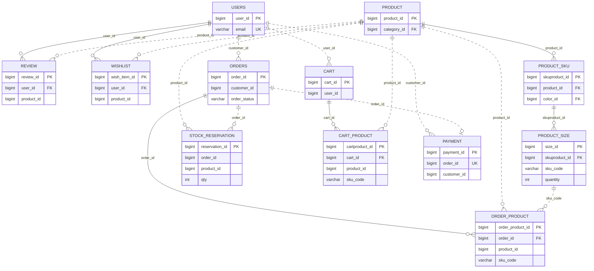
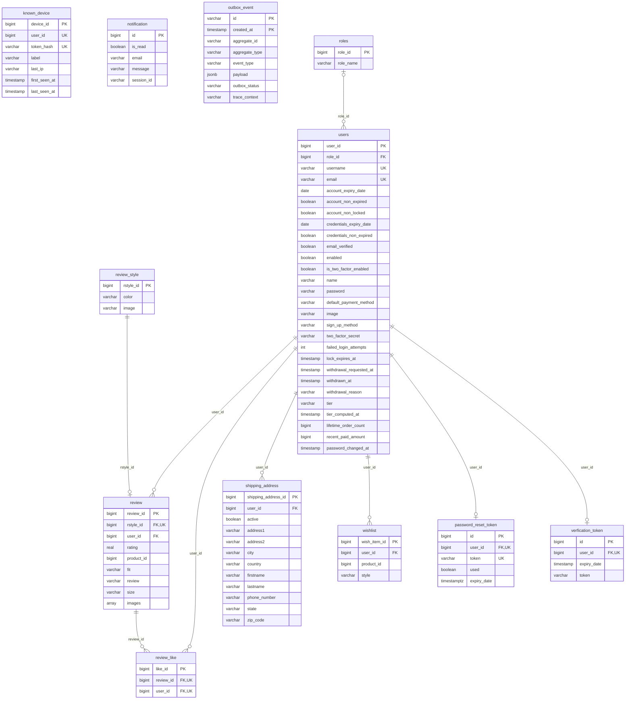
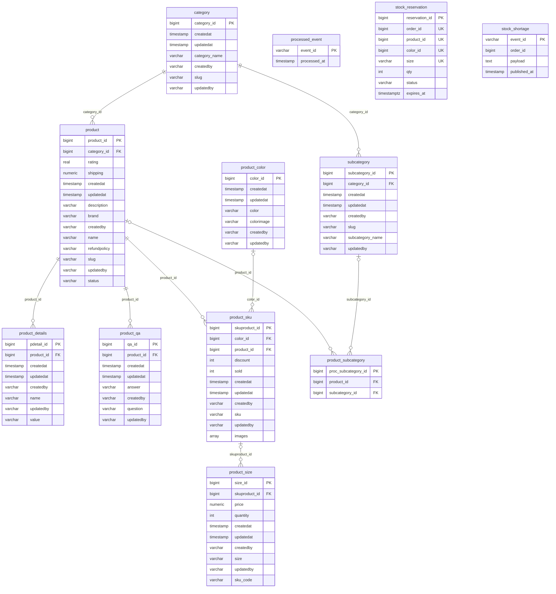
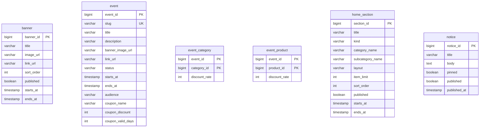
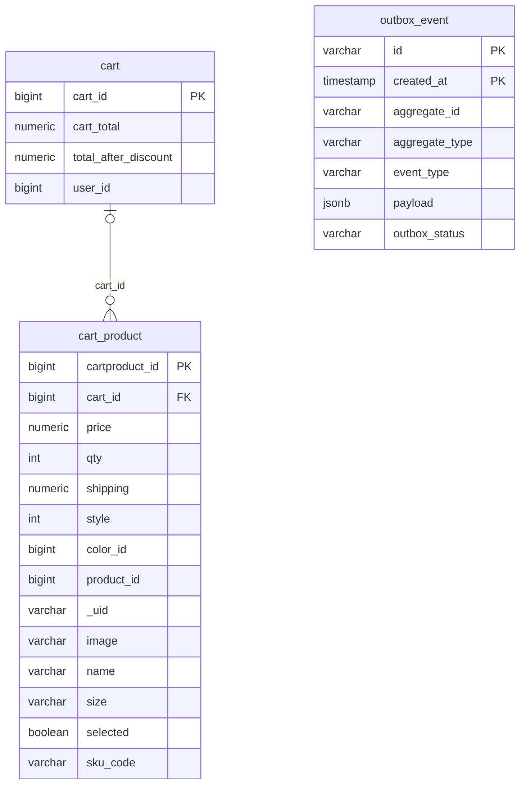
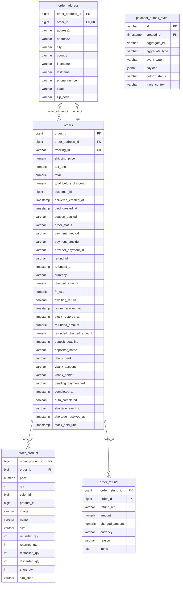
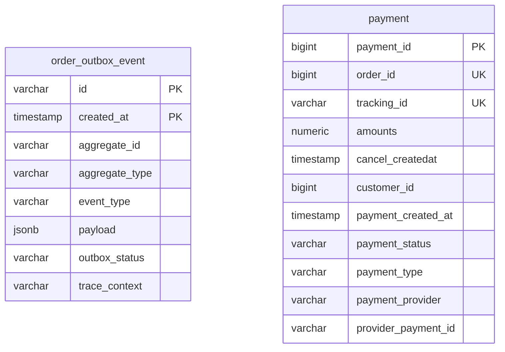
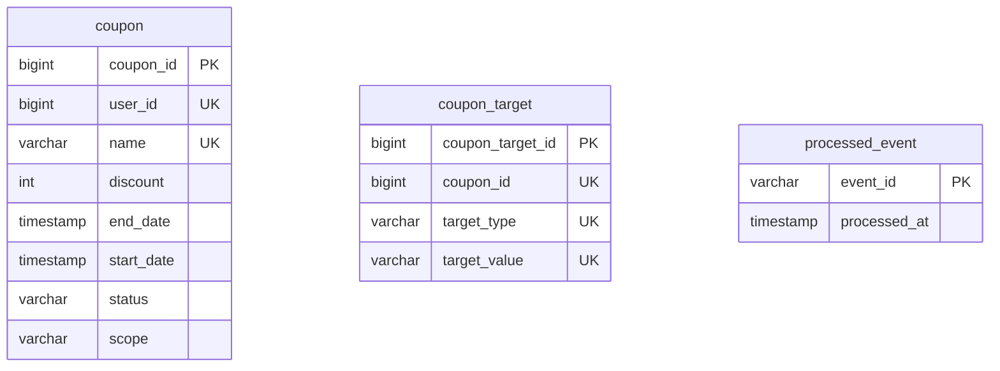

# 69. ERD — 실제 스키마

[日本語](69-erd.md) | **한국어**

> 작성일: 2026-09-28 · 상태: ✅ · **서비스별 그림은 마이그레이션에서 자동 생성**(`ops/tools/gen-erd.py`)
>
> 관련: [55 무중단 전환](55-zero-downtime-migrations.ko.md) · [65 사이즈 단위 SKU](65-size-level-sku.ko.md) · [59 결제 전 재고 예약](59-stock-reservation.ko.md)

## 0. 왜 다시 그렸나

README 의 ERD 는 GitHub 에 올린 **이미지 첨부 한 장**(user-attachments)이었다.

- **저장소 밖에 있다** — 첨부가 사라지거나 볼 권한이 어긋나면 깨지고, 저장소에서는 고칠 방법이 없다.
- **2024년 그림이다** — 그 뒤의 스키마(TSID · 아웃박스 월 파티션 · 재고 예약 · 사이즈 단위 SKU · 환불 · 무통장)가 없다.

이제 서비스별 그림은 Flyway 마이그레이션을 **실제로 적용한 PostgreSQL** 에서 뽑는다(손으로 그리지 않는다). GitHub 가 Mermaid 를 그대로 그린다.

```bash
python3 ops/tools/gen-erd.py          # 아래 서비스별 구간을 새로 쓴다(Docker 필요)
python3 ops/tools/gen-erd.py --check  # 문서가 스키마와 다르면 실패
```

**읽는 법** — 실선은 같은 DB 안의 **FK**, 점선은 서비스 사이의 **논리 참조**(DB 가 달라 FK 가 없다 — 정합성은 사가 · 아웃박스 · 대사 배치가 맞춘다).
공통 감사 컬럼(`created_at/by` · `updated_at/by` · `version`), 아웃박스 월 파티션, Spring Batch 메타 표는 생략했다.

## 1. 개요 — 서비스 사이의 참조(손으로 관리)



- 서비스마다 DB 가 따로다(database-per-service). 다른 서비스의 행을 FK 로 묶지 않고 **id 만** 들고 있다.
- `order_product.sku_code` 는 catalog 의 `product_size.sku_code` 를 주문 시점에 복사한 값이다 — 원본이 바뀌어도 주문 기록은 그대로다(docs/65).
- `stock_reservation` 은 catalog DB 에 있지만 order 의 `order_id` 를 든다 — 결제 전 재고를 잡아 두는 표다(docs/59).

## 2. 서비스별(자동 생성)

### 2.1 user-service (`users`)

회원 · 역할 · 배송지 · 리뷰 · 위시리스트 · 알려진 기기 · 아웃박스.

<!-- erd:user -->

<!-- /erd:user -->

### 2.2 catalog-service — 상품 (`product`)

카테고리 · 상품 · 색상(SKU) · 사이즈(재고 · sku_code) · 재고 예약 · 부족 기록 · 멱등 처리.

<!-- erd:catalog-product -->

<!-- /erd:catalog-product -->

### 2.3 catalog-service — 콘텐츠 (`content`)

배너 · 기획전 · 홈 섹션 · 공지. 상품과는 id 로만 잇는다.

<!-- erd:catalog-content -->

<!-- /erd:catalog-content -->

### 2.4 cart-service (`cart`)

<!-- erd:cart -->

<!-- /erd:cart -->

### 2.5 order-service (`orders`)

주문 · 배송지 · 품목(환불 · 반품 · 부족 수량) · 환불 기록 · 결제 아웃박스.

<!-- erd:order -->

<!-- /erd:order -->

### 2.6 pay-service (`pay`)

<!-- erd:pay -->

<!-- /erd:pay -->

### 2.7 coupon-service (`coupon`)

<!-- erd:coupon -->

<!-- /erd:coupon -->

