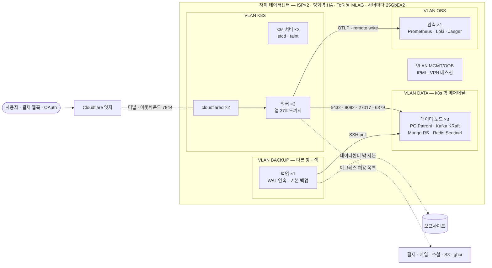
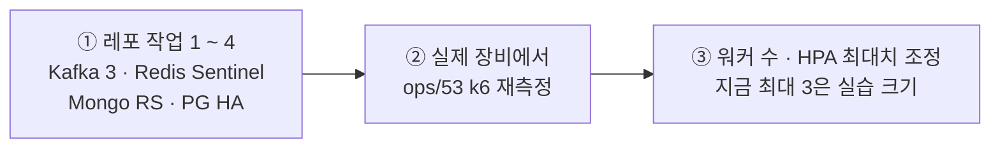

# 86. 자체 데이터센터 운영 — 하드웨어 · 네트워크 구성안

[日本語](86-self-hosted-datacenter.md) | **한국어** · 🖼️ 보기 좋은 페이지판(랙 배치도 · 망 구성도): [86-self-hosted-datacenter.ko.html](86-self-hosted-datacenter.ko.html) — 내려받아 브라우저로 엽니다(GitHub 는 HTML 을 소스로 보여 준다)

> 📝 **상태(2026-11-01) — 판단 자료, 결정 아님.** "자체 데이터센터에서 ecommerce-msa 를 운영하려면 하드웨어 · 네트워크를 어떻게 구성해야 하나" 에 대한 답을 레포(2026-10-26 `8ebcc934` 기준 조사, 2026-11-01 `50ef7995` 에서 근거 다시 확인)에서 끌어낸 것입니다. 장비를 사기 전에 §3 의 레포 작업과 실제 장비에서의 재측정이 먼저입니다.

## 한눈에

| | 권장 | 한 줄 이유 |
|---|---|---|
| 🖥️ 서버 | **약 12대** — k3s 서버 3 · 워커 3 · 데이터 3 · 관측 1 · 백업 1 · (CI 1) | 컨트롤 플레인 · 앱 · 데이터 어느 한 대가 죽어도 선다 |
| 🗄️ 데이터 계층 | **k8s 밖 베어메탈** — PG(Patroni) · Kafka(KRaft 3) · Mongo(레플리카 셋) · Redis(Sentinel) | 관리형이 없다 — 이중화를 직접. `external` 오버레이라 코드는 그대로 |
| 🌐 외부 진입 | **Cloudflare Tunnel 유지** | 인바운드 포트 0 · 공인 IP · DMZ 불필요. 빼면 코드도 바꿔야 한다 |
| 🧱 내부망 | **VLAN 다섯**(MGMT · K8S · DATA · OBS · BACKUP) + 경계 방화벽 | 레포의 NetworkPolicy 는 이그레스가 열려 있다 |
| 💾 백업 | **WAL 을 다른 장비로 연속 전송** + 데이터센터 밖 사본 | RPO 5분 — 지금은 같은 볼륨에 쌓인다 |
| ⚠️ 먼저 할 일 | **레포 작업 1 ~ 4**(Kafka 3 · Redis Sentinel · Mongo RS · PG HA) → 실제 장비에서 k6 재측정 | 하드웨어로는 풀리지 않는다(§3) |

**목차** — [0. 전제](#0-전제) · [1. 하드웨어](#1-하드웨어--권장-시작-구성서버-약-12대) · [2. 네트워크](#2-네트워크) · [3. 레포에서 먼저](#3-하드웨어로-풀리지-않는-것--레포에서-먼저)

## 0. 전제

- **레포에는 SLO · 목표 트래픽이 없습니다.** 아래 크기는 레포의 실측에서 추정한 **출발점**입니다.
- **실측은 데스크톱 한 대에서 VM 이 CPU 를 나눠 쓴 실습 클러스터의 값입니다** — 절대 수치로 쓰지 않는다([docs/83](83-load-test.ko.md)).
- **지금 운영은 OCI Ampere 노드 한 대 + Cloudflare Tunnel** 이고, 결정은 PostgreSQL · MongoDB 관리형, Redis · Kafka 는 클러스터 안입니다([docs/23](23-infrastructure-decision.ko.md) · [docs/32](32-external-managed-infra.ko.md)). 자체 데이터센터에는 관리형이 없으므로 **DB 이중화를 직접 해야 합니다** — 가장 큰 차이입니다.

## 1. 하드웨어 — 권장 시작 구성(서버 약 12대)

| 역할 | 대수 | 사양(대당) | 근거 |
|---|---|---|---|
| **k3s 서버**(컨트롤 플레인) | 3 | 8코어 · 32GB · NVMe 2×960GB RAID1 | etcd HA 는 3대. 앱이 오르지 않게 taint — 실습에서 부하 중 서버 노드가 리셋됐다 |
| **k3s 워커** | 3 | 16코어 · 64GB · NVMe 2×960GB | 앱 계층은 HPA 최대일 때 37파드, 요청 8.3코어 / 13Gi, **한도 34.5코어 / 26Gi**. 한 대가 죽어도 남은 둘(32코어)이 한도를 받아야 한다 |
| **데이터 노드** | 3 | 32코어 · 128 ~ 256GB · NVMe **두 쌍**(PG 2×1.92TB, Kafka 2×1.92TB) | 노드마다 PG(Patroni) · Kafka(KRaft) · Mongo(레플리카 셋) · Redis(Sentinel) 멤버 하나씩 — 아래 |
| **관측** | 1 | 16코어 · 64GB · SSD 4TB | 부하 회차가 몰린 날 Jaeger 가 22GB 로 불어 실습 관측 VM 디스크를 채웠다(). 장애 때도 보려면 클러스터 밖에 |
| **백업** | 1 | 8코어 · 32GB · HDD 4×8TB RAID6, **다른 방 · 다른 랙** | 아래 |
| **CI · 레지스트리** | 1(선택) | 16코어 · 64GB · 2TB | ghcr.io 와 GitHub 러너를 계속 쓰면 없어도 된다 |

**데이터 노드**

- PostgreSQL 실측: 상품당 2,108B · 주문당 약 1,100B · 사용자당 약 1,012B. 상품 2,000만이면 약 39GiB(적재할 때 WAL 용으로 59GiB 더 — [docs/19](19-local-performance-tuning.ko.md)), 1억이면 약 196GiB([docs/83](83-load-test.ko.md)).
- **작업 집합이 RAM 에 들어가야 합니다** — 운영(상품 200만)에서 필터 검색의 개수 세기가 임의 블록 읽기 11만 번으로 42.9초였다([docs/83 §2.8](83-load-test.ko.md)). 그 질의는 `d837605d7902` 에서 없앴지만(개수를 세지 않는다), 드문 조건은 여전히 카테고리를 훑는다([docs/85 §8](85-release-deploy-runbook.ko.md)). 그래서 PG 에 64GB 이상.
- 커넥션: 3 서비스 × 풀 5 × HPA 최대 3 기준 최악 140().
- PG 와 Kafka 는 둘 다 fsync 가 많다 — 같은 노드라도 **NVMe 쌍은 따로**.
- **k8s 밖(베어메탈)에 둔다**: `external` 오버레이가 이미 있어 ConfigMap 의 엔드포인트만 바꾸면 되고 코드는 그대로다([docs/32](32-external-managed-infra.ko.md)). k3s 업그레이드 · 노드 장애가 데이터에 닿지 않고, §2 의 VLAN 방화벽으로 접근을 강제할 수 있다.

**백업 서버**

- 운영 실측: DB 5.6GB 의 `base.tar.gz` 가 821MB(약 15%), 복원 1분 52초([docs/22](22-alerting-and-backup-automation.ko.md)).
- 돈이 걸린 데이터는 RPO 5분 이하([docs/15](15-backup-and-dr.ko.md)) — 그런데 지금 WAL 아카이브는 **같은 볼륨**에 쌓인다(`ops/29` 스스로 부족하다고 적음). 데이터 노드 → 백업 서버로 **WAL 을 계속 내보낸다**(pgBackRest 또는 WAL-G — 레포에 아직 없음).
- 데이터센터 밖 사본 하나 더 — 노드 밖에서 받아 가는 pull 방식이든 클라우드 오브젝트 스토리지든.

**더 작게 시작하려면**: 32코어 · 256GB 서버 3대에 k3s(서버 + 에이전트)와 데이터 VM 을 함께 올린다. 비용은 1/3 이지만 서버 하나가 죽으면 앱과 DB 멤버를 동시에 잃는다.

## 2. 네트워크

물리 배선: `인터넷 ─ ISP×2 ─ 방화벽(HA 쌍) ─ ToR 스위치 쌍(MLAG) ─ 각 서버 25GbE×2(LACP)`, 별도로 `OOB 스위치 1GbE ─ IPMI / iDRAC`.

### 2-1. 외부 진입 — Cloudflare Tunnel 유지(권장)

- 지금 구조는 **인바운드 포트 0개**다. cloudflared 2개가 서로 다른 노드에서 바깥으로 연결한다. 결제 웹훅(Stripe · PortOne)과 OAuth 콜백도 터널로 들어온다 — 공인 IP · DMZ · 외부용 TLS 인증서가 필요 없다. 방화벽은 cloudflared 의 아웃바운드 7844(TCP/UDP)만.
- Cloudflare 를 빼고 자체 공인 IP + L4 LB 로 받는다면 **코드도 바꿔야 한다**: 유입 제한이 `CF-Connecting-IP` 를 "엣지가 덮어쓰니 조작 불가" 로 믿는다(`CustomUserKeyResolver`) — 터널이 없으면 클라이언트가 그 헤더를 만들 수 있다. 그 밖에 Ingress `host` · ACME 인증서 · WAF · DDoS 대응이 새로 필요하다.

### 2-2. 내부 VLAN

| VLAN | 구성원 | 들어오는 것만 허용 |
|---|---|---|
| MGMT/OOB | IPMI, 스위치 관리 | VPN(배스천)에서만 |
| K8S | k3s 서버 · 워커 | 6443 은 MGMT 에서만. 노드끼리 flannel · 10250, (서버끼리) 2379-2380 |
| DATA | PG · Kafka · Mongo · Redis | K8S 에서 5432 · 9092(SSL) · 27017 · 6379/26379. 복제는 VLAN 안에서만 |
| OBS | 관측 서버 | K8S/DATA 에서 4318(OTLP) · 9090(remote write) · Loki push. Grafana 는 VPN 에서 |
| BACKUP | 백업 서버 | 백업 서버가 DATA 로 SSH 를 거는 pull(운영 노드에 자격증명을 두지 않는 방향) |

- 물리 대역을 k3s 기본 **파드 10.42/16 · 서비스 10.43/16** 과 겹치지 않게.
- 파드가 클러스터 밖으로 나갈 때는 노드 IP 로 SNAT 된다 — DATA 방화벽은 "K8S VLAN → 포트" 로 쓴다.
- 레포의 NetworkPolicy 는 인그레스만 막고 이그레스는 열려 있으며, 실제 클러스터에서 돌려 본 적이 없다([docs/57](57-remaining-priorities.ko.md)) — **경계 방화벽**이 실제 방어선이다.

### 2-3. 이그레스 허용 목록(방화벽 · 프록시)

| 대상 | 주소 |
|---|---|
| 결제 | `api.stripe.com` · `api-m.paypal.com` · `api.iamport.kr` · `api.portone.io` |
| 메일 · SMS | SMTP 587, SMS 업체(미선정) |
| 소셜 로그인 | Google · GitHub · Facebook · Kakao · LINE |
| 기타 | `apis.data.go.kr`(우체국) · `api.pwnedpasswords.com` · `ghcr.io` · Cloudflare(7844) |
| 이미지 | AWS S3 `ap-northeast-2` |

### 2-4. 대역폭 · 지연

- **내부**: 앱 트래픽은 작다(실습 천장이 성공 초당 약 1,400건의 작은 JSON). 10GbE 로 충분, 25GbE 는 복제 · 백업 여유.
- **인터넷**: 가장 큰 변수는 **이미지**다. 지금은 브라우저가 S3 에서 직접 받는다 — 이미지를 MinIO 로 데이터센터 안에 들이면 이미지 바이트가 전부 우리 회선을 탄다. 회선은 그 기준으로.
- **지연**: 요청 하나가 쿼리를 20번가량 보낸다 — 30ms 면 600ms([docs/32](32-external-managed-infra.ko.md)). **앱과 DB 는 같은 랙 · 같은 L2**. 동기 복제를 다른 사이트까지 늘리지 않는다.
- **공통**: 내부 DNS · **NTP**(JWT · TOTP · Kafka · 인증서가 모두 시계에 기댄다), 이중 전원공급장치 · A/B PDU · UPS.

## 3. 하드웨어로 풀리지 않는 것 — 레포에서 먼저

| # | 지금 레포 | 자체 운영에 필요한 것 |
|---|---|---|
| 1 | Kafka 브로커 1, 복제 1, 주요 토픽 파티션 1(자동 생성) | 브로커 3, RF 3, `min.insync.replicas=2`, 토픽 미리 생성 |
| 2 | Redis 단일(`SPRING_DATA_REDIS_HOST`) | Sentinel 설정(`spring.data.redis.sentinel.*`)으로 |
| 3 | Mongo 단일(운영은 Atlas) | 레플리카 셋 3 |
| 4 | PG 관리형 전제, WAL 은 같은 볼륨 | Patroni + VIP, WAL 은 다른 장비로. 풀러를 쓰면 transaction 모드 금지(`ops/25` 경고) |
| 5 | S3 클라이언트에 엔드포인트 override 없음(`AmazonS3Config` — region 만) | MinIO 로 옮기면 코드 수정(endpoint + path-style). S3 를 계속 쓰면 불필요 |
| 6 | eureka · chat 은 반드시 1개([docs/21](21-horizontal-scaling.ko.md)) | 장비를 늘려도 단일 장애점은 남는다 |
| 7 | actuator 가 앱과 같은 포트(관리 포트 분리 없음) | 네트워크로 나눌 수 없다 — 게이트웨이 차단에만 기댄다 |
| 8 | 운영 이미지는 Ampere(arm64)용 | x86 서버면 `ops/19 --platform linux/amd64` |

**순서**

실습 수치는 코어를 나눠 쓴 결과라 전용 장비에서는 천장이 다릅니다 — 장비 구매량은 ② 뒤에 확정합니다.
