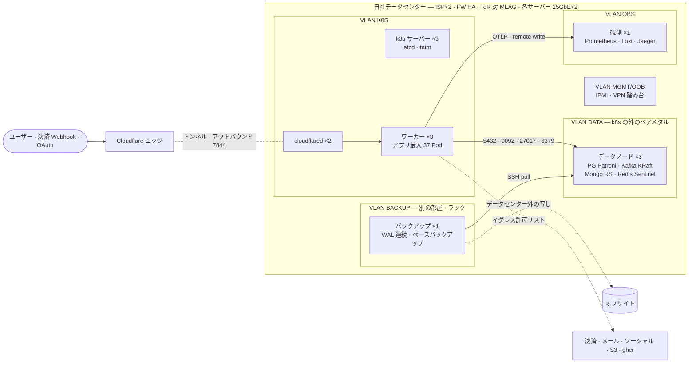
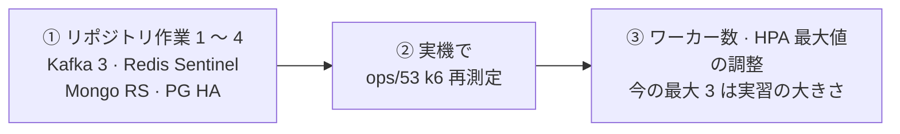

# 86. 自社データセンターでの運用 — ハードウェア · ネットワーク構成案

**日本語** | [한국어](86-self-hosted-datacenter.ko.md) · 🖼️ 見やすいページ版(ラック配置図 · 網構成図): [86-self-hosted-datacenter.html](86-self-hosted-datacenter.html) — ダウンロードしてブラウザで開きます(GitHub は HTML をソースとして表示する)

> 📝 **状態(2026-11-01)— 判断資料、決定ではない。**「自社データセンターで ecommerce-msa を運用するには、ハードウェア · ネットワークをどう構成すべきか」への答えを、リポジトリ(2026-10-26 `8ebcc934` 時点で調査、2026-11-01 `50ef7995` で根拠を再確認)から導いたものです。機器を買う前に §3 のリポジトリ側の作業と、実機での再測定が先です。

## ひと目で

| | 推奨 | 一行の理由 |
|---|---|---|
| 🖥️ サーバー | **約 12 台** — k3s サーバー 3 · ワーカー 3 · データ 3 · 観測 1 · バックアップ 1 · (CI 1) | コントロールプレーン · アプリ · データのどれが一台落ちても動く |
| 🗄️ データ層 | **k8s の外のベアメタル** — PG(Patroni)· Kafka(KRaft 3)· Mongo(レプリカセット)· Redis(Sentinel) | マネージドがない — 冗長化を自前で。`external` オーバーレイなのでコードはそのまま |
| 🌐 外部からの入口 | **Cloudflare Tunnel を維持** | インバウンドのポート 0 · 公開 IP · DMZ 不要。外すならコードも変える |
| 🧱 内部網 | **VLAN 五つ**(MGMT · K8S · DATA · OBS · BACKUP)+ 境界ファイアウォール | リポジトリの NetworkPolicy はイグレスが開いている |
| 💾 バックアップ | **WAL を別の機器へ連続送信** + データセンター外の写し | RPO 5 分 — 今は同じボリュームに溜まる |
| ⚠️ 先にやること | **リポジトリ作業 1 〜 4**(Kafka 3 · Redis Sentinel · Mongo RS · PG HA)→ 実機で k6 再測定 | ハードウェアでは解けない(§3) |

**目次** — [0. 前提](#0-前提) · [1. ハードウェア](#1-ハードウェア--推奨の出発構成サーバー約-12-台) · [2. ネットワーク](#2-ネットワーク) · [3. リポジトリで先に](#3-ハードウェアでは解けないこと--先にリポジトリで)

## 0. 前提

- **リポジトリには SLO · 目標トラフィックがありません。** 以下のサイズはリポジトリの実測から推定した**出発点**です。
  🕰️ 2026-11-14 からはある — SLO 四つ(可用性 99.5% · 検索 99%、段階 1 · 2 の後 99.9%)と処理量の目標(段階 2 の終わり毎秒 1,000 · 段階 3 の終わり 5,000)は [docs/91](91-slo-and-capacity.md)。以下のサイズはその目標で測り直す前の出発点のまま。
- **実測は デスクトップ一台の上で VM が CPU を分け合う実習クラスタの値です** — 絶対値として使わない([docs/83](83-load-test.md))。
- **今の本番は OCI Ampere ノード一台 + Cloudflare Tunnel** で、決定は PostgreSQL · MongoDB はマネージド、Redis · Kafka はクラスタ内です([docs/23](23-infrastructure-decision.md) · [docs/32](32-external-managed-infra.md))。自社データセンターにマネージドはないので **DB の冗長化を自分で行う必要があります** — これが最大の違いです。

## 1. ハードウェア — 推奨の出発構成(サーバー約 12 台)

| 役割 | 台数 | 仕様(一台あたり) | 根拠 |
|---|---|---|---|
| **k3s サーバー**(コントロールプレーン) | 3 | 8 コア · 32GB · NVMe 2×960GB RAID1 | etcd HA は 3 台。アプリが載らないよう taint — 実習で負荷中にサーバーノードがリセットした |
| **k3s ワーカー** | 3 | 16 コア · 64GB · NVMe 2×960GB | アプリ層は HPA 最大で 37 Pod、要求 8.3 コア / 13Gi、**上限 34.5 コア / 26Gi**。一台が落ちても残り二台(32 コア)が上限を受けられること。🕰️ いまのマニフェスト(`k8s/30` 〜 `50` · `k8s/70`、chat の HPA 1 〜 3 を含む)で数え直すと 37 Pod · 要求 8.7 コア / 13.3Gi · 上限 35.5 コア / 27Gi(2026-11-14) |
| **データノード** | 3 | 32 コア · 128 〜 256GB · NVMe **二組**(PG 2×1.92TB、Kafka 2×1.92TB) | ノードごとに PG(Patroni)· Kafka(KRaft)· Mongo(レプリカセット)· Redis(Sentinel)のメンバーを一つずつ — 下記 |
| **観測** | 1 | 16 コア · 64GB · SSD 4TB | 負荷の回が集中した日に Jaeger が 22GB に膨らみ実習の観測 VM のディスクを埋めた()。障害時も見られるようクラスタの外に |
| **バックアップ** | 1 | 8 コア · 32GB · HDD 4×8TB RAID6、**別の部屋 · 別のラック** | 下記 |
| **CI · レジストリ** | 1(任意) | 16 コア · 64GB · 2TB | ghcr.io と GitHub ランナーを使い続けるなら不要 |

**データノード**

- PostgreSQL の実測: 商品あたり 2,108B · 注文あたり約 1,100B · ユーザーあたり約 1,012B。商品 2,000 万で約 39GiB(投入時に WAL 用にさらに 59GiB — [docs/19](19-local-performance-tuning.md))、1 億で約 196GiB([docs/83](83-load-test.md))。
- **作業集合が RAM に収まること** — 本番(商品 200 万)でフィルター検索の件数数えがランダムブロック読み 11 万回で 42.9 秒だった([docs/83 §2.8](83-load-test.md))。その照会は `d837605d7902` でなくした(件数を数えない)が、まれな条件は今もカテゴリを走査する([docs/85 §8](85-release-deploy-runbook.md))。だから PG に 64GB 以上。
- 接続数: DB を使うサービス 9 個(catalog はデータソース 2 個)× プール 5 × HPA 最大 3 → 最悪 150 — 2026-11-01 に chat も HPA 最大 3 になった後の値、それ以前の chat 1 個固定のときは 140( · [docs/21 §2-1](21-horizontal-scaling.md))。
- PG と Kafka はどちらも fsync が多い — 同じノードでも **NVMe の組は分ける**。
- **k8s の外(ベアメタル)に置く**: `external` オーバーレイが既にあり、ConfigMap のエンドポイントを変えるだけでコードはそのまま([docs/32](32-external-managed-infra.md))。k3s のアップグレード · ノード障害がデータに及ばず、§2 の VLAN ファイアウォールでアクセスを強制できる。

**バックアップサーバー**

- 本番の実測: DB 5.6GB の `base.tar.gz` が 821MB(約 15%)、復元 1 分 52 秒([docs/22](22-alerting-and-backup-automation.md))。
- お金が絡むデータは RPO 5 分以下([docs/15](15-backup-and-dr.md)) — ところが今の WAL アーカイブは**同じボリューム**に溜まる(`ops/29` 自身が不足と書いている)。データノード → バックアップサーバーへ **WAL を送り続ける**(pgBackRest か WAL-G — リポジトリにはまだない)。
- データセンター外の写しをもう一つ — ノードの外から取りに行く pull 方式でもクラウドのオブジェクトストレージでも。

**もっと小さく始めるなら**: 32 コア · 256GB のサーバー 3 台に k3s(サーバー + エージェント)とデータ VM を同居させる。費用は 1/3 だが、一台が落ちるとアプリと DB メンバーを同時に失う。

## 2. ネットワーク

物理配線: `インターネット ─ ISP×2 ─ ファイアウォール(HA 対)─ ToR スイッチ対(MLAG)─ 各サーバー 25GbE×2(LACP)`、別に `OOB スイッチ 1GbE ─ IPMI / iDRAC`。

### 2-1. 外部からの入口 — Cloudflare Tunnel を維持(推奨)

- 今の構造は**インバウンドのポート 0 個**。cloudflared 2 個が別々のノードから外へ接続する。決済 Webhook(Stripe · PortOne)と OAuth のコールバックもトンネル経由 — 公開 IP · DMZ · 外向き TLS 証明書が要らない。ファイアウォールは cloudflared のアウトバウンド 7844(TCP/UDP)だけ。
- Cloudflare を外し自前の公開 IP + L4 LB で受けるなら**コードも変える必要がある**: 流入制限が `CF-Connecting-IP` を「エッジが上書きするので偽装不可」と信頼している(`CustomUserKeyResolver`)— トンネルがなければクライアントがそのヘッダーを作れる。ほかに Ingress の `host` · ACME 証明書 · WAF · DDoS 対策が新たに要る。

### 2-2. 内部 VLAN

| VLAN | メンバー | 受け入れるもの |
|---|---|---|
| MGMT/OOB | IPMI、スイッチ管理 | VPN(踏み台)からのみ |
| K8S | k3s サーバー · ワーカー | 6443 は MGMT からのみ。ノード間 flannel · 10250、(サーバー間)2379-2380 |
| DATA | PG · Kafka · Mongo · Redis | K8S から 5432 · 9092(SSL)· 27017 · 6379/26379。複製は VLAN 内のみ |
| OBS | 観測サーバー | K8S/DATA から 4318(OTLP)· 9090(remote write)· Loki push。Grafana は VPN から |
| BACKUP | バックアップサーバー | バックアップサーバーが DATA へ SSH する pull(本番ノードに資格情報を置かない向き) |

- 物理の帯域を k3s 既定の **Pod 10.42/16 · Service 10.43/16** と重ねない。
- Pod がクラスタの外へ出るときはノード IP に SNAT される — DATA のファイアウォールは「K8S VLAN → ポート」で書く。
- リポジトリの NetworkPolicy はイングレスだけを塞ぎイグレスは開いており、実クラスタで回したこともない([docs/57](57-remaining-priorities.md))— **境界ファイアウォール**が実際の防御線。

### 2-3. イグレス許可リスト(ファイアウォール · プロキシ)

| 宛先 | アドレス |
|---|---|
| 決済 | `api.stripe.com` · `api-m.paypal.com` · `api.iamport.kr` · `api.portone.io` |
| メール · SMS | SMTP 587、SMS 業者(未選定) |
| ソーシャルログイン | Google · GitHub · Facebook · Kakao · LINE |
| その他 | `apis.data.go.kr`(韓国郵便)· `api.pwnedpasswords.com` · `ghcr.io` · Cloudflare(7844) |
| 画像 | AWS S3 `ap-northeast-2` |

### 2-4. 帯域 · 遅延

- **内部**: アプリのトラフィックは小さい(実習の天井が成功毎秒約 1,400 件の小さな JSON)。10GbE で足り、25GbE は複製 · バックアップの余裕。
- **インターネット**: 最大の変数は**画像**。今はブラウザが S3 から直接取る — 画像を MinIO でデータセンター内に入れると画像のバイトがすべて自社回線を通る。回線はその基準で。
- **遅延**: 一つの要求が照会を 20 回ほど送る — 30ms なら 600ms([docs/32](32-external-managed-infra.md))。**アプリと DB は同じラック · 同じ L2**。同期複製を別サイトまで伸ばさない。
- **共通**: 内部 DNS · **NTP**(JWT · TOTP · Kafka · 証明書がすべて時計に依存)、二重電源 · A/B PDU · UPS。

## 3. ハードウェアでは解けないこと — 先にリポジトリで

| # | 今のリポジトリ | 自社運用に必要なもの |
|---|---|---|
| 1 | Kafka ブローカー 1、複製 1、主要トピックのパーティション 1(自動作成) | ブローカー 3、RF 3、`min.insync.replicas=2`、トピックを事前作成 |
| 2 | Redis 単一(`SPRING_DATA_REDIS_HOST`) | Sentinel 設定(`spring.data.redis.sentinel.*`)へ |
| 3 | Mongo 単一(本番は Atlas) | レプリカセット 3 |
| 4 | PG はマネージド前提、WAL は同じボリューム | Patroni + VIP、WAL は別の機器へ。プーラーを使うなら transaction モード禁止(`ops/25` の警告) |
| 5 | S3 クライアントにエンドポイントの上書きがない(`AmazonS3Config` — region だけ) | MinIO へ移すならコード修正(endpoint + path-style)。S3 を使い続けるなら不要 |
| 6 | eureka は必ず 1 個([docs/21](21-horizontal-scaling.md))— chat は 2026-11-01 に Redis のファンアウトで 1 〜 3(§2-1) | 機器を増やしても単一障害点は残る(eureka) |
| 7 | actuator がアプリと同じポート(管理ポートの分離なし) | ネットワークで分けられない — ゲートウェイの遮断だけに頼る |
| 8 | 本番イメージは Ampere(arm64)用 | x86 サーバーなら `ops/19 --platform linux/amd64` |

**順序**

実習の数値はコアを分け合った結果で、専用機では天井が違います — 機器の購入量は ② の後で確定します。
