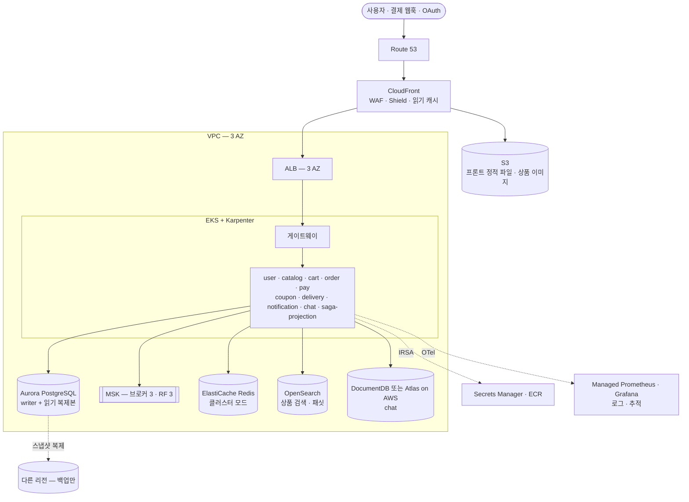
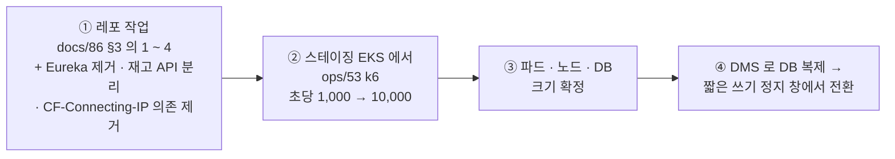

# 87. AWS 에서 수백만 명 규모로 — 구성 상정안

[日本語](87-aws-at-scale.md) | **한국어** · 페이지판: [한국어](87-aws-at-scale.ko.html) · [日本語](87-aws-at-scale.html)

> 📝 **상태(2026-11-01) — 판단 자료, 결정 아님.** "AWS 로 수백만 명이 쓰는 사이트를 구축하려면 어떻게 해야 하나" 를 이 레포(2026-11-01 `663f986f`)의 구조와 실측에서 상정한 것입니다. 자체 데이터센터 판은 [docs/86](86-self-hosted-datacenter.ko.md) — §3 의 레포 작업은 두 판에 공통입니다. 비용은 사양 가정에서 나온 짐작입니다.

## 한눈에

| | 상정 | 한 줄 이유 |
|---|---|---|
| 👥 규모 | 가입자 300만 · 하루 방문 30만 · **행사 피크 초당 5,000 ~ 10,000 요청** | 레포에 목표 트래픽이 없어 가정했다(§0) |
| 🌐 앞단 | **CloudFront(+ WAF · Shield) → ALB**, 정적 파일 · 이미지는 S3 | 읽기를 엣지에서 끝낸다 — catalog 파드 하나는 초당 ~350건에서 막힌다 |
| ☸️ 앱 | **EKS 3 AZ + Karpenter**, Eureka 대신 k8s Service DNS | HPA 최대 3 · Eureka 1개는 실습 크기 |
| 🗄️ 데이터 | **Aurora PostgreSQL · MSK(브로커 3) · ElastiCache(클러스터) · OpenSearch** | 단일 Kafka · Redis 를 관리형 이중화로, 드문 필터 503 은 검색 엔진으로 |
| 💰 비용 | **월 약 $10,000 ~ 20,000**(서울, 가정 규모) | 트래픽 · 이미지 전송량 · 예약 할인으로 크게 달라진다 |
| ⚠️ 먼저 | 레포 작업 → 스테이징에서 k6(초당 1,000 → 10,000) → 크기 확정 → DMS 로 이전 | 장비 · 관리형으로는 풀리지 않는 것이 먼저다(§3 · §5) |

**목차** — [0. 가정](#0-가정) · [1. 구성](#1-구성) · [2. 층별 — 지금과 AWS](#2-층별--지금과-aws) · [3. 규모에서 바뀌는 설계](#3-수백만-규모에서-바뀌는-설계) · [4. 비용](#4-대략의-비용) · [5. 순서](#5-순서)

## 0. 가정

| 항목 | 가정 | 계산 |
|---|---|---|
| 가입자(MAU) | 300만 | — |
| 하루 방문자(DAU) | 30만 | 가입자의 10% |
| 하루 요청 | 약 900만 | 방문당 요청 30 |
| 평시 피크 | **초당 약 1,000** | 피크 시간에 하루의 15%(시간당 135만 = 초당 375) × 순간 3배 |
| 행사 피크 | **초당 5,000 ~ 10,000** | 평시 피크의 5 ~ 10배 |

**지금의 천장**(실습, [docs/83](83-load-test.ko.md)): catalog 파드 셋(파드당 1코어)이 성공 초당 ~1,050 ~ 1,100 에서 멈춘다 — **파드당 ~350/초**, 병목은 catalog CPU(JSON 직렬화 22%). 행사 피크 10,000/초를 캐시 없이 받으면 catalog 만 ~30파드다. CloudFront 가 읽기의 80% 를 받으면 ~2,000/초 · 6파드 수준으로 줄어든다 — 이 상정안의 중심이 그것이다.

> 🕰️ 2026-11-14: "레포에 목표 트래픽이 없다" 는 이제 맞지 않는다 — [docs/91](91-slo-and-capacity.ko.md) 이 처리량 목표(docs/89 단계 2 끝 초당 1,000 · 단계 3 끝 5,000)와 SLO 넷을 정했다. 위 규모 가정(행사 피크 5,000 ~ 10,000)은 이 상정안의 것으로 둔다. 천장 수치는 2026-10-24 새벽 회차의 것 — 같은 날 목록 응답 · Page 읽기 수정 뒤 catalog · 게이트웨이 4 · 4 에서 성공 초당 ~1,400(파드당 ~350 그대로), JSON 은 17.6% 였다([docs/83 §5](83-load-test.ko.md) "결론").

## 1. 구성

## 2. 층별 — 지금과 AWS

| 층 | 지금 | AWS 에서 | 이유 |
|---|---|---|---|
| 진입 | Cloudflare Tunnel | **CloudFront + WAF + ALB**(Cloudflare 를 유지하고 오리진만 ALB 로 둬도 된다) | 상품 · 홈 · 검색 GET 을 엣지에서 캐시. 유입 제한의 `CF-Connecting-IP` 신뢰는 `X-Forwarded-For` + ALB 기준으로 바꾼다([docs/86 §2-1](86-self-hosted-datacenter.ko.md)) |
| 앱 | k3s 노드 1대 | **EKS 3 AZ**, Karpenter 로 노드 자동 증설, 행사 전 미리 늘리기 | HPA 최대 3은 실습 크기 — 피크에 catalog 수십 파드도 되어야 한다 |
| 서비스 찾기 | Eureka(1개 고정) | **k8s Service DNS**(Spring Cloud Kubernetes 또는 게이트웨이 정적 라우트) | Eureka 는 단일 장애점이고 쓰기 판정(B-86) 같은 손이 든다 |
| DB | 클러스터 안 PG | **Aurora PostgreSQL** — 서비스별 DB 그대로, 읽기 복제본은 catalog · 주문 조회용 | 장애 조치는 보통 수십 초, PITR · 스냅샷은 관리형. 커넥션은 RDS Proxy 로 묶되 세션 상태(SET · 준비된 문장)를 쓰면 연결이 고정된다 — 측정해서 쓰고, Flyway 는 프록시를 거치지 않는다 |
| 검색 | PG `LIKE` · EXISTS(드문 조건 503) | **OpenSearch** — 이미 있는 플래그 `catalog.search-engine` 을 켠다([docs/74](74-feature-flags.ko.md)) | 드문 · 0건 조합의 503 과 패싯 개수를 근본적으로 푼다([docs/85 §8](85-release-deploy-runbook.ko.md) ④) |
| 메시지 | Kafka 브로커 1 · RF 1 | **MSK 브로커 3+(3 AZ)**, RF 3, `min.insync.replicas=2`, 토픽 미리 생성, 파티션은 처리량에 맞춰 | 아웃박스 · 사가가 Kafka 에 기댄다 — 가장 먼저 견고해져야 한다 |
| 캐시 | Redis 1대 | **ElastiCache 클러스터 모드 · Multi-AZ** | 유입 제한 · 장바구니 · 로그인 잠금이 Redis 를 쓴다. 유입 제한은 fail-open 이라 장애 때 통과된다([docs/85 §7-1](85-release-deploy-runbook.ko.md)) |
| chat | 인메모리 STOMP + Redis 팬아웃(2026-11-01 — 1 ~ 3) | 그대로 — Redis 를 ElastiCache 로 | 이미 늘릴 수 있다([docs/21 §2-1](21-horizontal-scaling.ko.md)) |
| 이미지 · 프론트 | S3 직접 · nginx 파드 | **S3 + CloudFront(OAC)**, 프론트도 S3 정적 배포 | 바이트를 앱 · 회선에서 뺀다 |
| 비밀 · 신원 | k8s Secret, 자체 CA mTLS | **Secrets Manager + IRSA**, mTLS 는 ACM Private CA 또는 서비스 메시 | 스토어 비밀번호 교체(ops/59) 같은 수작업을 줄인다 |
| 관측 | 노드 위 docker compose | Managed Prometheus · Grafana, 로그는 OpenSearch 나 CloudWatch, 추적은 X-Ray 또는 Tempo | 장애 때도 보이게 클러스터 밖에 |
| 배포 | `ops/28` 손 배포 | GitHub Actions(OIDC) → ECR → Argo CD, 카나리(Argo Rollouts) | expand → contract · ROLLBACK-UNSAFE(B-54) 규칙은 그대로 |

## 3. 수백만 규모에서 바뀌는 설계

1. **읽기는 앞단에서 끝낸다.** 상품 목록 · 상세 · 홈을 CloudFront 에서 30 ~ 60초 캐시하고, 재고 수량은 별도의 작은 API 로 뺀다(지금은 카드 응답마다 재고를 다시 읽는다 — `HomeViewCache` 도 재고만은 응답마다). 이것만으로 catalog 부하가 몇 분의 1 로 준다.
2. **재고 차감은 핫스팟이 된다.** 인기 상품의 행 잠금에 몰린다 — 예약을 Redis(Lua) 같은 원자 차감으로 먼저 받고 DB 확정은 비동기로 하는 구조를 검토한다. 지금의 gRPC 재고 예약이 출발점이다.
3. **쓰기 DB 는 서비스마다 하나의 Aurora 로 시작한다.** 주문 수억 건까지는 월별 파티셔닝으로 버티고, 그 위로 가야 할 때 샤딩을 고민한다.
4. **행사 트래픽은 대기열로 받는다.** 피크 10배를 늘 준비하면 비싸다 — 진입 대기열(CloudFront + 가상 대기실)과 Karpenter 사전 증설.
5. **멀티 리전은 처음부터 하지 않는다.** 3 AZ 로 시작하고 백업 · 스냅샷만 다른 리전에 복제한다(RPO 5분 · 복구는 몇 시간). 리전 장애까지 몇 분 안에 넘기려면 Aurora Global Database · MSK 복제가 필요하고, 비용과 복잡도가 크게 뛴다.

## 4. 대략의 비용

서울 리전, §0 의 가정 규모, 온디맨드 기준의 짐작입니다.

| 항목 | 월 |
|---|---|
| EKS 노드(평시 vCPU 64 ~ 96, 피크에 늘림) | $2,000 ~ 4,000 |
| Aurora(writer + reader, r6g.xlarge 급 여러 DB) | $3,000 ~ 6,000 |
| MSK(브로커 3) | ~$1,500 |
| ElastiCache | ~$800 |
| OpenSearch | ~$1,500 |
| CloudFront · 데이터 전송 · 관측 | $1,000 ~ 3,000 |
| **합계** | **약 $10,000 ~ 20,000** |

트래픽 · 이미지 전송량 · 예약 인스턴스(Savings Plans) 할인으로 크게 달라집니다. 확정은 §5 ② 의 측정 뒤에.

## 5. 순서

