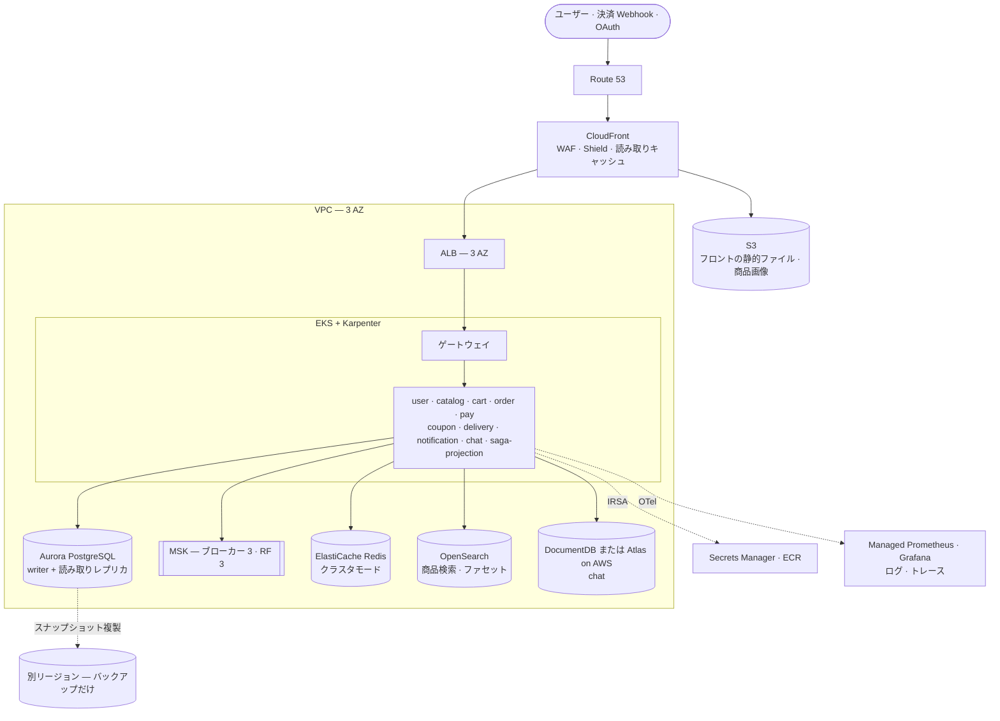
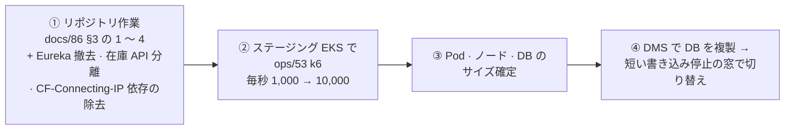

# 87. AWS で数百万人規模に — 構成の想定案

**日本語** | [한국어](87-aws-at-scale.ko.md) · ページ版: [日本語](87-aws-at-scale.html) · [한국어](87-aws-at-scale.ko.html)

> 📝 **状態(2026-11-01)— 判断資料、決定ではない。**「AWS で数百万人が使うサイトを構築するにはどうすべきか」を、このリポジトリ(2026-11-01 `663f986f`)の構造と実測から想定したものです。自社データセンター版は [docs/86](86-self-hosted-datacenter.md) — §3 のリポジトリ作業は両版で共通です。費用は仕様の仮定から出した見当です。

## ひと目で

| | 想定 | 一行の理由 |
|---|---|---|
| 👥 規模 | 会員 300 万 · 一日の訪問 30 万 · **セールのピーク毎秒 5,000 〜 10,000 要求** | リポジトリに目標トラフィックがないため仮定した(§0) |
| 🌐 前段 | **CloudFront(+ WAF · Shield)→ ALB**、静的ファイル · 画像は S3 | 読み取りをエッジで終わらせる — catalog の Pod 一つは毎秒 ~350 件で頭打ち |
| ☸️ アプリ | **EKS 3 AZ + Karpenter**、Eureka の代わりに k8s Service DNS | HPA 最大 3 · Eureka 1 個は実習の大きさ |
| 🗄️ データ | **Aurora PostgreSQL · MSK(ブローカー 3)· ElastiCache(クラスタ)· OpenSearch** | 単一の Kafka · Redis をマネージドの冗長化へ、まれなフィルターの 503 は検索エンジンで |
| 💰 費用 | **月 約 $10,000 〜 20,000**(ソウル、仮定の規模) | トラフィック · 画像転送量 · 予約割引で大きく変わる |
| ⚠️ 先に | リポジトリ作業 → ステージングで k6(毎秒 1,000 → 10,000)→ サイズ確定 → DMS で移行 | 機器 · マネージドでは解けないことが先(§3 · §5) |

**目次** — [0. 仮定](#0-仮定) · [1. 構成](#1-構成) · [2. 層ごと — 今と AWS](#2-層ごと--今と-aws) · [3. 規模で変わる設計](#3-数百万人規模で変わる設計) · [4. 費用](#4-おおよその費用) · [5. 順序](#5-順序)

## 0. 仮定

| 項目 | 仮定 | 計算 |
|---|---|---|
| 会員(MAU) | 300 万 | — |
| 一日の訪問者(DAU) | 30 万 | 会員の 10% |
| 一日の要求 | 約 900 万 | 訪問あたり要求 30 |
| 平常のピーク | **毎秒 約 1,000** | ピーク時間に一日の 15%(毎時 135 万 = 毎秒 375)× 瞬間 3 倍 |
| セールのピーク | **毎秒 5,000 〜 10,000** | 平常ピークの 5 〜 10 倍 |

**今の天井**(実習、[docs/83](83-load-test.md)): catalog の Pod 三つ(Pod あたり 1 コア)が成功毎秒 ~1,050 〜 1,100 で止まる — **Pod あたり ~350/秒**、ボトルネックは catalog の CPU(JSON シリアライズ 22%)。セールのピーク 10,000/秒をキャッシュなしで受けると catalog だけで ~30 Pod。CloudFront が読み取りの 80% を受ければ ~2,000/秒 · 6 Pod ほどに減る — この想定案の中心はそれです。

## 1. 構成

## 2. 層ごと — 今と AWS

| 層 | 今 | AWS では | 理由 |
|---|---|---|---|
| 入口 | Cloudflare Tunnel | **CloudFront + WAF + ALB**(Cloudflare を残しオリジンだけ ALB にしてもよい) | 商品 · ホーム · 検索の GET をエッジでキャッシュ。流入制限の `CF-Connecting-IP` の信頼は `X-Forwarded-For` + ALB 基準に変える([docs/86 §2-1](86-self-hosted-datacenter.md)) |
| アプリ | k3s ノード 1 台 | **EKS 3 AZ**、Karpenter でノード自動増設、セール前に事前に増やす | HPA 最大 3 は実習の大きさ — ピークに catalog 数十 Pod も可能であること |
| サービス発見 | Eureka(1 個固定) | **k8s Service DNS**(Spring Cloud Kubernetes またはゲートウェイの静的ルート) | Eureka は単一障害点で、書き込み判定(B-86)のような手間がかかる |
| DB | クラスタ内 PG | **Aurora PostgreSQL** — サービスごとの DB はそのまま、読み取りレプリカは catalog · 注文照会用 | フェイルオーバーは普通数十秒、PITR · スナップショットはマネージド。接続は RDS Proxy でまとめるが、セッション状態(SET · プリペアドステートメント)を使うと接続が固定される — 測って使い、Flyway はプロキシを通さない |
| 検索 | PG の `LIKE` · EXISTS(まれな条件で 503) | **OpenSearch** — 既にあるフラグ `catalog.search-engine` を有効に([docs/74](74-feature-flags.md)) | まれ · 0 件の組み合わせの 503 とファセット件数を根本から解く([docs/85 §8](85-release-deploy-runbook.md) ④) |
| メッセージ | Kafka ブローカー 1 · RF 1 | **MSK ブローカー 3+(3 AZ)**、RF 3、`min.insync.replicas=2`、トピック事前作成、パーティションは処理量に合わせて | アウトボックス · サガが Kafka に頼る — 最初に堅牢にすべき |
| キャッシュ | Redis 1 台 | **ElastiCache クラスタモード · Multi-AZ** | 流入制限 · カート · ログインロックが Redis を使う。流入制限は fail-open なので障害時は素通り([docs/85 §7-1](85-release-deploy-runbook.md)) |
| chat | インメモリ STOMP(1 個固定) | Redis pub/sub のファンアウトか Amazon MQ のブローカーリレーに変えてから複数に | 今の構造では増やせない([docs/21](21-horizontal-scaling.md)) |
| 画像 · フロント | S3 直接 · nginx Pod | **S3 + CloudFront(OAC)**、フロントも S3 の静的配信 | バイトをアプリ · 回線から外す |
| 秘密 · 身元 | k8s Secret、自前 CA の mTLS | **Secrets Manager + IRSA**、mTLS は ACM Private CA かサービスメッシュ | ストアのパスワード交換(ops/59)のような手作業を減らす |
| 観測 | ノード上の docker compose | Managed Prometheus · Grafana、ログは OpenSearch か CloudWatch、トレースは X-Ray か Tempo | 障害時も見えるようクラスタの外に |
| デプロイ | `ops/28` の手作業 | GitHub Actions(OIDC)→ ECR → Argo CD、カナリア(Argo Rollouts) | expand → contract · ROLLBACK-UNSAFE(B-54)の規則はそのまま |

## 3. 数百万人規模で変わる設計

1. **読み取りは前段で終わらせる。** 商品一覧 · 詳細 · ホームを CloudFront で 30 〜 60 秒キャッシュし、在庫数は別の小さな API に分ける(今はカードの応答ごとに在庫を読み直す — `HomeViewCache` も在庫だけは応答ごと)。これだけで catalog の負荷が数分の一になる。
2. **在庫の引き当てはホットスポットになる。** 人気商品の行ロックに集中する — 予約を Redis(Lua)のような原子的な減算で先に受け、DB の確定は非同期にする構造を検討する。今の gRPC 在庫予約が出発点。
3. **書き込み DB はサービスごとに一つの Aurora から始める。** 注文数億件までは月ごとのパーティショニングで耐え、その先に進むときにシャーディングを考える。
4. **セールのトラフィックは待ち行列で受ける。** ピーク 10 倍を常に用意すると高い — 入口の待ち行列(CloudFront + 仮想待合室)と Karpenter の事前増設。
5. **マルチリージョンは最初からしない。** 3 AZ で始め、バックアップ · スナップショットだけ別リージョンに複製する(RPO 5 分 · 復旧は数時間)。リージョン障害まで数分で切り替えるには Aurora Global Database · MSK の複製が要り、費用と複雑さが大きく跳ね上がる。

## 4. おおよその費用

ソウルリージョン、§0 の仮定の規模、オンデマンド基準の見当です。

| 項目 | 月 |
|---|---|
| EKS ノード(平常 vCPU 64 〜 96、ピークに増やす) | $2,000 〜 4,000 |
| Aurora(writer + reader、r6g.xlarge 級の DB 複数) | $3,000 〜 6,000 |
| MSK(ブローカー 3) | ~$1,500 |
| ElastiCache | ~$800 |
| OpenSearch | ~$1,500 |
| CloudFront · データ転送 · 観測 | $1,000 〜 3,000 |
| **合計** | **約 $10,000 〜 20,000** |

トラフィック · 画像転送量 · 予約インスタンス(Savings Plans)の割引で大きく変わります。確定は §5 ② の測定の後で。

## 5. 順序

