# 98. 주문 · 배송 · 반품 처리 흐름 — 화면 안내

[日本語](98-order-delivery-return-screens.md) | **한국어** · 페이지판: [日本語](98-order-delivery-return-screens.html) · [한국어](98-order-delivery-return-screens.ko.html)

> 📝 **상태(2026-11-21)** — 실습 클러스터(`https://shop.lab`, 이미지 `fe8c80336435`)에서 10:51 ~ 11:08 에 실제로 돌려 본 화면 27장을 흐름 순서로 묶었습니다. 화면 문구는 일본어(JA) 판입니다. 설명은 그 시점 저장소(`fe8c8033`)의 동작 기준입니다. 관련: [25 배송 서비스 설계](25-delivery-service-design.ko.md) · [49 결제수단 확장](49-payment-providers.ko.md) · [59 결제 전 재고 예약](59-stock-reservation.ko.md) · [76 주문 상태 이벤트](76-order-status-read-model.ko.md).

## 개요

### 등장하는 주문

| 주문 | 내용 | 흐름 | 장 |
|---|---|---|---|
| A #911795917788677344 | 키보드 1개 · $194.30 · Stripe | 결제 → 송장 등록(발송) → 주문자가 배송 취소 → 주문자가 전액 환불 | 2 · 3 |
| B #911769673802552548 | 귀걸이 4개 · $242.20 · Stripe | 발송됨 → 관리자 반품 입고 2 → 환불 2 → 나머지 환불 2 → 반품 대기 | 4 |
| C #911800100251231471 | 탄산수 12팩 × 3 · $86.07 | 장바구니 → 체크아웃 → Stripe 결제 대기 | 1 |

### 주문 상태의 흐름

- **お支払い待ち**(결제 대기) → **決済完了**(결제 완료) → **商品準備中**(배송 생성 · 송장 대기) → **発送済み**(송장 등록) → **配送完了**(배달 완료)
- 발송 전: **配送キャンセル**(주문자가 배송 취소) → **決済完了**(로 복귀) → **返金済み**(주문자 취소 · 환불, 재고 자동 복원)
- 발송 후: **返品入庫**(관리자: 돌아온 수량 · 재고 복원) + **返金**(관리자: 환불 수량) → **返金済み**(회수가 덜 되면 返品待ち)

진행 막대의 4번째 칸은 송장을 등록한 시점이므로 **発送済み / 발송 완료** 입니다(예전 문구 '配送中'은 택배가 움직이는 중으로 읽혀 2026-11-21 에 바꿨다). 주문 상태의 진실은 order 서비스의 DB 이고, 화면의 進行の記録 은 이벤트로 따라오는 읽기 모델이라 몇 초 늦을 수 있습니다.

## 1. 고객 — 장바구니에서 결제까지 (주문 C)

고객이 상품을 담고, 배송지와 결제 수단을 고른 뒤 주문을 만듭니다. 주문은 먼저 **お支払い待ち(결제 대기)**로 생기고, 결제가 끝나야 다음 단계로 넘어갑니다.

### 24. 장바구니

`/cart`

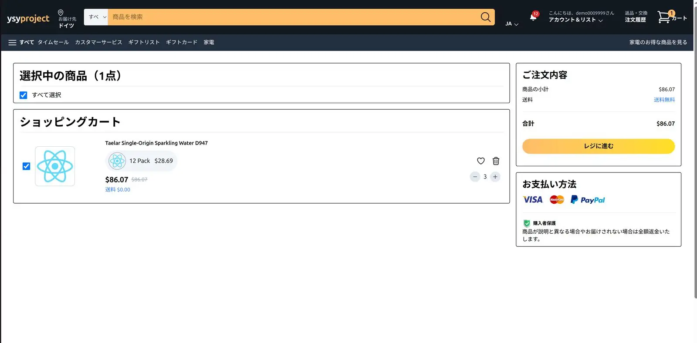

담은 상품(탄산수 12팩 × 3, $86.07)을 확인합니다. 체크한 줄만 주문에 들어가고, 오른쪽 **ご注文内容**에 소계 · 배송비(무료) · 합계가 나옵니다.

**レジに進む**를 누르면 체크아웃으로 갑니다. 이때 가격 · 배송비는 담을 때의 값이 아니라 catalog 의 지금 값으로 다시 맞춥니다.

### 25. 체크아웃 — 배송지 · 결제 수단

`/checkout`

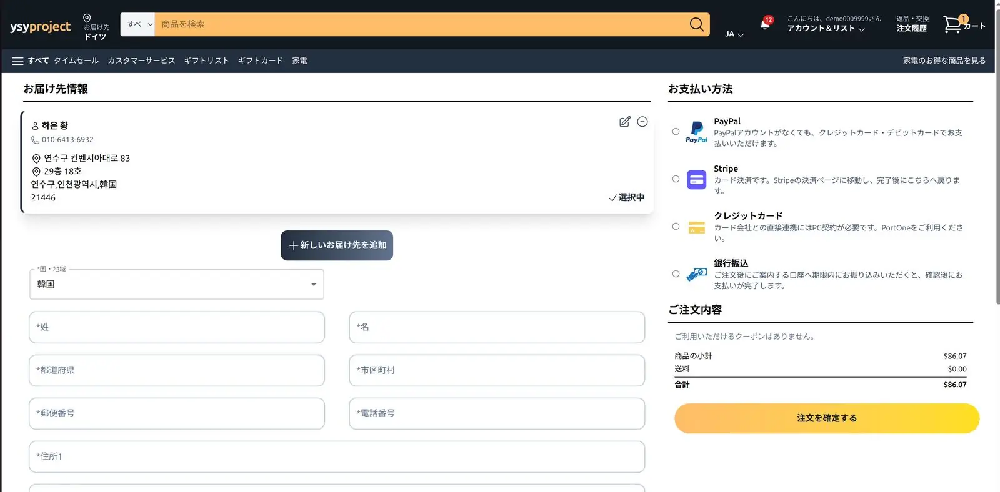

저장된 배송지(**選択中**)를 쓰거나 새 배송지를 추가합니다. 결제 수단은 PayPal · Stripe · 신용카드(PortOne) · 은행 송금 넷입니다.

쓸 수 있는 쿠폰이 있으면 **ご注文内容** 위에 나옵니다(이번에는 없음).

### 26. Stripe 선택 → 주문 확정

`/checkout`

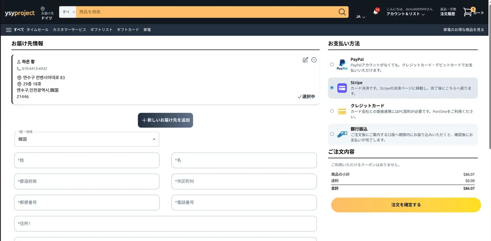

Stripe 를 고르고 **注文を確定する**를 누르면 주문이 만들어집니다. 금액과 SKU 는 화면이 보낸 값을 믿지 않고 서버가 정합니다.

같은 시도를 두 번 눌러도 주문은 하나만 생깁니다(주문 생성 멱등 키).

### 27. 주문 상세 — 결제 대기 · 재고 확보

`/order/{注文番号}`

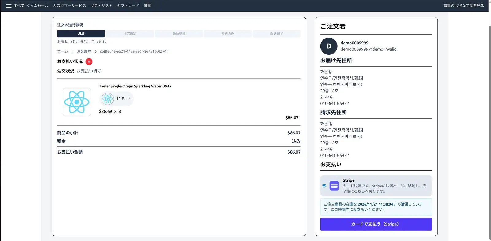

진행 막대는 첫 칸 **決済**에 있고, 주문 상태는 **お支払い待ち**입니다.

주문을 만들 때 재고를 30분 잡아 둡니다(docs/59). 이 화면에서는 **11:38:04 까지** 확보돼 있습니다. 그 안에 **カードで支払う(Stripe)**로 Stripe 결제 페이지에 가서 결제하면 돌아와 **決済完了**가 됩니다. 시간이 지나면 확보가 풀립니다.

## 2. 관리자 — 송장 등록(발송) (주문 A)

결제가 끝나면 배송이 자동으로 만들어지고(**受付待ち**), 관리자의 **配送管理** 화면에 송장 대기로 올라옵니다. 송장을 등록하면 주문이 **発送済み**가 됩니다.

### 1. 배송 관리 — 송장 대기 목록

`/admin/delivery`

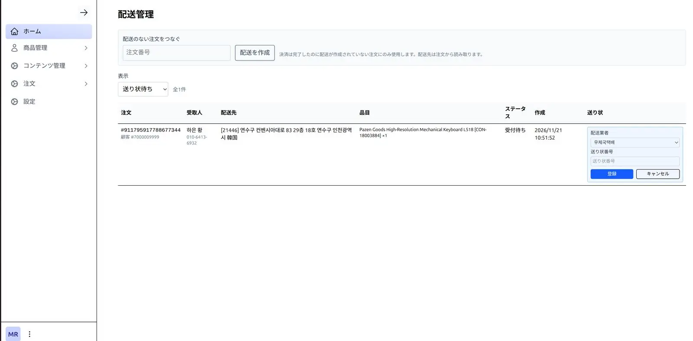

기본 보기는 **送り状待ち**(송장 대기)입니다. 주문 A(#911795917788677344, 키보드 1개)가 **受付待ち**로 있습니다. 결제 확인(10:51:52)과 같은 시각에 만들어졌습니다.

위의 **配送のない注文をつなぐ**는 결제는 끝났는데 배송이 만들어지지 않은 주문을 손으로 잇는 복구용입니다. 결제 완료 · 처리 중 주문만 되고, 배송지는 주문에서 읽습니다.

### 2. 택배사 선택 — 테스트 배송

`/admin/delivery`

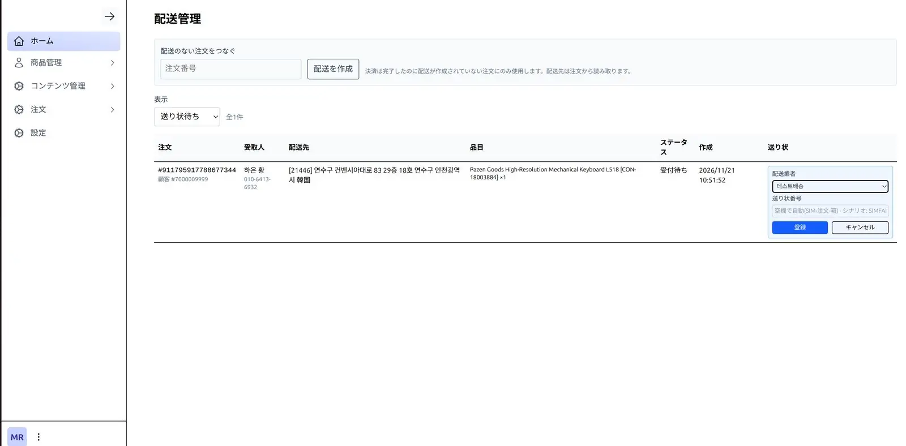

택배사로 우체국택배 또는 **테스트배송**을 고릅니다. 테스트배송은 실제 택배사 없이 배송 전 과정을 시간에 따라 진행시키는 시뮬레이터입니다.

송장 번호 칸을 비우면 `SIM-주문번호-상자`로 자동으로 만들어지고, 접두사로 각본을 고를 수 있습니다.

| 접두사 | 각본 |
|---|---|
| `SIM-` | 정상: 집화 → 이동 → 배달 출발 → 완료 |
| `SIMFAIL-` | 배달 시도 실패 뒤 완료 |
| `SIMEXC-` | 분실(예외)에서 멈춤 |
| `SIMINTL-` | 국제 배송: 통관 보류를 거침 |
| `SIMNONE-` | 택배사가 송장을 모름(등록 직후 · 오타) |

### 3. 등록 뒤 — 송장 대기 0건

`/admin/delivery`

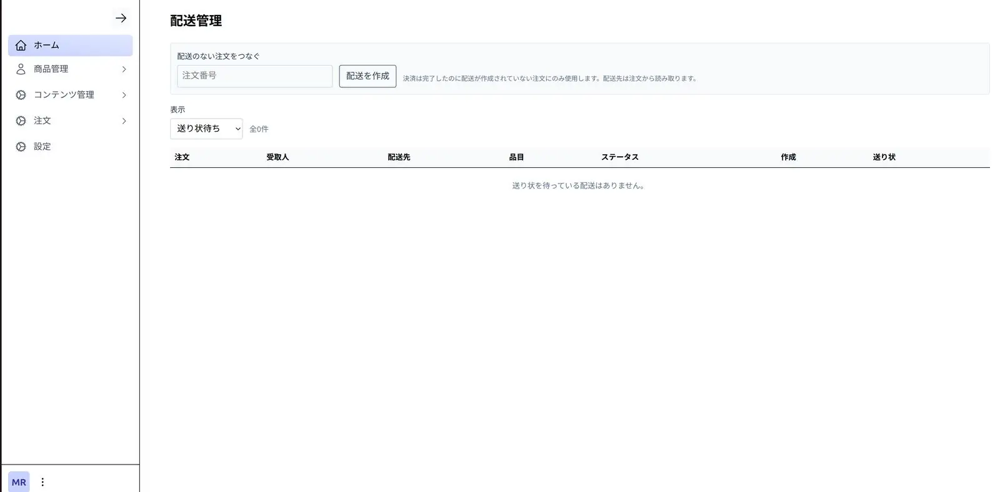

**登録**을 누르면 그 배송은 송장 대기 목록에서 빠집니다(**全0件**). 배송 상태는 **伝票登録済み**가 되고, 주문에는 **発送済み**(10:54:11)가 기록됩니다.

그 뒤로는 폴러가 택배사(여기서는 시뮬레이터)를 주기적으로 조회해 상태를 진행시킵니다.

### 10. 고객 화면 — 발송됨

`/order/{注文番号}`

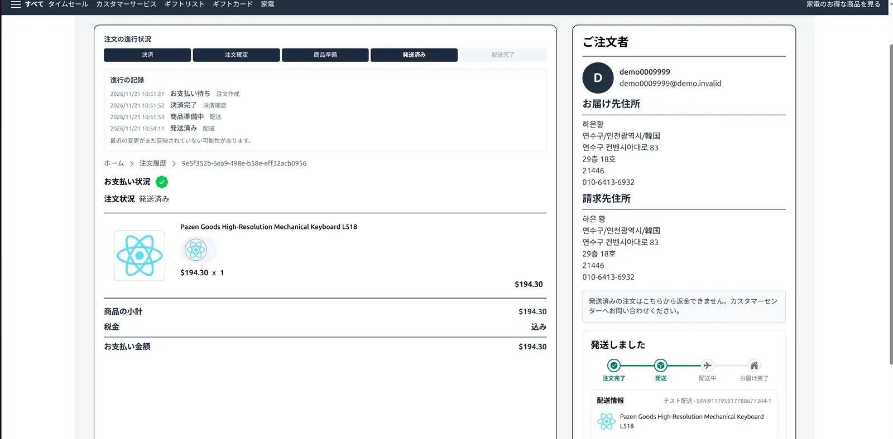

진행 막대가 **発送済み**까지 찼고, **進行の記録**에 お支払い待ち → 決済完了 → 商品準備中 → 発送済み 가 시각과 함께 남습니다.

오른쪽 **発送しました** 상자에는 택배사 · 송장 번호(`テスト配送 · SIM-911795917788677344-1`)와 단계 표시(注文完了 → 発送 → 配送中 → お届け完了)가 나옵니다.

발송된 주문은 고객 화면에서 바로 환불할 수 없다고 안내합니다(**カスタマーセンターへ**).

대신 택배사가 아직 집화하지 않았으면(송장만 등록된 **伝票登録済み** 상태) 이 **発送しました** 상자 아래에 **配送をキャンセルする** 버튼이 나옵니다. 상자가 여럿이면 모두 집화 전이어야 합니다. 이번 시험에서는 주문자가 이 버튼을 눌렀습니다(다음 장).

## 3. 배송 취소(반송) → 고객 환불 (주문 A)

주문자가 주문 상세의 **配送をキャンセルする**로 배송을 취소합니다(관리자가 아니라 고객의 조작입니다). 택배사가 집화하기 전에만 됩니다. 배송이 취소되면 주문은 결제 완료로 돌아가고, 고객이 주문 화면에서 직접 취소 · 환불을 신청할 수 있게 됩니다. 집화 뒤에는 배송 취소가 거절되고("이미 발송되어 취소할 수 없습니다. 반품을 신청해 주세요") 4장의 반품 절차로 갑니다.

### 11. 배송 취소 뒤 고객 화면

`/order/{注文番号}`

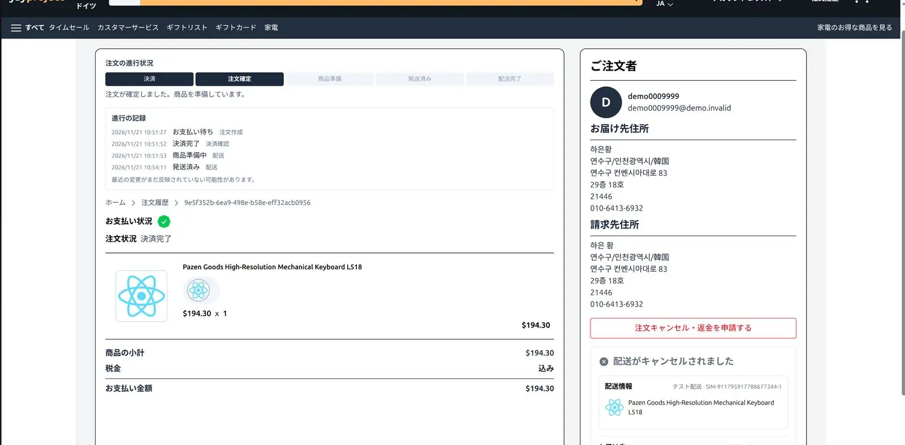

주문자가 배송 상자의 **配送をキャンセルする**를 눌러 배송이 취소되자(10:57:41) 진행 막대가 **注文確定**으로 돌아갔고, 주문 상태는 **決済完了**입니다. 오른쪽에는 **配送がキャンセルされました**가 나옵니다.

발송 전 주문이 되었으므로 **注文キャンセル・返金を申請する** 버튼이 다시 나타납니다.

> ⚠️ 이 화면의 進行の記録에는 아직 취소 줄이 없습니다. 상태 읽기 모델은 이벤트를 받아 늦게 따라오므로 "最近の変更がまだ反映されていない可能性があります"라고 안내합니다. 조금 뒤의 화면(14번)에는 그 줄이 있습니다.

### 12. 관리자 배송 관리 — 최근 전체

`/admin/delivery`

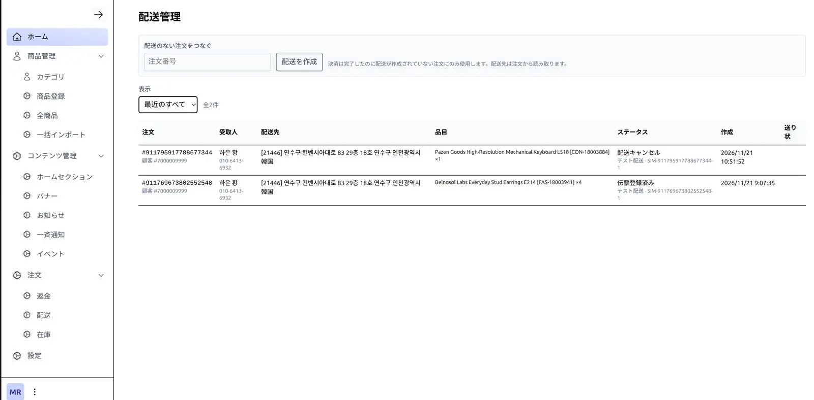

보기를 **最近のすべて**로 바꾸면 송장 대기 밖의 배송도 보입니다. 주문 A 는 **配送キャンセル**, 다른 주문 B 는 **伝票登録済み**입니다.

취소된 배송이나 이미 발송된 상자에는 송장을 다시 등록할 수 없습니다(409).

### 13. 고객 — 환불 신청

`/order/{注文番号}`

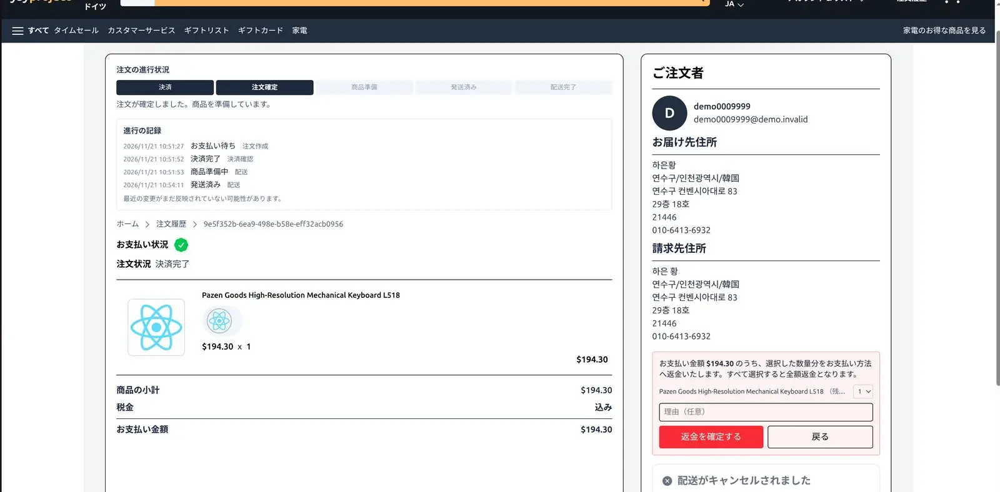

줄마다 환불할 수량을 고르고(전부 고르면 전액 환불) 이유를 적은 뒤(선택) **返金を確定する**를 누릅니다.

환불은 그 주문의 결제 수단으로 돌아갑니다(여기서는 Stripe). 같은 주문에 환불이 겹치면 늦은 요청은 "다른 요청이 처리 중"으로 거절됩니다.

### 14. 고객 — 환불 완료

`/order/{注文番号}`

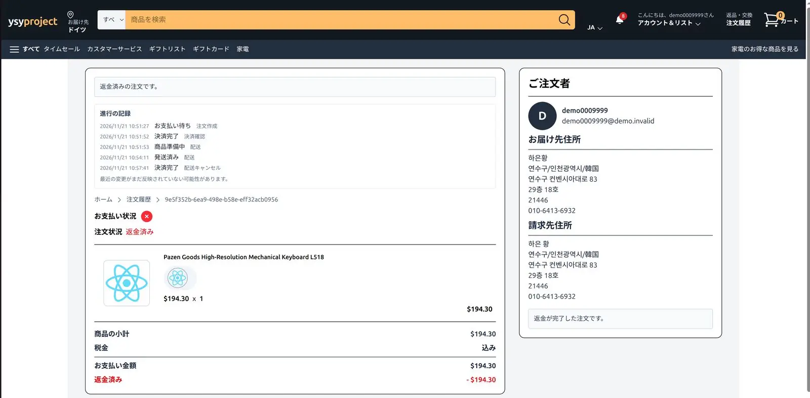

주문 상태가 **返金済み**, お支払い状況은 ✕, 금액 아래에 **返金済み −$194.30**가 나옵니다.

進行の記録 마지막 줄에 `10:57:41 決済完了 · 配送キャンセル`가 들어와 있습니다. 발송 전 주문의 환불이므로 재고는 자동으로 돌아갑니다(4장 22번의 **在庫復元**).

## 4. 관리자 — 발송된 주문의 반품 입고 · 환불 (주문 B)

이미 발송된 주문은 관리자가 **返金管理**에서 처리합니다. 돌아온 물건을 받는 **返品入庫**(재고)와 돈을 돌려주는 **返金**(결제)은 서로 다른 버튼이고, 순서도 수량도 따로 정합니다. 그래서 "환불은 했는데 물건이 아직 안 왔다" 같은 상태를 있는 그대로 남길 수 있습니다.

### 15. 환불 관리 — 발송된 주문

`/admin/refund`

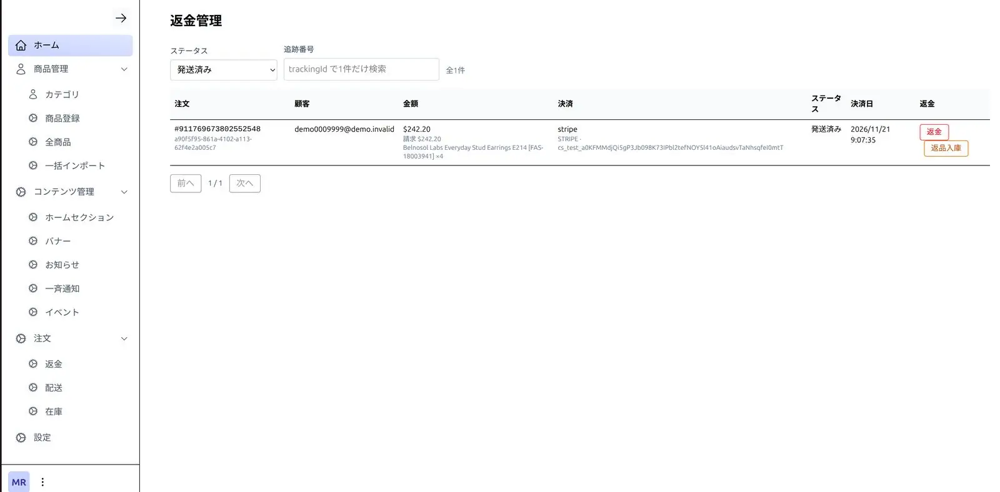

상태 **発送済み**로 거르면 주문 B(#911769673802552548, 귀걸이 4개, $242.20, Stripe)가 보입니다. 오른쪽에 **返金**과 **返品入庫** 두 버튼이 있습니다.

추적 번호(trackingId)로 한 건만 찾을 수도 있습니다.

### 16. 반품 입고 — 수량 · 재고 복원

`/admin/refund`

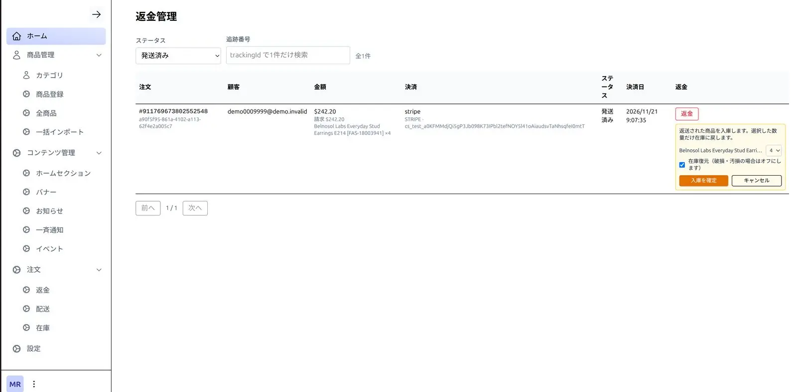

돌아온 수량을 고르고(최대 4), **在庫復元**을 켜 두면 그 수량만큼 판매 재고로 돌아갑니다. 파손 · 오염이면 끄고 입고만 기록합니다.

**入庫を確定**을 누릅니다. 여기서는 2개를 입고했습니다.

### 17. 입고 기록

`/admin/refund`

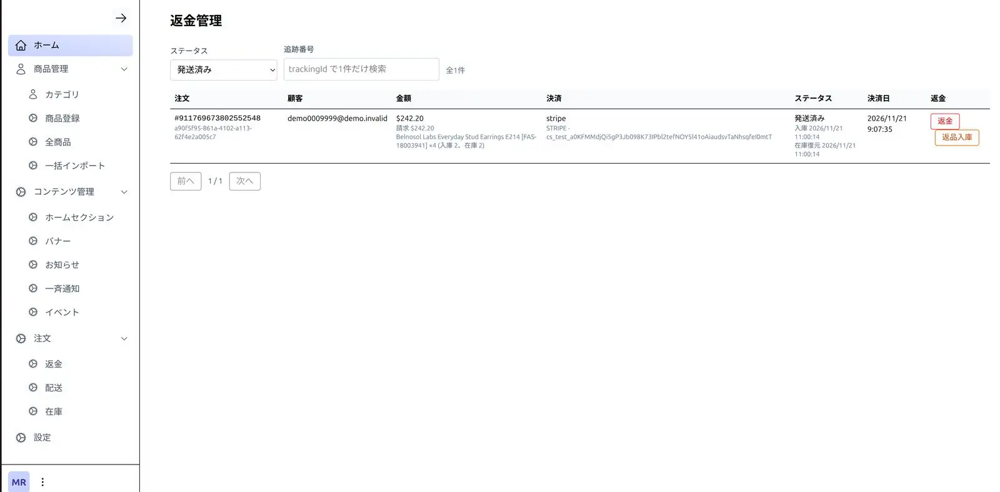

품목 줄에 **(入庫 2、在庫 2)**, 상태 칸에 **入庫 2026/11/21 11:00:14 · 在庫復元 11:00:14**가 남습니다. 아직 환불은 하지 않았으므로 상태는 그대로 **発送済み**입니다.

### 18. 환불 — 수량 선택

`/admin/refund`

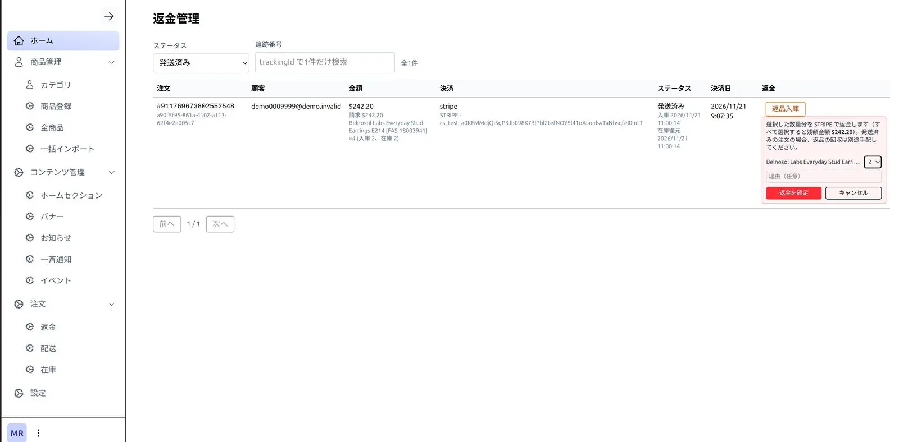

**返金**을 누르면 환불할 수량을 고르는 칸이 열립니다. 전부 고르면 남은 금액 전액($242.20)이 환불됩니다.

안내문대로, 발송된 주문의 환불은 **물건 회수를 따로 처리해야 합니다**. 환불 버튼이 택배 회수를 부르지는 않습니다.

### 19. 수량은 0 ~ 주문 수량

`/admin/refund`

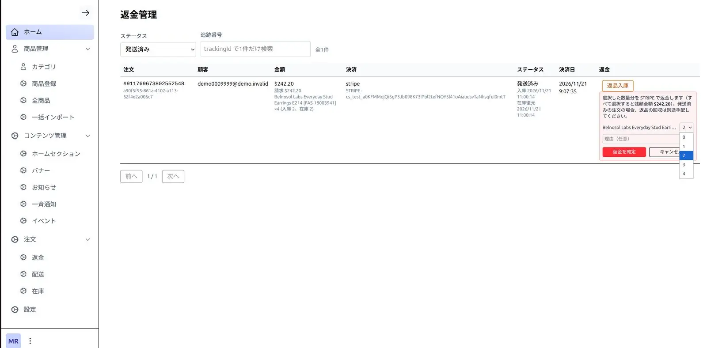

입고 수량과 상관없이 0 ~ 4 중에서 고릅니다. 여기서는 입고한 것과 같은 2개를 골랐습니다.

### 20. 부분 환불 결과

`/admin/refund`

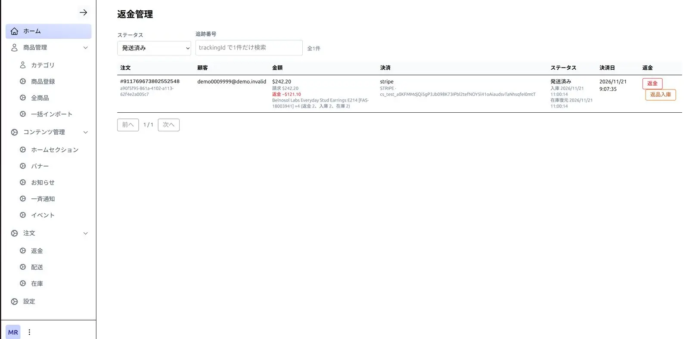

금액 칸에 **返金 −$121.10**(2개분)이 붙고, 품목 줄은 **(返金 2、入庫 2、在庫 2)**가 됩니다. 아직 일부만 환불했으므로 주문은 **発送済み**에 남습니다.

### 21. 남은 2개까지 환불한 뒤 — 발송된 주문 0건

`/admin/refund`

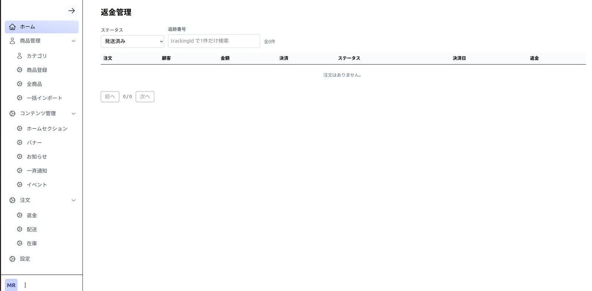

남은 2개도 18 · 19번과 같은 **返金** 칸에서 수량 2 를 골라 환불하자(11:01:10) 주문 B 는 **発送済み** 목록에서 빠졌습니다(**全0件**). 전액 환불된 주문은 **返金済み**로 옮겨 갑니다.

### 22. 환불된 주문 목록

`/admin/refund`

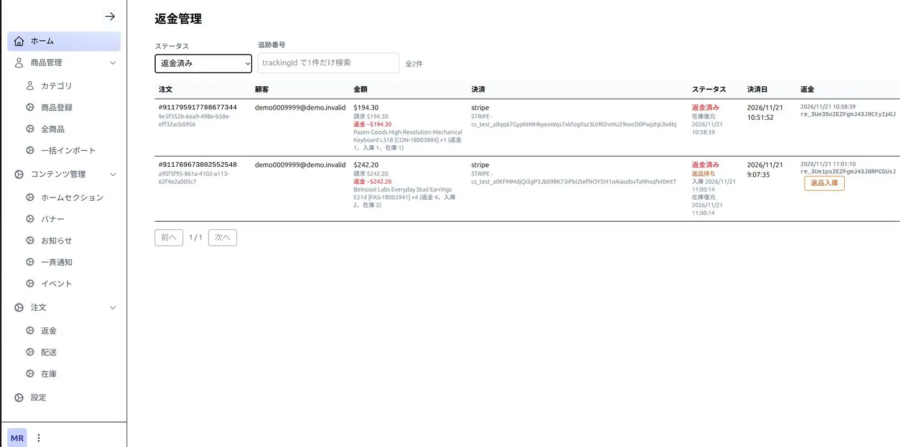

상태 **返金済み**로 거르면 두 주문이 보입니다.

- **주문 A**: 返金 −$194.30 (返金 1、入庫 1、在庫 1), 상태 칸에 **在庫復元 10:58:39**, 오른쪽에 Stripe 환불 번호(`re_…`)가 있습니다. 발송 전 취소였으므로 입고 · 재고 복원이 환불과 함께 자동으로 기록됐습니다.
- **주문 B**: 返金 −$242.20 (返金 4、入庫 2、在庫 2), 상태 칸에 **返品待ち**가 있습니다. 4개를 환불했지만 돌아온 것은 2개라, 나머지 2개의 회수를 기다린다는 뜻입니다. **返品入庫** 버튼이 남아 있어 물건이 도착하면 이어서 입고합니다.

## 5. 관리자 — 그 밖의 화면

상품 · 재고 · 첫 화면 구성 · 알림을 다루는 화면들입니다. 왼쪽 메뉴는 **商品管理** · **コンテンツ管理** · **注文**(返金 · 配送 · 在庫) · **設定**으로 나뉩니다.

### 4. 전체 상품

`/admin/allproducts`

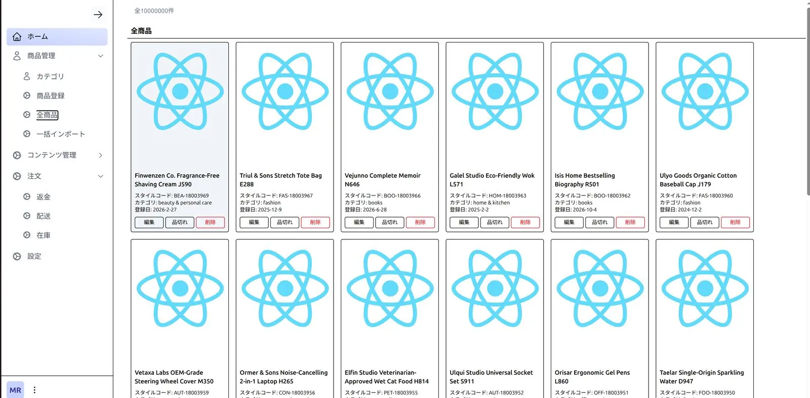

등록된 상품 전체(실습 데이터 **10,000,000건**)를 카드로 봅니다. 카드마다 스타일 코드 · 카테고리 · 등록일과 **編集**(수정) · **品切れ**(품절 처리) · **削除**(삭제) 버튼이 있습니다.

같은 메뉴에 **カテゴリ** · **商品登録** · **一括インポート**(대량 등록)가 있습니다.

### 23. 재고 관리

`/admin/stock`

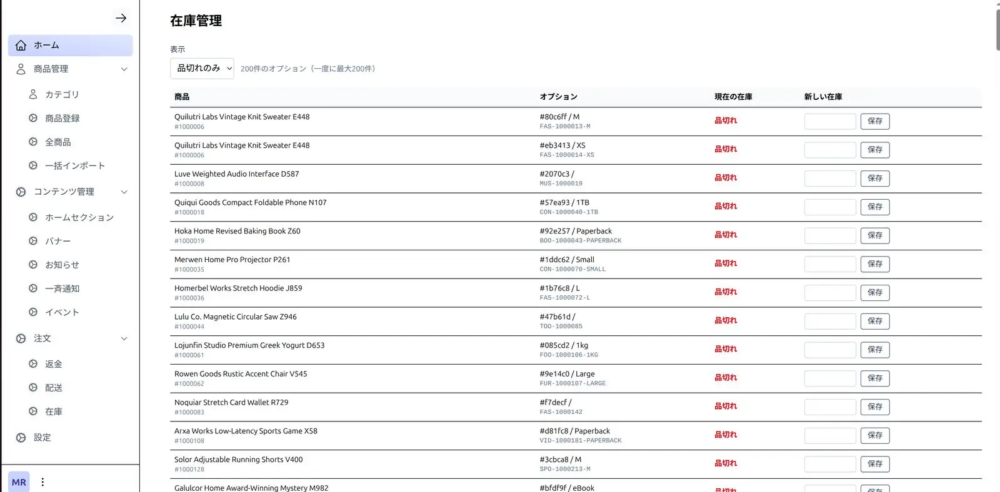

옵션(색상 · 사이즈) 단위로 재고를 봅니다. 보기 **品切れのみ**는 재고 0인 옵션만, 한 번에 최대 200건입니다.

**新しい在庫**에 수량을 넣고 **保存**하면 그 옵션의 재고가 바뀝니다. 반품 입고의 재고 복원(4장)도 이 수량에 더해집니다.

### 9. 홈 섹션 관리

`/admin/home`

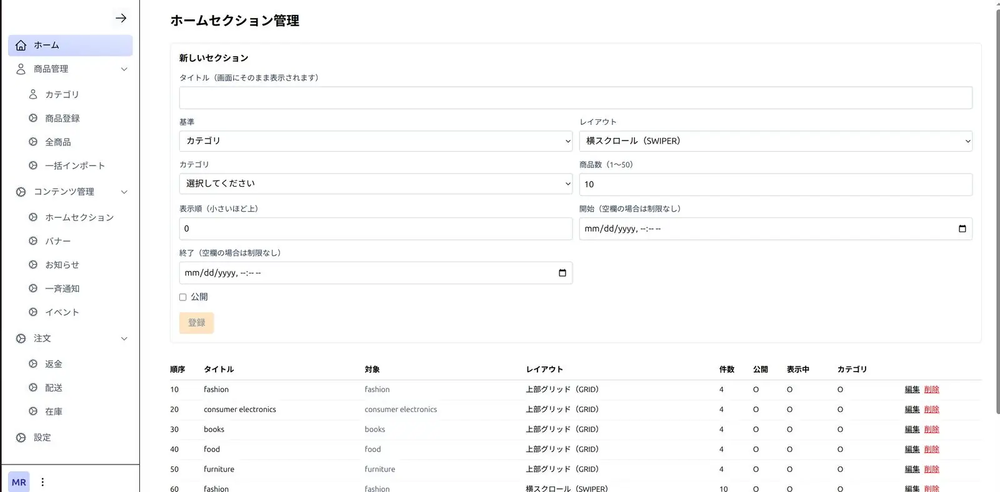

첫 화면에 나오는 상품 묶음을 정합니다: 제목 · 기준(카테고리 등) · 레이아웃(상단 그리드 GRID / 가로 스크롤 SWIPER) · 상품 수(1~50) · 표시 순서 · 기간 · 공개.

아래 표에 지금 섹션(fashion · consumer electronics · books …)과 공개 · 표시 중 여부가 나옵니다. 첫 화면 구성은 파드 메모리에 30초 캐시되므로 바꾼 내용은 30초 안에 반영됩니다.

### 5. 배너 관리

`/admin/banner`

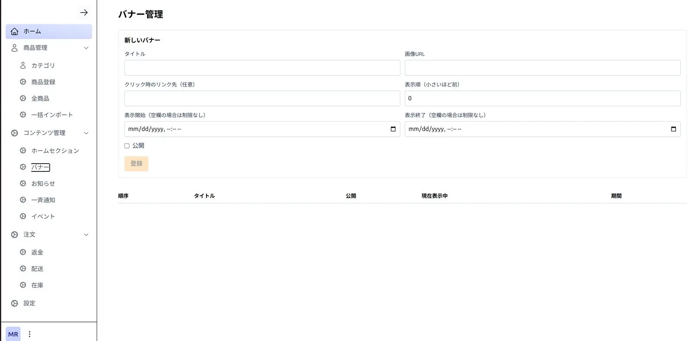

제목 · 이미지 URL · 클릭 시 링크(선택) · 표시 순서 · 표시 기간 · 공개를 넣어 배너를 등록합니다.

링크는 `http(s)://…` 또는 사이트 안의 `/…` 경로만 받습니다.

### 6. 공지 관리

`/admin/notice`

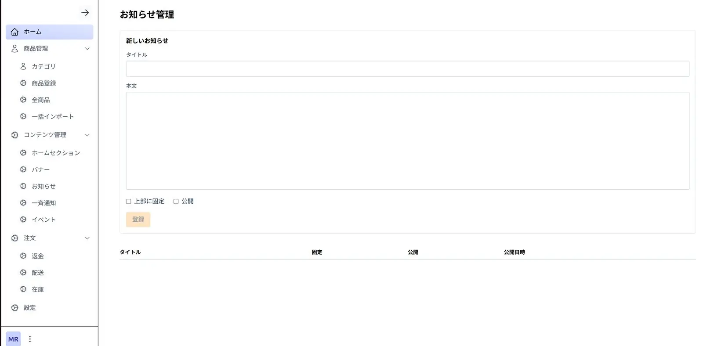

제목 · 본문을 쓰고 **上部に固定**(위에 고정) · **公開**를 고릅니다. 공지를 공개하면 로그인한 사용자에게 알림도 자동으로 나갑니다.

### 7. 일괄 알림

`/admin/broadcast`

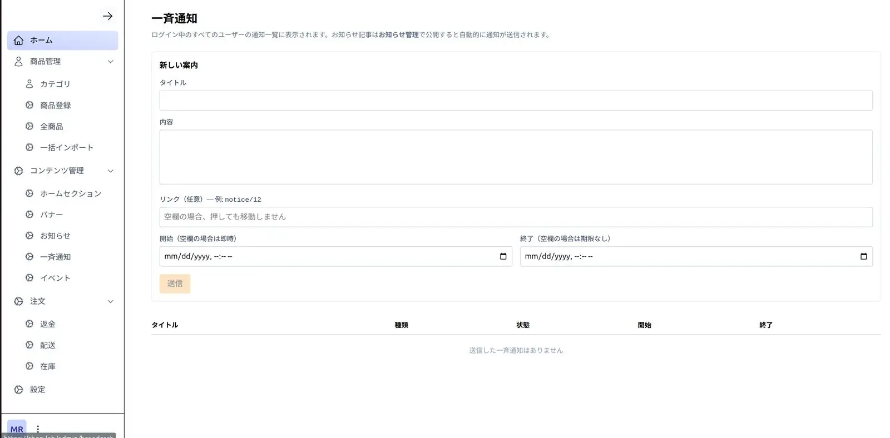

로그인 중인 모든 사용자의 알림 목록에 안내를 보냅니다: 제목 · 내용 · 링크(선택, 예 `notice/12`) · 시작 · 종료.

공지 글을 알리는 데는 이 화면이 아니라 공지 관리에서 공개하면 됩니다(자동 발송).

### 8. 특집(기획전) 관리

`/admin/event`

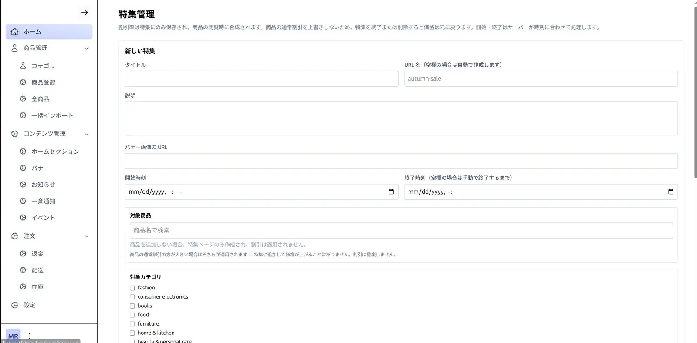

제목 · URL 이름 · 설명 · 배너 이미지 · 시작/종료 시각 · 대상 상품 · 대상 카테고리로 기획전을 만듭니다.

할인율은 기획전에만 저장되고 상품을 볼 때 합성됩니다. 상품의 평소 할인을 덮어쓰지 않으므로 기획전을 끝내거나 지우면 가격이 원래대로 돌아갑니다. 평소 할인이 더 크면 그쪽이 적용되고, 할인은 겹치지 않습니다. 시작 · 종료는 서버가 시각에 맞춰 처리합니다.

---

스크린샷 번호는 찍은 순서입니다(10:53 ~ 11:08). 조작 화면이 없는 단계(주문자의 배송 취소 버튼 · 주문 B 의 두 번째 환불)는 앞뒤 화면으로 설명했습니다.
