# 98. 注文 · 配送 · 返品の処理の流れ — 画面ガイド

**日本語** | [한국어](98-order-delivery-return-screens.ko.md) · ページ版: [日本語](98-order-delivery-return-screens.html) · [한국어](98-order-delivery-return-screens.ko.html)

> 📝 **状態(2026-11-21)** — 実習クラスタ(`https://shop.lab`、イメージ `fe8c80336435`)で 10:51 〜 11:08 に実際に操作した画面 27 枚を流れの順にまとめました。画面の文言は日本語(JA)版です。説明はその時点のリポジトリ(`fe8c8033`)の動作に基づきます。関連: [25 配送サービス設計](25-delivery-service-design.md) · [49 決済手段の拡張](49-payment-providers.md) · [59 決済前の在庫予約](59-stock-reservation.md) · [76 注文ステータスイベント](76-order-status-read-model.md)。

## 概要

### 登場する注文

| 注文 | 内容 | 流れ | 章 |
|---|---|---|---|
| A #911795917788677344 | キーボード 1 個 · $194.30 · Stripe | 決済 → 送り状登録(発送)→ 注文者が配送キャンセル → 注文者が全額返金 | 2 · 3 |
| B #911769673802552548 | イヤリング 4 個 · $242.20 · Stripe | 発送済み → 管理者が返品入庫 2 → 返金 2 → 残り 2 を返金 → 返品待ち | 4 |
| C #911800100251231471 | 炭酸水 12 パック × 3 · $86.07 | カート → チェックアウト → Stripe 決済待ち | 1 |

### 注文ステータスの流れ

- **お支払い待ち**(決済を待つ) → **決済完了**(決済を確認) → **商品準備中**(配送作成 · 送り状待ち) → **発送済み**(送り状登録) → **配送完了**(お届け完了)
- 発送前: **配送キャンセル**(注文者が配送をキャンセル) → **決済完了**(に戻る) → **返金済み**(注文者のキャンセル · 返金、在庫は自動で戻る)
- 発送後: **返品入庫**(管理者: 戻った数量 · 在庫復元) + **返金**(管理者: 返金数量) → **返金済み**(回収が足りなければ 返品待ち)

進行バーの 4 番目のマスは送り状を登録した時点なので **発送済み** です(以前の文言 '配送中' は荷物が動いている途中と読めるため 2026-11-21 に変えた)。注文ステータスの真実は order サービスの DB で、画面の 進行の記録 はイベントで追いかける読み取りモデルのため数秒遅れることがあります。

## 1. お客様 — カートから決済まで (注文 C)

お客様が商品をカートに入れ、配送先と決済手段を選んで注文を作ります。注文はまず **お支払い待ち** で作られ、決済が終わると次の段階に進みます。

### 24. カート

`/cart`

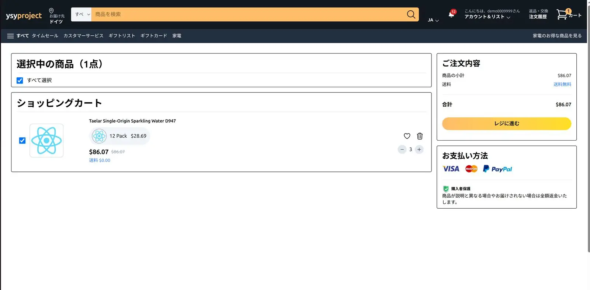

入れた商品(炭酸水 12 パック × 3、$86.07)を確認します。チェックした行だけが注文に入り、右の **ご注文内容** に小計 · 送料(無料)· 合計が出ます。

**レジに進む** でチェックアウトへ。このとき価格 · 送料はカートに入れた時の値ではなく、catalog の今の値に合わせ直します。

### 25. チェックアウト — 配送先 · 決済手段

`/checkout`

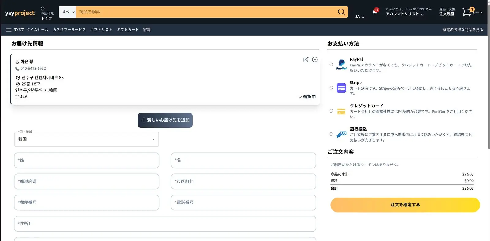

保存済みの配送先(**選択中**)を使うか、新しい配送先を追加します。決済手段は PayPal · Stripe · クレジットカード(PortOne)· 銀行振込の 4 つです。

使えるクーポンがあれば **ご注文内容** の上に出ます(今回はなし)。

### 26. Stripe を選択 → 注文確定

`/checkout`

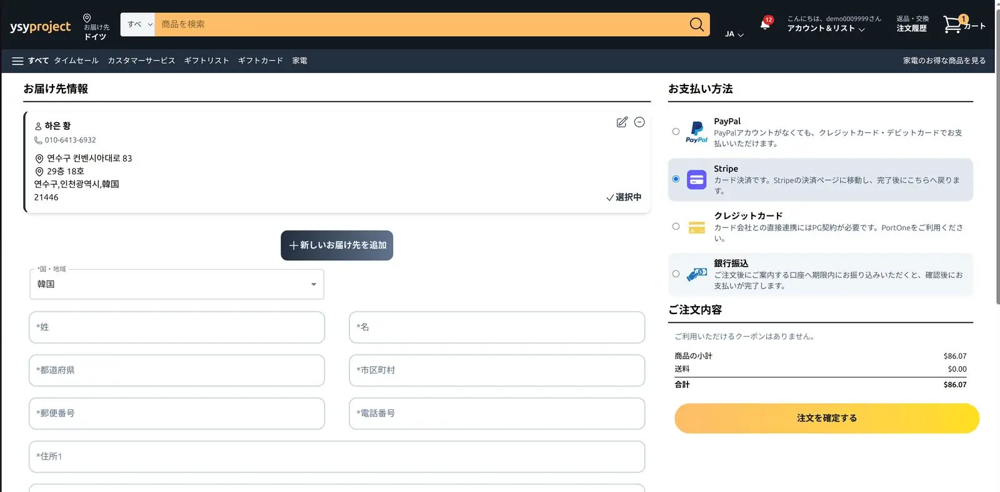

Stripe を選んで **注文を確定する** を押すと注文が作られます。金額と SKU は画面から送られた値を信じず、サーバーが決めます。

同じ試行を二度押しても注文は一つだけです(注文作成の冪等キー)。

### 27. 注文詳細 — 決済待ち · 在庫確保

`/order/{注文番号}`

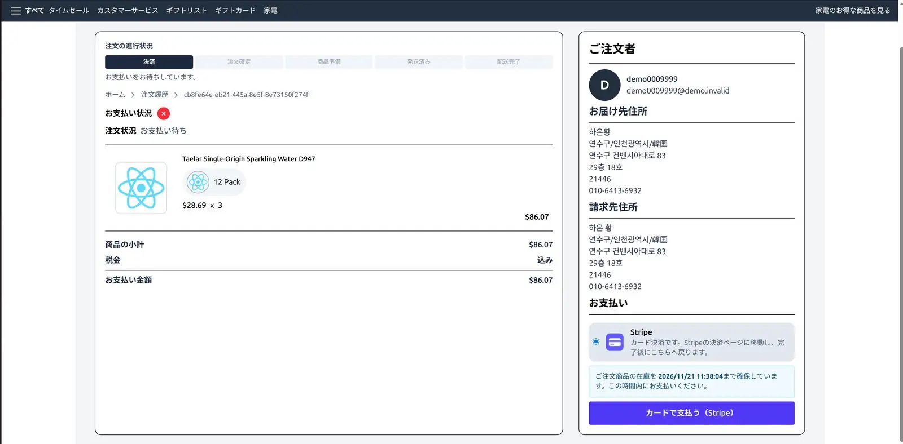

進行バーは最初のマス **決済** にあり、注文ステータスは **お支払い待ち** です。

注文を作るとき在庫を 30 分確保します(docs/59)。この画面では **11:38:04 まで** 確保されています。その間に **カードで支払う(Stripe)** で Stripe の決済ページへ行き決済すると、戻ってきて **決済完了** になります。時間が過ぎると確保は解かれます。

## 2. 管理者 — 送り状登録(発送) (注文 A)

決済が終わると配送が自動で作られ(**受付待ち**)、管理者の **配送管理** 画面に送り状待ちとして上がります。送り状を登録すると注文は **発送済み** になります。

### 1. 配送管理 — 送り状待ち一覧

`/admin/delivery`

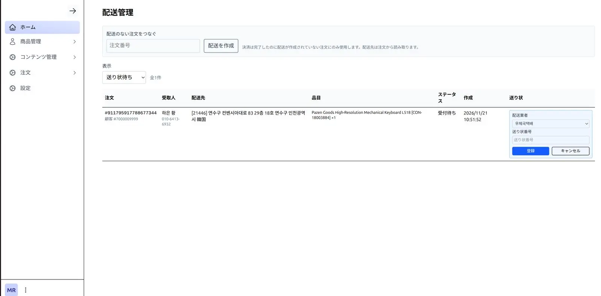

既定の表示は **送り状待ち** です。注文 A(#911795917788677344、キーボード 1 個)が **受付待ち** で並んでいます。決済確認(10:51:52)と同じ時刻に作られました。

上の **配送のない注文をつなぐ** は、決済は済んだのに配送が作られていない注文を手でつなぐ復旧用です。決済済み · 処理中の注文だけが対象で、配送先は注文から読みます。

### 2. 配送業者の選択 — テスト配送

`/admin/delivery`

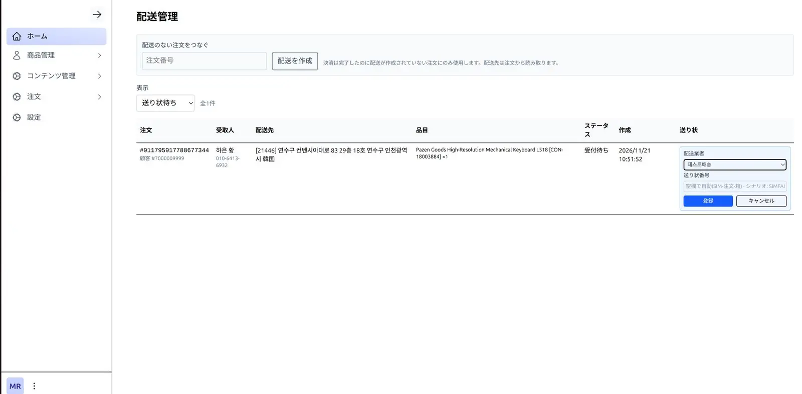

配送業者として郵便局宅配便か **テスト配送** を選びます。テスト配送は実際の業者なしに配送の全過程を時間とともに進めるシミュレーターです。

送り状番号を空欄にすると `SIM-注文番号-箱` で自動作成され、接頭辞でシナリオを選べます。

| 接頭辞 | シナリオ |
|---|---|
| `SIM-` | 正常: 集荷 → 移動 → 配達出発 → 完了 |
| `SIMFAIL-` | 配達失敗のあと完了 |
| `SIMEXC-` | 紛失(例外)で止まる |
| `SIMINTL-` | 国際配送: 通関保留を通る |
| `SIMNONE-` | 配送業者が送り状を知らない(登録直後 · 打ち間違い) |

### 3. 登録後 — 送り状待ち 0 件

`/admin/delivery`

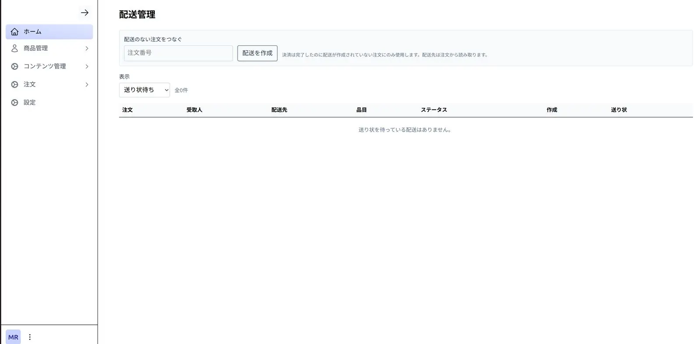

**登録** を押すとその配送は送り状待ち一覧から消えます(**全0件**)。配送ステータスは **伝票登録済み** になり、注文には **発送済み**(10:54:11)が記録されます。

その後はポーラーが配送業者(ここではシミュレーター)を定期的に照会してステータスを進めます。

### 10. お客様の画面 — 発送済み

`/order/{注文番号}`

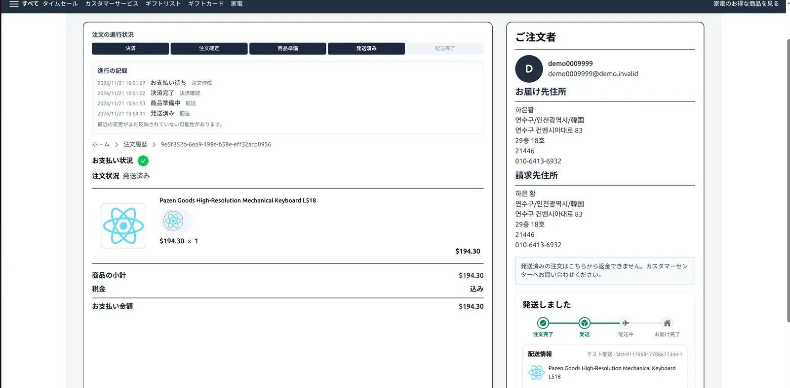

進行バーが **発送済み** まで埋まり、**進行の記録** に お支払い待ち → 決済完了 → 商品準備中 → 発送済み が時刻とともに残ります。

右の **発送しました** ボックスには配送業者 · 送り状番号(`テスト配送 · SIM-911795917788677344-1`)と段階表示(注文完了 → 発送 → 配送中 → お届け完了)が出ます。

発送済みの注文はお客様の画面から直接返金できない旨を案内します(**カスタマーセンターへ**)。

その代わり、配送業者がまだ集荷していなければ(送り状だけ登録された **伝票登録済み**)この **発送しました** ボックスの下に **配送をキャンセルする** ボタンが出ます。箱が複数なら全部が集荷前である必要があります。今回の試験では注文者がこのボタンを押しました(次の章)。

## 3. 配送キャンセル(返送)→ お客様の返金 (注文 A)

注文者が注文詳細の **配送をキャンセルする** で配送を取り消します(管理者ではなくお客様の操作です)。配送業者が集荷する前だけできます。配送が取り消されると注文は決済完了に戻り、お客様が注文画面から直接キャンセル · 返金を申請できるようになります。集荷後は配送キャンセルが拒否され(「すでに発送されたためキャンセルできません。返品を申請してください」)、4 章の返品の手続きになります。

### 11. 配送キャンセル後のお客様の画面

`/order/{注文番号}`

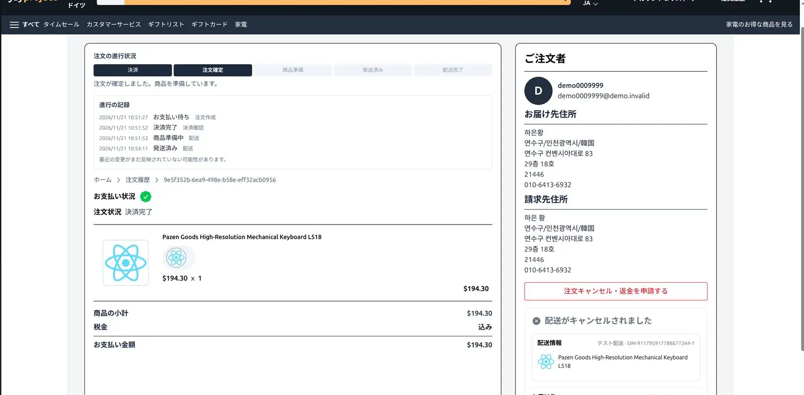

注文者が配送ボックスの **配送をキャンセルする** を押して配送が取り消されると(10:57:41)、進行バーは **注文確定** に戻り、注文ステータスは **決済完了** です。右には **配送がキャンセルされました** が出ます。

発送前の注文になったので **注文キャンセル・返金を申請する** ボタンが再び現れます。

> ⚠️ この画面の 進行の記録 にはまだキャンセルの行がありません。ステータスの読み取りモデルはイベントを受けて遅れて追いかけるため「最近の変更がまだ反映されていない可能性があります」と案内します。少し後の画面(14 番)にはその行があります。

### 12. 管理者の配送管理 — 最近のすべて

`/admin/delivery`

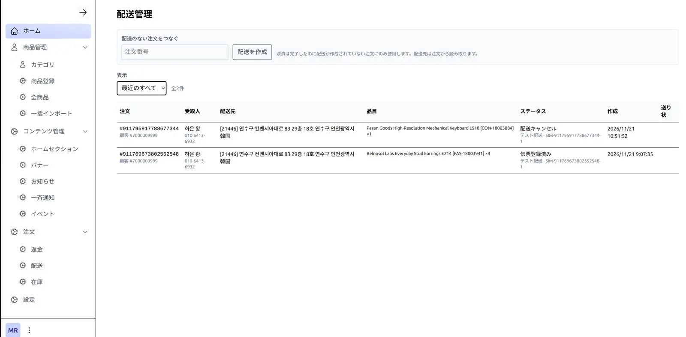

表示を **最近のすべて** にすると送り状待ち以外の配送も見えます。注文 A は **配送キャンセル**、別の注文 B は **伝票登録済み** です。

キャンセルされた配送やすでに発送された箱には送り状を登録し直せません(409)。

### 13. お客様 — 返金の申請

`/order/{注文番号}`

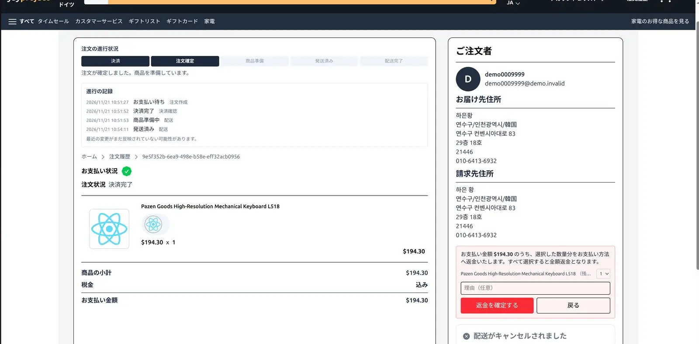

行ごとに返金する数量を選び(全部選ぶと全額返金)、理由を書いて(任意)**返金を確定する** を押します。

返金はその注文の決済手段に戻ります(ここでは Stripe)。同じ注文に返金が重なると、遅い要求は「別の要求が処理中」として拒否されます。

### 14. お客様 — 返金完了

`/order/{注文番号}`

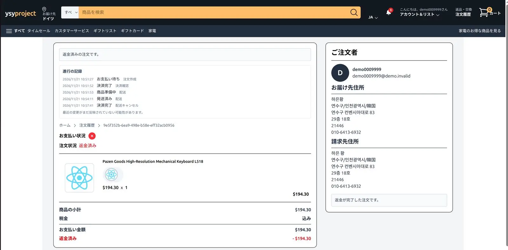

注文ステータスが **返金済み**、お支払い状況は ✕、金額の下に **返金済み −$194.30** が出ます。

進行の記録 の最後の行に `10:57:41 決済完了 · 配送キャンセル` が入っています。発送前の注文の返金なので在庫は自動で戻ります(4 章 22 番の **在庫復元**)。

## 4. 管理者 — 発送済み注文の返品入庫 · 返金 (注文 B)

すでに発送された注文は管理者が **返金管理** で処理します。戻った品物を受け取る **返品入庫**(在庫)と、お金を返す **返金**(決済)は別のボタンで、順序も数量も別々に決めます。そのため「返金はしたが品物はまだ戻っていない」といった状態をそのまま残せます。

### 15. 返金管理 — 発送済みの注文

`/admin/refund`

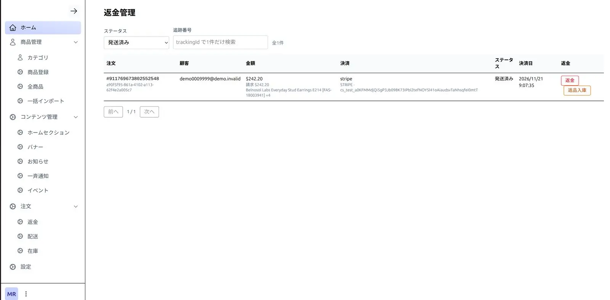

ステータス **発送済み** で絞ると注文 B(#911769673802552548、イヤリング 4 個、$242.20、Stripe)が見えます。右に **返金** と **返品入庫** の 2 つのボタンがあります。

追跡番号(trackingId)で 1 件だけ探すこともできます。

### 16. 返品入庫 — 数量 · 在庫復元

`/admin/refund`

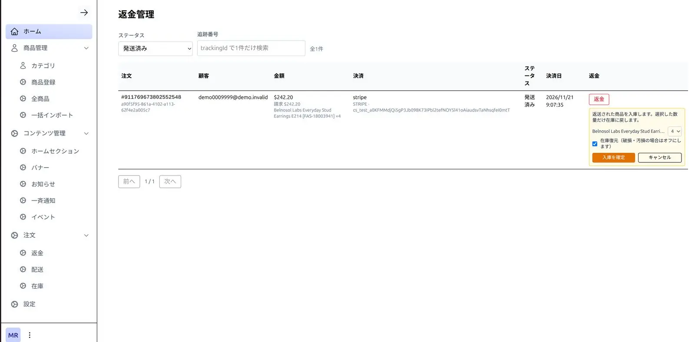

戻った数量を選び(最大 4)、**在庫復元** をオンのままにするとその数だけ販売在庫に戻ります。破損 · 汚れならオフにして入庫だけを記録します。

**入庫を確定** を押します。ここでは 2 個を入庫しました。

### 17. 入庫の記録

`/admin/refund`

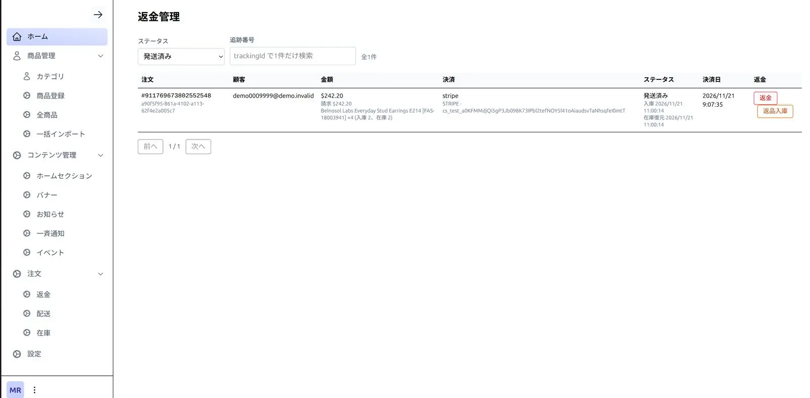

品目の行に **(入庫 2、在庫 2)**、ステータス欄に **入庫 2026/11/21 11:00:14 · 在庫復元 11:00:14** が残ります。まだ返金していないのでステータスは **発送済み** のままです。

### 18. 返金 — 数量の選択

`/admin/refund`

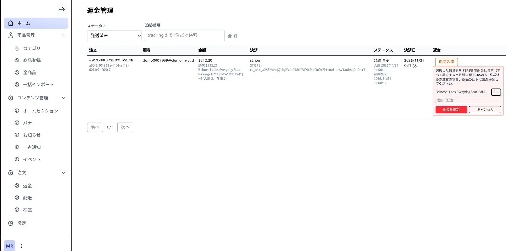

**返金** を押すと返金する数量を選ぶ欄が開きます。全部選ぶと残額の全額($242.20)が返金されます。

案内文のとおり、発送済み注文の返金では **品物の回収を別途手配する必要があります**。返金ボタンが集荷を呼ぶわけではありません。

### 19. 数量は 0 〜 注文数量

`/admin/refund`

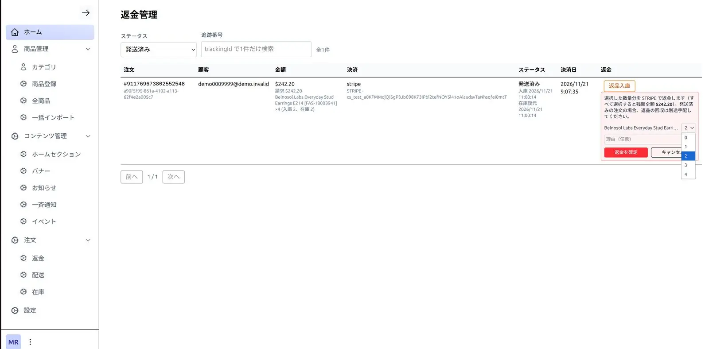

入庫数量と関係なく 0 〜 4 から選びます。ここでは入庫と同じ 2 個を選びました。

### 20. 一部返金の結果

`/admin/refund`

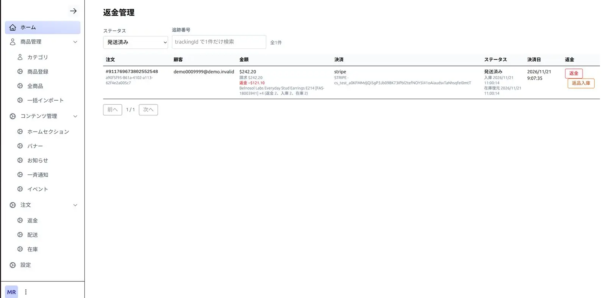

金額欄に **返金 −$121.10**(2 個分)が付き、品目の行は **(返金 2、入庫 2、在庫 2)** になります。まだ一部だけの返金なので注文は **発送済み** に残ります。

### 21. 残り 2 個も返金した後 — 発送済み 0 件

`/admin/refund`

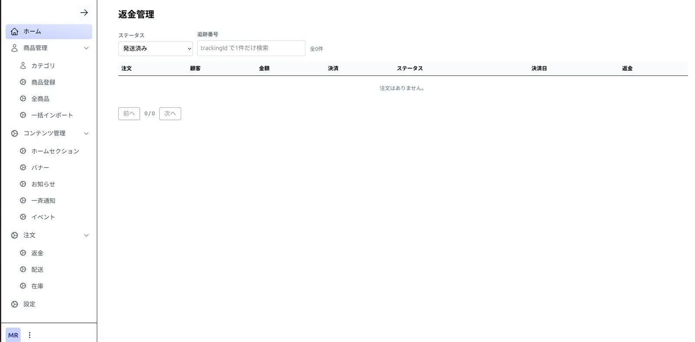

残りの 2 個も 18 · 19 番と同じ **返金** 欄で数量 2 を選んで返金すると(11:01:10)、注文 B は **発送済み** の一覧から消えました(**全0件**)。全額返金された注文は **返金済み** に移ります。

### 22. 返金済みの注文一覧

`/admin/refund`

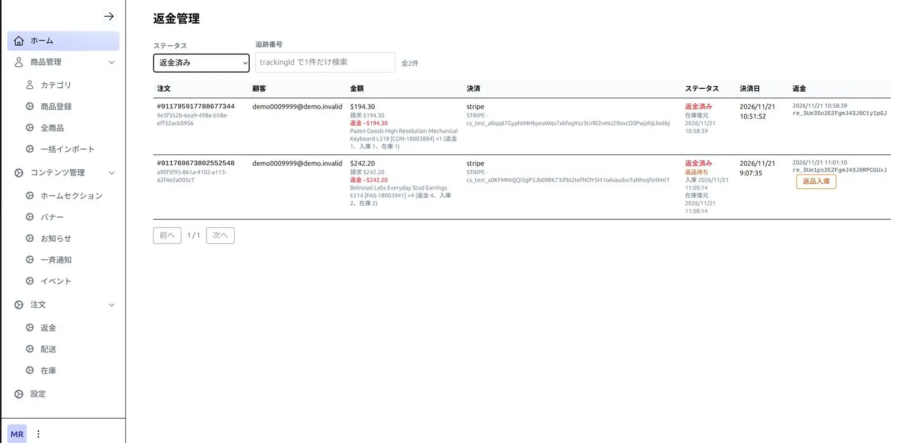

ステータス **返金済み** で絞ると 2 つの注文が見えます。

- **注文 A**: 返金 −$194.30(返金 1、入庫 1、在庫 1)、ステータス欄に **在庫復元 10:58:39**、右に Stripe の返金番号(`re_…`)があります。発送前のキャンセルだったので、入庫 · 在庫復元が返金と一緒に自動で記録されました。
- **注文 B**: 返金 −$242.20(返金 4、入庫 2、在庫 2)、ステータス欄に **返品待ち**。4 個を返金したが戻ったのは 2 個なので、残り 2 個の回収を待っているという意味です。**返品入庫** ボタンが残っていて、品物が届いたら続けて入庫します。

## 5. 管理者 — その他の画面

商品 · 在庫 · トップ画面の構成 · お知らせを扱う画面です。左のメニューは **商品管理** · **コンテンツ管理** · **注文**(返金 · 配送 · 在庫)· **設定** に分かれます。

### 4. 全商品

`/admin/allproducts`

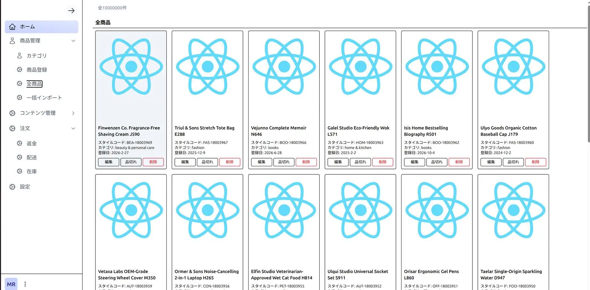

登録された商品全体(実習データ **10,000,000 件**)をカードで見ます。カードごとにスタイルコード · カテゴリ · 登録日と **編集** · **品切れ** · **削除** のボタンがあります。

同じメニューに **カテゴリ** · **商品登録** · **一括インポート** があります。

### 23. 在庫管理

`/admin/stock`

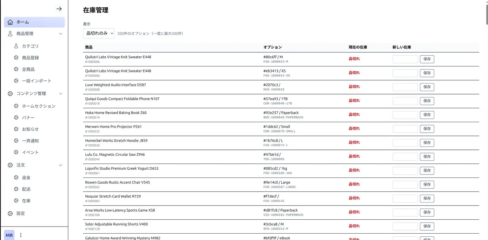

オプション(色 · サイズ)単位で在庫を見ます。表示 **品切れのみ** は在庫 0 のオプションだけ、一度に最大 200 件です。

**新しい在庫** に数量を入れて **保存** するとそのオプションの在庫が変わります。返品入庫の在庫復元(4 章)もこの数量に加わります。

### 9. ホームセクション管理

`/admin/home`

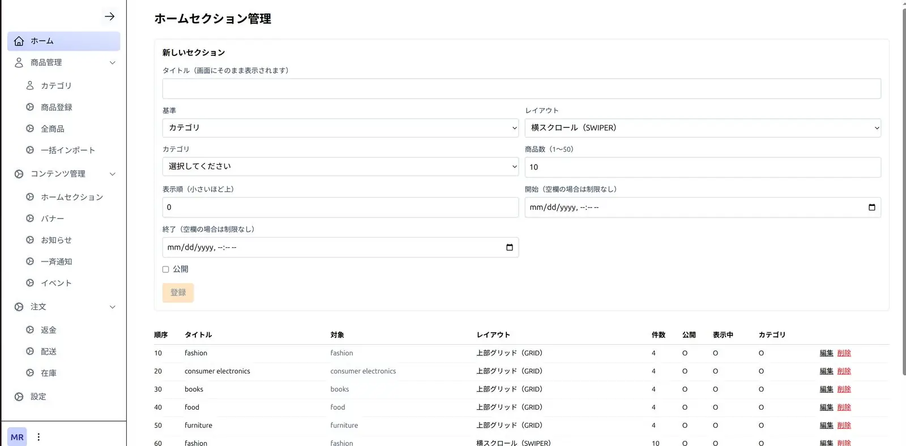

トップ画面に出る商品のまとまりを決めます: タイトル · 基準(カテゴリなど)· レイアウト(上部グリッド GRID / 横スクロール SWIPER)· 商品数(1〜50)· 表示順 · 期間 · 公開。

下の表に今のセクション(fashion · consumer electronics · books …)と公開 · 表示中かどうかが出ます。トップ画面の構成は Pod のメモリに 30 秒キャッシュされるので、変更は 30 秒以内に反映されます。

### 5. バナー管理

`/admin/banner`

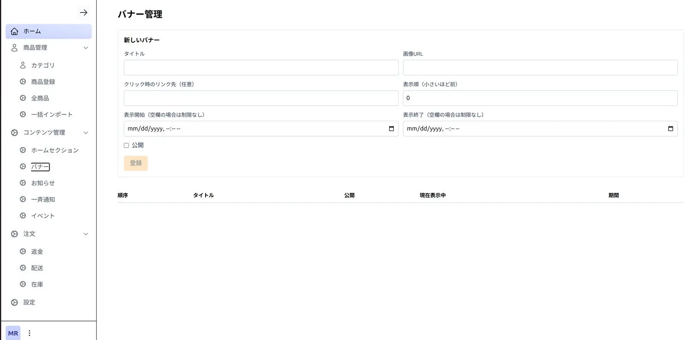

タイトル · 画像 URL · クリック時のリンク(任意)· 表示順 · 表示期間 · 公開を入れてバナーを登録します。

リンクは `http(s)://…` かサイト内の `/…` パスだけを受け付けます。

### 6. お知らせ管理

`/admin/notice`

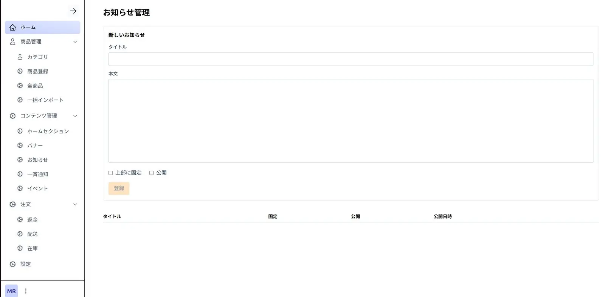

タイトル · 本文を書き、**上部に固定** · **公開** を選びます。お知らせを公開するとログイン中のユーザーに通知も自動で送られます。

### 7. 一斉通知

`/admin/broadcast`

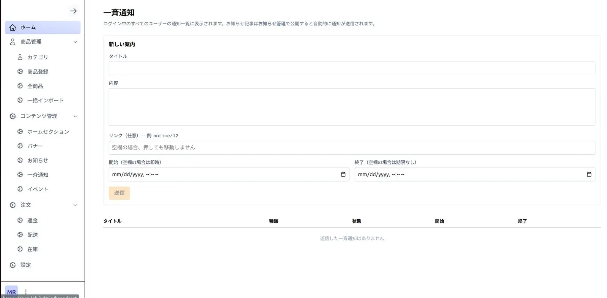

ログイン中のすべてのユーザーの通知一覧に案内を送ります: タイトル · 内容 · リンク(任意、例 `notice/12`)· 開始 · 終了。

お知らせ記事を知らせるにはこの画面ではなく、お知らせ管理で公開すれば自動で送られます。

### 8. 特集管理

`/admin/event`

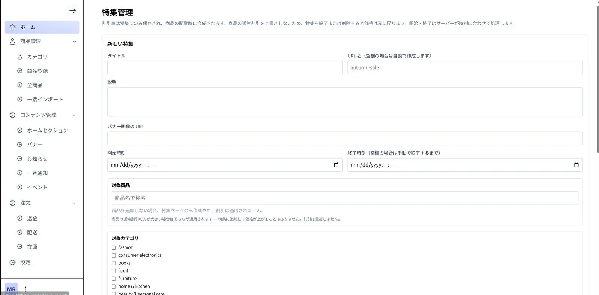

タイトル · URL 名 · 説明 · バナー画像 · 開始/終了時刻 · 対象商品 · 対象カテゴリで特集を作ります。

割引率は特集にだけ保存され、商品の閲覧時に合成されます。商品の通常割引を上書きしないので、特集を終了または削除すると価格は元に戻ります。通常割引の方が大きければそちらが適用され、割引は重複しません。開始 · 終了はサーバーが時刻に合わせて処理します。

---

スクリーンショットの番号は撮った順です(10:53 〜 11:08)。操作画面のない段階(注文者の配送キャンセルボタン · 注文 B の 2 回目の返金)は前後の画面で説明しました。
